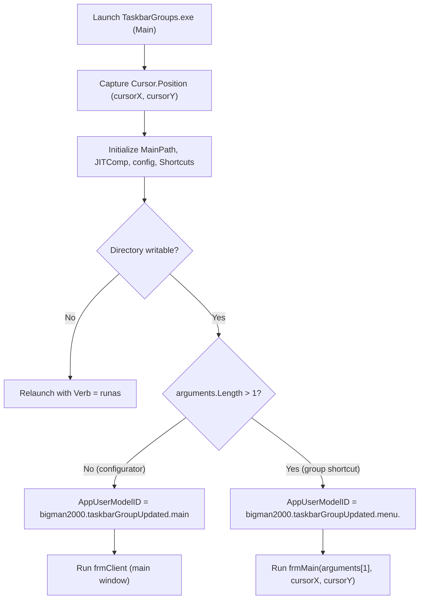

# Taskbar Groups Architecture

## 1. Overview & Concept

**Taskbar Groups** (`taskbar-groups-updated`) is an actively maintained fork of [tjackenpacken/taskbar-groups](https://github.com/tjackenpacken/taskbar-groups). It is a lightweight, portable Windows utility that lets users bundle application, folder, UWP/Microsoft Store, and game shortcuts into compact popup drawers pinned directly to the Windows taskbar.

- **Tech Stack:** C# 7.3, .NET Framework 4.7.2, Windows Forms (`TaskbarGroups.sln` / `main/client.csproj`).
- **Distribution Model:** single portable `TaskbarGroups.exe` without an installer or external satellite resource assemblies (`.resources.dll`). All settings, icon caches, and generated `.lnk` shortcuts are stored alongside `TaskbarGroups.exe`.

---

## 2. Entry Point & Two Execution Modes (`main/client.cs`)

`TaskbarGroups.exe` runs in two independent modes depending on command-line arguments. To ensure the group popup `frmMain` opens at the exact taskbar button position, `Cursor.Position` is captured at the very start of `Main()` before any WinForms UI is initialized.

Before launching the UI, startup initialization performs:
1. Resolves absolute paths `MainPath.path` (application directory) and `MainPath.exeString` (full path to `TaskbarGroups.exe`).
2. Ensures `JITComp`, `config`, and `Shortcuts` folders exist and configures `ProfileOptimization.SetProfileRoot`.
3. Tests write permissions in the application folder using `directoryTestingDocument.txt`; if read-only (e.g., inside `Program Files`), it relaunches itself elevated (`Verb = "runas"`).

- **Configurator Mode (no CLI arguments):** sets `AppUserModelID = "bigman2000.taskbarGroupUpdated.main"` via `SetCurrentProcessExplicitAppUserModelID` and launches `frmClient`.
- **Group Popup Mode (`<Group_Name>` argument):** sets a unique `AppUserModelID = "bigman2000.taskbarGroupUpdated.menu.<Group_Name>"` so Windows prevents taskbar icon stacking across different pinned groups and the configurator window, then launches `frmMain(arguments[1], cursorX, cursorY)`.

---

## 3. Project Modules & Responsibilities

### Forms (`main/Forms/`)
- **`frmClient`** — main group management window:
  - live search/filtering by group or program name and sorting (`Default`, `A -> Z`, `Z -> A`);
  - UI language switcher `cmbLanguage` (26 languages);
  - asynchronous GitHub release version check;
  - importing groups from `.tgroup` / `.zip` archives;
  - scrollable list of `ucCategoryPanel` cards.
- **`frmGroup`** — group creation and editing window:
  - group name (supports Unicode/Cyrillic up to 49 characters) and grid width (`Width`);
  - group icon selection (`.ico`, `.png`, `.jpg`, `.exe`, `.lnk`, drag-and-drop);
  - background theme/color (`Dark`, `Light`, `Custom`) and transparency (`Opacity` 0–100%);
  - popup icon size (`Compact`, `Medium`, `Large`), optional shortcut labels (`showLabels`), `allowOpenAll` (`Ctrl + Enter`), and `activateRunningWindow`;
  - drag-and-drop shortcut reordering with edge auto-scroll plus up/down buttons;
  - per-shortcut editing: `FilePath` (editable textbox or file picker with automatic `WorkingDirectory` update), `WorkingDirectory`, `Arguments`, and custom icon assignment (including extraction from `.exe` / `.dll`).
- **`frmMain`** — borderless popup drawer near the cursor/taskbar:
  - screen-edge-aware positioning;
  - Windows 11 rounded window corners;
  - running process detection and visual highlighting;
  - keyboard navigation (arrow keys, `1`–`9`/`0`, `Enter`, `Ctrl + Enter` to open all, `Esc` or focus loss to close);
  - right-click context menu (*Switch to window*, *Close window*, *Open new instance*, *Run as administrator*, *Open file location*).
- **`frmIconPicker`** — modal picker dialog for selecting a specific embedded icon when an `.exe` or `.dll` contains multiple icons.

### User Controls (`main/User controls/`)
- **`ucCategoryPanel`** — group card inside `frmClient`:
  - displays all group mini-icons with responsive multi-row wrapping (`UpdateLayout`) when resizing the window (no hidden overflow);
  - supports 2D drag-and-drop shortcut reordering directly inside the card;
  - provides `Preview`, `Edit group` (`cmdEditGroup`), `Clone`, `Export`, and `Delete` actions.
- **`ucProgramShortcut`** — shortcut entry row inside `frmGroup` (inline rename, selection for parameter editing, drag-and-drop, deletion).
- **`ucShortcut`** — shortcut tile inside `frmMain` (icon/label rendering, running-app highlight, click handling, and context menu).

### Classes (`main/Classes/`)
- **`Category` & `ProgramShortcut`** — group and shortcut data models, XML serialization to `ObjectData.xml`, `.ico`/`.lnk` generation, and local icon cache building.
- **`ShellLink`** — low-level COM `.lnk` creation (`IShellLinkW`, `IPropertyStore`) writing `System.AppUserModel.ID`.
- **`IconExtractor`, `IconFactory`, `ImageFunctions`** — icon extraction from `.exe`/`.dll`/image files (Win32 `ExtractIconEx`), resizing, and multi-size `.ico` packaging (16–256 px).
- **`WindowHelper`** — matches running processes to shortcut targets, activates existing windows (`SetForegroundWindow` / `ShowWindow`), and closes windows.
- **`handleWindowsApp`, `handleFolder`** — resolves display names and icons for UWP / Microsoft Store apps and folders.
- **`ModernButton`** — custom owner-drawn button with rounded corners and configurable border.
- **`Localization` (`Localization.cs`, `LocalizationData.cs`, `LocalizationData2.cs`)** — built-in 26-language UI localization compiled directly into `TaskbarGroups.exe`.

---

## 4. Runtime Directory Layout & Data Formats

At runtime, the application maintains the following portable structure beside `TaskbarGroups.exe`:

- **`config/lang.txt`** — stores the active UI language code (`en`, `ru`, `de`, `zh-CN`, etc.).
- **`config/<Group_Name>/ObjectData.xml`** — XML-serialized `Category`:
  - `Category` fields: `Name`, `ColorString`, `Opacity`, `Width`, `allowOpenAll`, `activateRunningWindow`, `IconSizeMode`, `showLabels`, `ShortcutList`;
  - `ProgramShortcut` fields: `FilePath`, `isWindowsApp`, `name`, `Arguments`, `WorkingDirectory`, `CustomIconPath`.
- **`config/<Group_Name>/GroupIcon.ico` & `GroupImage.png`** — generated group icon files for the shortcut and UI.
- **`config/<Group_Name>/Icons/`** — local PNG icon cache for group shortcuts (including custom icons saved as `custom_<i>.png`).
- **`Shortcuts/<Group Name>.lnk`** — generated Windows shortcuts ready to be pinned to the taskbar (launching `TaskbarGroups.exe <Group_Name>`).
- **`JITComp/`** — JIT compilation profiles (`*.Profile`) for faster form startup.
- **`.tgroup` / `.zip`** — group export/import archive containing the contents of `config/<Group_Name>/` (import validates `ObjectData.xml` and regenerates the `.lnk`).

---

## 5. Build, Versioning & CI/CD

- **Single Version Source:** root [`VERSION`](../VERSION) file (`Major.Minor.Build.Revision`, e.g. `0.3.0.4`). Version attributes are intentionally omitted from [`main/Properties/AssemblyInfo.cs`](../main/Properties/AssemblyInfo.cs).
- **MSBuild Integration (`main/client.csproj`):** the `PrepareVersion` target runs before `BeforeBuild`, reads `VERSION`, increments the 4th digit by `+1` on local `Release` builds (unless `CI=true` or `/p:SkipVersionIncrement=true` is set), and emits `obj/<Configuration>/GeneratedAssemblyVersion.cs` containing `AssemblyVersion` and `AssemblyFileVersion`.
- **Automated Releases (`.github/workflows/release.yml`):**
  - pushing to `master` checks `VERSION`; if tag `v<version>` does not yet exist on GitHub, CI builds `Release` with `/p:SkipVersionIncrement=true`, packages `TaskbarGroups-v<version>.zip` (excluding `.pdb`), and creates a GitHub Release with that tag;
  - manually pushing a `v*` tag (e.g., `v1.0.0.0` for major/minor releases) synchronizes `VERSION` to the tag in CI, builds `Release`, and attaches the release archive.
