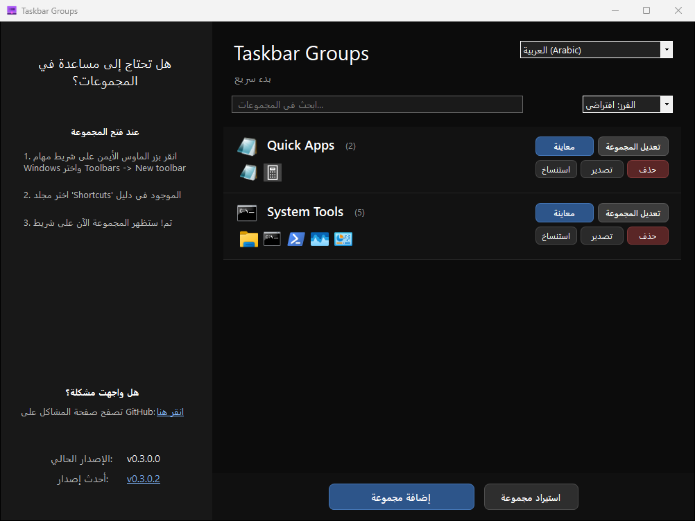
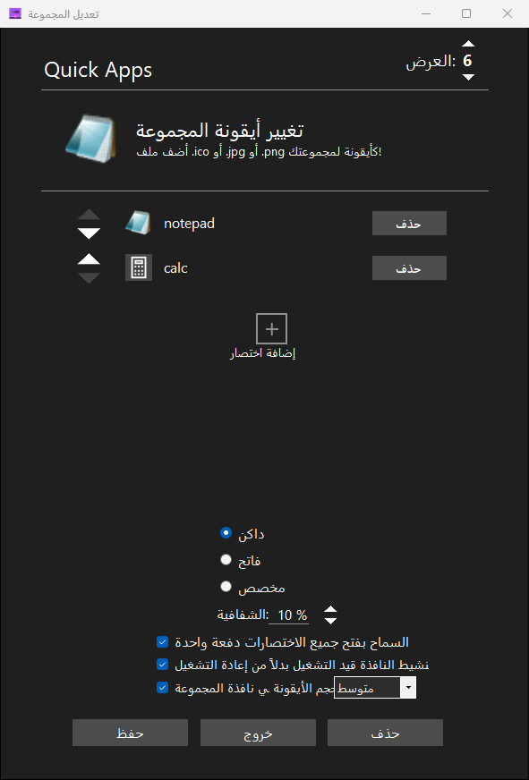

  <a href="../README.md">🇬🇧&nbsp;English</a> · <a href="README.de.md">🇩🇪&nbsp;Deutsch&nbsp;(German)</a> · <a href="README.es.md">🇪🇸&nbsp;Español&nbsp;(Spanish)</a> · <a href="README.fr.md">🇫🇷&nbsp;Français&nbsp;(French)</a> · <a href="README.it.md">🇮🇹&nbsp;Italiano&nbsp;(Italian)</a> · <a href="README.nl.md">🇳🇱&nbsp;Nederlands&nbsp;(Dutch)</a> · <a href="README.pl.md">🇵🇱&nbsp;Polski&nbsp;(Polish)</a> · <a href="README.pt-BR.md">🇧🇷&nbsp;Português&nbsp;(Brasil)&nbsp;(Portuguese)</a> · <a href="README.ru.md">🇷🇺&nbsp;Русский&nbsp;(Russian)</a> · <a href="README.uk.md">🇺🇦&nbsp;Українська&nbsp;(Ukrainian)</a> · <a href="README.tr.md">🇹🇷&nbsp;Türkçe&nbsp;(Turkish)</a> · <a href="README.az.md">🇦🇿&nbsp;Azərbaycanca&nbsp;(Azerbaijani)</a> · <a href="README.hr.md">🇭🇷&nbsp;Hrvatski&nbsp;(Croatian)</a> · <a href="README.id.md">🇮🇩&nbsp;Bahasa&nbsp;Indonesia&nbsp;(Indonesian)</a> · <a href="README.vi.md">🇻🇳&nbsp;Tiếng&nbsp;Việt&nbsp;(Vietnamese)</a> · <a href="README.th.md">🇹🇭&nbsp;ไทย&nbsp;(Thai)</a> · <a href="README.ja.md">🇯🇵&nbsp;日本語&nbsp;(Japanese)</a> · <a href="README.ko.md">🇰🇷&nbsp;한국어&nbsp;(Korean)</a> · <a href="README.zh-CN.md">🇨🇳&nbsp;简体中文&nbsp;(Chinese&nbsp;Simplified)</a> · <a href="README.zh-TW.md">🇹🇼&nbsp;繁體中文&nbsp;(Chinese&nbsp;Traditional)</a> · <b>🇸🇦&nbsp;العربية&nbsp;(Arabic)</b> · <a href="README.he.md">🇮🇱&nbsp;עברית&nbsp;(Hebrew)</a> · <a href="README.fa.md">🇮🇷&nbsp;فارسی&nbsp;(Persian)</a> · <a href="README.hi.md">🇮🇳&nbsp;हिन्दी&nbsp;(Hindi)</a> · <a href="README.ur.md">🇵🇰&nbsp;اردو&nbsp;(Urdu)</a> · <a href="README.bn.md">🇧🇩&nbsp;বাংলা&nbsp;(Bengali)</a>

  

<h1 align="center">Taskbar Groups</h1>

  <b>Taskbar Groups أداة خفيفة لنظام Windows تتيح إنشاء مجموعات اختصارات على شريط المهام.</b>

  <a href="https://github.com/bigman2000/taskbar-groups-updated/releases">التنزيل وملاحظات الإصدار</a>

> ℹ️ **ملاحظة:** هذا المشروع هو تفريع (Fork) مُحدّث باستمرار من [tjackenpacken/taskbar-groups](https://github.com/tjackenpacken/taskbar-groups). نظراً لعدم تحديث المستودع الأصلي منذ فترة طويلة، تم إنشاء هذا التفريع لإصلاح الأخطاء وإضافة ميزات جديدة.

---

## 📖 جدول المحتويات

* ➤ التثبيت
* ➤ إنشاء مجموعتك الأولى
* ➤ توثيق النوافذ
  * الشاشة الرئيسية
  * شاشة إنشاء المجموعة
  * ملاحظات إضافية
* ➤ تخزين الأيقونات المؤقت
* ➤ اختصارات لوحة المفاتيح
* ➤ بنية المجلدات
* ➤ التحديثات الأخيرة
* ➤ الترخيص

---

## 🔽 كيفية تنزيل Taskbar Groups
1. قم بتنزيل ملف `.zip` من أحدث إصدار (الرابط أعلاه)
2. فك ضغط ملف `.zip` في المجلد الذي تريده
3. شغّل ملف `TaskbarGroups.exe` داخل المجلد المستخرج

---

## 🛠️ إنشاء مجموعتك الأولى
1. انقر على **"إضافة مجموعة"**
2. أدخل اسماً للمجموعة واختر أيقونة
3. انقر على **"إضافة اختصار"** واختر ملفات `.exe` أو `.lnk` (أو اسحبها وأفلتها)
4. احفظ المجموعة
5. انقر بزر الماوس الأيسر على بطاقة المجموعة لفتح مجلد `Shortcuts`
6. انقر بزر الماوس الأيمن على الاختصار المحدد واختر **"تثبيت على شريط المهام"**

---

## 🖥️ توثيق النوافذ
فيما يلي شرح لكل نافذة وعناصرها.

#### الشاشة الرئيسية

الشاشة الرئيسية التي تظهر عند تشغيل `TaskbarGroups.exe`. يمكنك إنشاء المجموعات واستيرادها والبحث فيها وفرزها ومعاينتها وتعديلها واستنساخها وتصديرها وحذفها وتبديل لغة الواجهة (26 لغة).

#### شاشة إنشاء المجموعة

في شاشة إنشاء وتعديل المجموعة يمكنك ضبط الإعدادات التالية:

* **اسم المجموعة** — أي اسم تريده (يدعم Unicode والأحرف العربية والروسية، حتى 49 حرفاً).
* **العرض** — يحدد عدد الاختصارات في كل صف.
* **تغيير أيقونة المجموعة** — انقر على (+) أو اسحب ملفات `.png` أو `.jpg` أو `.ico` أو `.exe` أو `.lnk`.
* **إضافة اختصار** — يدعم `.exe` و`.lnk` و`.url` والمجلدات وتطبيقات Microsoft Store وألعاب Steam.
* **فتح جميع الاختصارات دفعة واحدة** — يسمح بتشغيل جميع اختصارات المجموعة معاً عبر `Ctrl + Enter`.
* **تنشيط النافذة قيد التشغيل** — ينتقل إلى النافذة المفتوحة بالفعل بدلاً من فتح نسخة جديدة.
* **إظهار التسميات / حجم الأيقونة** — تسميات اختيارية وأحجام *مضغوط* أو *متوسط* أو *كبير*.
* **دليل العمل، مسار الملف والوسائط** — تعديل مسار الملف التنفيذي (مفيد عند انتقال البرنامج لمجلد جديد بعد التحديث)، دليل العمل، وسائط التشغيل، والأيقونة المخصصة (بما في ذلك الاستخراج من `.exe`/`.dll`).
* **لون الخلفية والشفافية** — داكن أو فاتح أو مخصص مع شفافية من 0% إلى 100%.

#### ملاحظات إضافية
تُستخرج الأيقونات من ملفات `.exe` مباشرة؛ أما `.lnk` وتطبيقات Microsoft Store فيتم التعرف عليها تلقائياً.

---

## 📦 تخزين الأيقونات المؤقت
تُحفظ الأيقونات مؤقتاً في `/config/<اسم_المجموعة>/Icons` لفتح القائمة فوراً. حفظ المجموعة يعيد إنشاء الذاكرة المؤقتة.

---

## ⌨️ اختصارات لوحة المفاتيح
* **مفاتيح الأرقام `1`–`9`، `0`** — تشغيل الاختصار في الموضع 1–10.
* **الأسهم / `Enter` / `Esc`** — التنقل أو التشغيل أو إغلاق القائمة.
* **`Ctrl + Enter`** — فتح جميع اختصارات المجموعة دفعة واحدة (عند التفعيل).
* **النقر بزر الماوس الأيمن على اختصار** — قائمة سياقية: *التبديل إلى النافذة*، *إغلاق النافذة*، *فتح نسخة جديدة*، *تشغيل كمسؤول*، *فتح موقع الملف*.

---

## 📁 بنية المجلدات
* **`/config`** — يحتوي على مجلدات الإعدادات لكل مجموعة.
* **`/config/<Group_Name>/Icons`** — الذاكرة المؤقتة المحلية لأيقونات المجموعة.
* **`/config/<Group_Name>/GroupIcon.ico / GroupImage.png`** — ملفات الأيقونة المنشأة للمجموعة.
* **`/config/<Group_Name>/ObjectData.xml`** — ملف XML يحفظ الاختصارات وإعدادات المجموعة.
* **`/config/lang.txt`** — يحفظ رمز لغة الواجهة المحددة.
* **`/JITComp`** — ملفات تعريف مترجمة لتسريع بدء التشغيل.
* **`/Shortcuts`** — اختصارات `.lnk` المنشأة للتثبيت على شريط مهام Windows.

---

## ✨ التحديثات الأخيرة
* **التعريب والترجمة (26 لغة)**: ترجمة كاملة للواجهة مع محدد لغة في النافذة الرئيسية وملفات README متزامنة بـ 26 لغة.
* **لوحة التشغيل (`frmMain`)**: تلميحات الأدوات، اكتشاف التطبيقات النشطة، تنشيط النافذة المفتوحة، قائمة السياق، أحجام الأيقونات، التسميات، زوايا Windows 11 الدائرية والتنقل بلوحة المفاتيح.
* **محرر المجموعة (`frmGroup`)**: إعادة الترتيب بالسحب والإفلات مع التمرير التلقائي، تعديل مسار الملف التنفيذي، منتقي أيقونات `.exe`/`.dll`/الصور ودعم Unicode.
* **النافذة الرئيسية (`frmClient`)**: تخطيط ثابت، بحث وفرز، معاينة، استنساخ، تصدير/استيراد (`.tgroup`/`.zip`)، حذف سريع، التفاف تلقائي للأيقونات على عدة أسطر حسب حجم النافذة وإعادة الترتيب بالسحب والإفلات داخل البطاقة.

---

## 📜 الترخيص
هذا المشروع مرخص بموجب [رخصة MIT](https://github.com/bigman2000/taskbar-groups-updated/blob/master/LICENSE).

---
