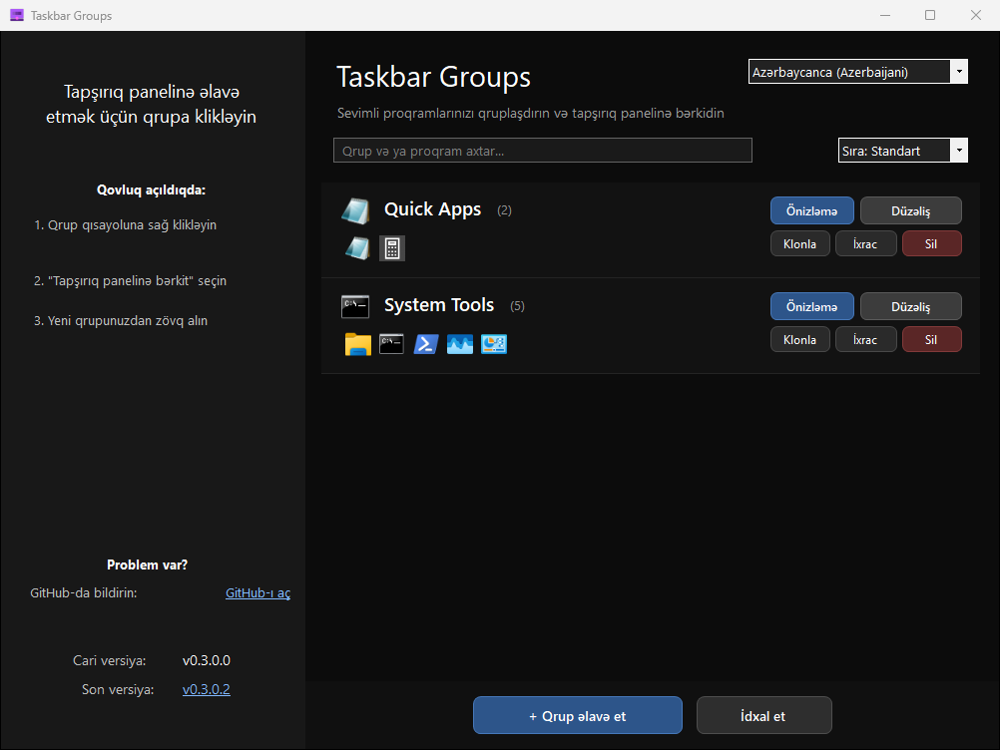
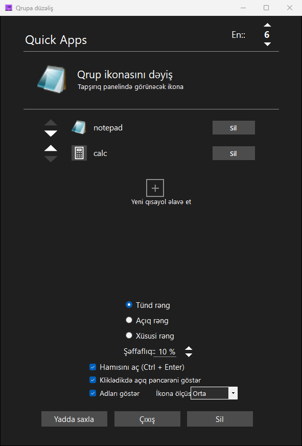

  <a href="../README.md">🇬🇧&nbsp;English</a> · <a href="README.de.md">🇩🇪&nbsp;Deutsch&nbsp;(German)</a> · <a href="README.es.md">🇪🇸&nbsp;Español&nbsp;(Spanish)</a> · <a href="README.fr.md">🇫🇷&nbsp;Français&nbsp;(French)</a> · <a href="README.it.md">🇮🇹&nbsp;Italiano&nbsp;(Italian)</a> · <a href="README.nl.md">🇳🇱&nbsp;Nederlands&nbsp;(Dutch)</a> · <a href="README.pl.md">🇵🇱&nbsp;Polski&nbsp;(Polish)</a> · <a href="README.pt-BR.md">🇧🇷&nbsp;Português&nbsp;(Brasil)&nbsp;(Portuguese)</a> · <a href="README.ru.md">🇷🇺&nbsp;Русский&nbsp;(Russian)</a> · <a href="README.uk.md">🇺🇦&nbsp;Українська&nbsp;(Ukrainian)</a> · <a href="README.tr.md">🇹🇷&nbsp;Türkçe&nbsp;(Turkish)</a> · <b>🇦🇿&nbsp;Azərbaycanca&nbsp;(Azerbaijani)</b> · <a href="README.hr.md">🇭🇷&nbsp;Hrvatski&nbsp;(Croatian)</a> · <a href="README.id.md">🇮🇩&nbsp;Bahasa&nbsp;Indonesia&nbsp;(Indonesian)</a> · <a href="README.vi.md">🇻🇳&nbsp;Tiếng&nbsp;Việt&nbsp;(Vietnamese)</a> · <a href="README.th.md">🇹🇭&nbsp;ไทย&nbsp;(Thai)</a> · <a href="README.ja.md">🇯🇵&nbsp;日本語&nbsp;(Japanese)</a> · <a href="README.ko.md">🇰🇷&nbsp;한국어&nbsp;(Korean)</a> · <a href="README.zh-CN.md">🇨🇳&nbsp;简体中文&nbsp;(Chinese&nbsp;Simplified)</a> · <a href="README.zh-TW.md">🇹🇼&nbsp;繁體中文&nbsp;(Chinese&nbsp;Traditional)</a> · <a href="README.ar.md">🇸🇦&nbsp;العربية&nbsp;(Arabic)</a> · <a href="README.he.md">🇮🇱&nbsp;עברית&nbsp;(Hebrew)</a> · <a href="README.fa.md">🇮🇷&nbsp;فارسی&nbsp;(Persian)</a> · <a href="README.hi.md">🇮🇳&nbsp;हिन्दी&nbsp;(Hindi)</a> · <a href="README.ur.md">🇵🇰&nbsp;اردو&nbsp;(Urdu)</a> · <a href="README.bn.md">🇧🇩&nbsp;বাংলা&nbsp;(Bengali)</a>

  

<h1 align="center">Taskbar Groups</h1>

  <b>Taskbar Groups — Windows tapşırıq panelində qısa yol qrupları yaratmaq üçün yüngül proqramdır.</b>

  <a href="https://github.com/bigman2000/taskbar-groups-updated/releases">Yükləmə və buraxılış qeydləri</a>

> ℹ️ **Qeyd:** Bu layihə [tjackenpacken/taskbar-groups](https://github.com/tjackenpacken/taskbar-groups) layihəsinin aktiv saxlanılan forkudur. Orijinal repozitoriya uzun müddətdir yenilənmədiyi və tərk edilmiş göründüyü üçün xətaları düzəltmək və yeni funksiyalar əlavə etmək məqsədilə yaradılmışdır.

---

## 📖 Mündəricat

* ➤ Quraşdırma
* ➤ İlk qrupun yaradılması
* ➤ Pəncərələrin sənədləşməsi
  * Əsas pəncərə
  * Qrup redaktoru
  * Əlavə qeydlər
* ➤ İkonların keşlənməsi
* ➤ Qısayol düymələri
* ➤ Qovluq strukturu
* ➤ Son yeniliklər
* ➤ Lisenziya

---

## 🔽 Taskbar Groups necə yüklənir
1. Ən son buraxılışdan `.zip` faylını yükləyin (yuxarıdakı keçid)
2. Arxivi istədiyiniz qovluğa çıxarın
3. Çıxarılmış qovluqdakı `TaskbarGroups.exe` faylını işə salın

---

## 🛠️ İlk qrupunuzu yaradın
1. **"Qrup əlavə et"** düyməsinə klikləyin
2. Qrupa ad verin və ikon seçin
3. **"Qısa yol əlavə et"** düyməsinə klikləyin və `.exe` və ya `.lnk` fayllarını seçin (və ya sürükləyib buraxın)
4. Qrupu yadda saxlayın
5. `Shortcuts` qovluğunu açmaq üçün qrup kartına sol klikləyin
6. Seçilmiş qısa yola sağ klikləyin və **"Tapşırıq panelinə bərkit"** seçin

---

## 🖥️ Pəncərələrin sənədləşməsi
Aşağıda hər bir pəncərə və onun elementləri haqqında məlumat verilir.

#### Əsas pəncərə

`TaskbarGroups.exe` işə salındıqda açılan əsas pəncərədir. Burada qruplar yarada, idxal edə, axtara, çeşidləyə, önizləyə, redaktə edə, klonlaya, ixrac edə, silə və interfeys dilini dəyişə bilərsiniz (26 dil).

#### Qrup redaktoru

Qrup yaratma və redaktə pəncərəsində bütün parametrləri tənzimləyə bilərsiniz:

* **Qrup adı** — İstənilən ad (Unicode və kiril əlifbası dəstəklənir, maks. 49 simvol).
* **Eni** — Hər sətirdə göstəriləcək qısa yolların sayı.
* **Qrup ikonunu dəyiş** — (+) üzərinə klikləyin və ya `.png`, `.jpg`, `.ico`, `.exe`, `.lnk` faylını sürükləyin.
* **Qısa yol əlavə et** — `.exe`, `.lnk`, `.url`, qovluqlar, Microsoft Store tətbiqləri və Steam oyunlarını dəstəkləyir.
* **Hamısını birlikdə aç** — `Ctrl + Enter` ilə qrupdakı bütün qısa yolları eyni anda açmağa imkan verir.
* **Açıq pəncərəni aktivləşdir** — Yeni nüsxə açmaq əvəzinə artıq işləyən pəncərəyə keçid edir.
* **Adları göstər / İkon ölçüsü** — İstəyə bağlı ad etiketləri və *Kiçik*, *Orta*, *Böyük* ölçüləri.
* **İş qovluğu, proqram yolu və arqumentlər** — İcra olunan faylın yolunu (proqram yenilənəndə yeni qovluğa köçdükdə faydalıdır), iş qovluğunu, parametrləri və xüsusi ikonu (`.exe`/`.dll` daxil) tənzimləyin.
* **Fon rəngi və şəffaflıq** — Tünd, Açıq və ya Fərdi rəng və 0%–100% şəffaflıq.

#### Əlavə qeydlər
`.exe` fayllarından ikon birbaşa çıxarılır; `.lnk` və Microsoft Store tətbiqləri üçün avtomatik müəyyən edilir.

---

## 📦 İkonların keşlənməsi
İkonlar `/config/<Qrup_Adı>/Icons` qovluğunda keşlənir ki, menyu dərhal açılsın. Qrupu yadda saxladıqda keş yenilənir.

---

## ⌨️ Qısayol düymələri
* **Rəqəm düymələri `1`–`9`, `0`** — 1–10-cu mövqedəki qısa yolu açır.
* **Ox düymələri / `Enter` / `Esc`** — Naviqasiya, işə salma və ya menyunu bağlama.
* **`Ctrl + Enter`** — Qrupdakı bütün qısa yolları eyni anda açır (aktivdirsə).
* **Qısa yola sağ klik** — Kontekst menyusu: *Pəncərəyə keç*, *Pəncərəni bağla*, *Yeni nüsxə aç*, *Administrator kimi işə sal*, *Faylın yerini aç*.

---

## 📁 Qovluq strukturu
* **`/config`** — Yaradılmış bütün qrupların konfiqurasiya qovluqları.
* **`/config/<Group_Name>/Icons`** — Qrupun lokal ikon keşi.
* **`/config/<Group_Name>/GroupIcon.ico / GroupImage.png`** — Qrup üçün yaradılmış ikon faylları.
* **`/config/<Group_Name>/ObjectData.xml`** — Qrup parametrlərini və qısa yolları saxlayan XML faylı.
* **`/config/lang.txt`** — Seçilmiş interfeys dilinin kodunu saxlayır.
* **`/JITComp`** — Daha sürətli açılış üçün tərtib edilmiş profillər.
* **`/Shortcuts`** — Tapşırıq panelinə bərkitmək üçün `.lnk` qısa yolları.

---

## ✨ Son yeniliklər
* **Lokallaşdırma (26 dil)**: Əsas pəncərədə dil seçicisi ilə tam interfeys tərcüməsi və 26 dildə sinxronlaşdırılmış README faylları.
* **Başlatma paneli (`frmMain`)**: İpucları, işləyən tətbiqlərin aşkarlanması, açıq pəncərəni aktivləşdirmə, kontekst menyusu, ikon ölçüləri, etiketlər, Windows 11 yuvarlaq küncləri və klaviatura naviqasiyası.
* **Qrup redaktoru (`frmGroup`)**: Avtomatik sürüşdürmə ilə sürüklə-burax sıralama, proqram yolunun redaktəsi, `.exe`/`.dll`/şəkillərdən ikon seçimi və Unicode dəstəyi.
* **Əsas pəncərə (`frmClient`)**: Sabit düzən, axtarış və çeşidləmə, Önizləmə, Klonlama, İxrac/İdxal (`.tgroup`/`.zip`), sürətli Silmə, pəncərə ölçüsünə uyğun çoxsətirli ikon düzülüşü və kart daxilində sürüklə-burax sıralama.

---

## 📜 Lisenziya
Bu layihə [MIT Lisenziyası](https://github.com/bigman2000/taskbar-groups-updated/blob/master/LICENSE) altında yayımlanır.

---
