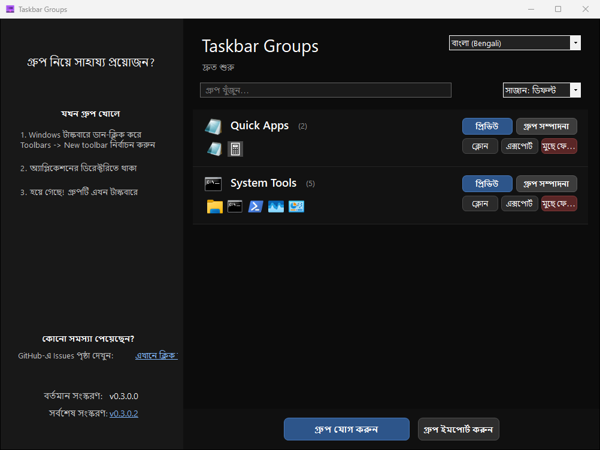
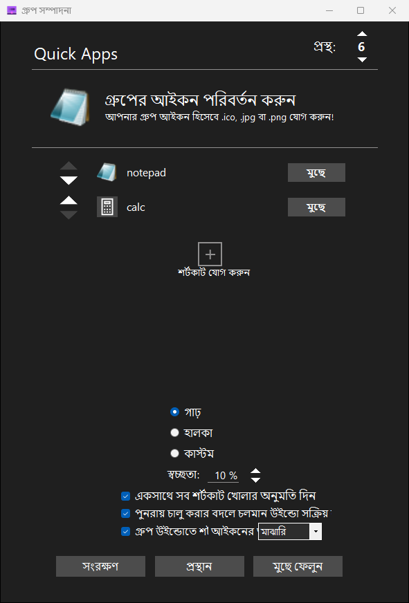

  <a href="../README.md">🇬🇧&nbsp;English</a> · <a href="README.de.md">🇩🇪&nbsp;Deutsch&nbsp;(German)</a> · <a href="README.es.md">🇪🇸&nbsp;Español&nbsp;(Spanish)</a> · <a href="README.fr.md">🇫🇷&nbsp;Français&nbsp;(French)</a> · <a href="README.it.md">🇮🇹&nbsp;Italiano&nbsp;(Italian)</a> · <a href="README.nl.md">🇳🇱&nbsp;Nederlands&nbsp;(Dutch)</a> · <a href="README.pl.md">🇵🇱&nbsp;Polski&nbsp;(Polish)</a> · <a href="README.pt-BR.md">🇧🇷&nbsp;Português&nbsp;(Brasil)&nbsp;(Portuguese)</a> · <a href="README.ru.md">🇷🇺&nbsp;Русский&nbsp;(Russian)</a> · <a href="README.uk.md">🇺🇦&nbsp;Українська&nbsp;(Ukrainian)</a> · <a href="README.tr.md">🇹🇷&nbsp;Türkçe&nbsp;(Turkish)</a> · <a href="README.az.md">🇦🇿&nbsp;Azərbaycanca&nbsp;(Azerbaijani)</a> · <a href="README.hr.md">🇭🇷&nbsp;Hrvatski&nbsp;(Croatian)</a> · <a href="README.id.md">🇮🇩&nbsp;Bahasa&nbsp;Indonesia&nbsp;(Indonesian)</a> · <a href="README.vi.md">🇻🇳&nbsp;Tiếng&nbsp;Việt&nbsp;(Vietnamese)</a> · <a href="README.th.md">🇹🇭&nbsp;ไทย&nbsp;(Thai)</a> · <a href="README.ja.md">🇯🇵&nbsp;日本語&nbsp;(Japanese)</a> · <a href="README.ko.md">🇰🇷&nbsp;한국어&nbsp;(Korean)</a> · <a href="README.zh-CN.md">🇨🇳&nbsp;简体中文&nbsp;(Chinese&nbsp;Simplified)</a> · <a href="README.zh-TW.md">🇹🇼&nbsp;繁體中文&nbsp;(Chinese&nbsp;Traditional)</a> · <a href="README.ar.md">🇸🇦&nbsp;العربية&nbsp;(Arabic)</a> · <a href="README.he.md">🇮🇱&nbsp;עברית&nbsp;(Hebrew)</a> · <a href="README.fa.md">🇮🇷&nbsp;فارسی&nbsp;(Persian)</a> · <a href="README.hi.md">🇮🇳&nbsp;हिन्दी&nbsp;(Hindi)</a> · <a href="README.ur.md">🇵🇰&nbsp;اردو&nbsp;(Urdu)</a> · <b>🇧🇩&nbsp;বাংলা&nbsp;(Bengali)</b>

  

<h1 align="center">Taskbar Groups</h1>

  <b>Taskbar Groups হলো Windows-এর জন্য একটি হালকা ইউটিলিটি যা টাস্কবারে শর্টকাট গ্রুপ তৈরি করতে সাহায্য করে।</b>

  <a href="https://github.com/bigman2000/taskbar-groups-updated/releases">ডাউনলোড ও রিলিজ নোটস</a>

> ℹ️ **দ্রষ্টব্য:** এই প্রকল্পটি [tjackenpacken/taskbar-groups](https://github.com/tjackenpacken/taskbar-groups)-এর একটি সক্রিয়ভাবে রক্ষণাবেক্ষণকৃত ফর্ক। মূল রিপোজিটরি দীর্ঘদিন আপডেট না হওয়ায় বাগ ফিক্স ও নতুন ফিচার যোগ করতে এই ফর্কটি তৈরি করা হয়েছে।

---

## 📖 সূচিপত্র

* ➤ ইনস্টলেশন
* ➤ প্রথম গ্রুপ তৈরি
* ➤ উইন্ডো ডকুমেন্টেশন
  * মূল স্ক্রিন
  * গ্রুপ তৈরির স্ক্রিন
  * অতিরিক্ত নোট
* ➤ আইকন ক্যাশিং
* ➤ কীবোর্ড শর্টকাট
* ➤ ফোল্ডার কাঠামো
* ➤ সাম্প্রতিক আপডেট
* ➤ লাইসেন্স

---

## 🔽 কীভাবে Taskbar Groups ডাউনলোড করবেন
1. সর্বশেষ রিলিজ থেকে `.zip` ফাইলটি ডাউনলোড করুন (উপরের লিংক)
2. `.zip` ফাইলটি আপনার পছন্দের ফোল্ডারে আনজিপ করুন
3. এক্সট্র্যাক্ট করা ফোল্ডার থেকে `TaskbarGroups.exe` চালান

---

## 🛠️ আপনার প্রথম গ্রুপ তৈরি করুন
1. **"গ্রুপ যোগ করুন"**-এ ক্লিক করুন
2. গ্রুপের একটি নাম দিন এবং আইকন নির্বাচন করুন
3. **"শর্টকাট যোগ করুন"**-এ ক্লিক করে `.exe` বা `.lnk` ফাইল বেছে নিন (অথবা ড্র্যাগ অ্যান্ড ড্রপ করুন)
4. গ্রুপটি সংরক্ষণ করুন
5. `Shortcuts` ফোল্ডার খুলতে গ্রুপ কার্ডে বাম-ক্লিক করুন
6. নির্বাচিত শর্টকাটে ডান-ক্লিক করে **"টাস্কবারে পিন করুন"** নির্বাচন করুন

---

## 🖥️ উইন্ডো ডকুমেন্টেশন
নিচে প্রতিটি উইন্ডো এবং এর উপাদানগুলোর বর্ণনা দেওয়া হলো।

#### মূল স্ক্রিন

`TaskbarGroups.exe` চালু করলে মূল স্ক্রিন খোলে। এখান থেকে গ্রুপ তৈরি, ইমপোর্ট, অনুসন্ধান, সাজানো, প্রিভিউ, সম্পাদনা, ক্লোন, এক্সপোর্ট, মুছে ফেলা এবং ভাষা পরিবর্তন (২৬টি ভাষা) করা যায়।

#### গ্রুপ তৈরির স্ক্রিন

গ্রুপ তৈরি/সম্পাদনা স্ক্রিনে আপনি নিচের সেটিংসগুলো করতে পারবেন:

* **গ্রুপের নাম** — যেকোনো নাম দিন (বাংলা ও Unicode সমর্থিত, সর্বোচ্চ ৪৯ অক্ষর)।
* **প্রস্থ** — প্রতি সারিতে কয়টি শর্টকাট দেখাবে তা নির্ধারণ করে।
* **গ্রুপ আইকন পরিবর্তন** — (+)-এ ক্লিক করুন অথবা `.png`, `.jpg`, `.ico`, `.exe`, `.lnk` ফাইল টেনে এনে ছাড়ুন।
* **শর্টকাট যোগ করুন** — `.exe`, `.lnk`, `.url`, ফোল্ডার, Microsoft Store অ্যাপ এবং Steam গেম সমর্থন করে।
* **সবগুলো একসাথে খুলুন** — `Ctrl + Enter` চেপে গ্রুপের সব শর্টকাট একসাথে চালু করে।
* **চলমান উইন্ডো সক্রিয় করুন** — নতুন ইনস্ট্যান্স খোলার বদলে আগে থেকে খোলা উইন্ডোতে নিয়ে যায়।
* **লেবেল দেখান / আইকনের আকার** — ঐচ্ছিক লেবেল এবং *সংক্ষিপ্ত*, *মাঝারি* বা *বড়* আকার বেছে নিন।
* **কার্যকরী ডিরেক্টরি, ফাইলের পাথ ও আর্গুমেন্ট** — এক্সিকিউটেবল ফাইলের পাথ সম্পাদনা (আপডেটে নতুন ফোল্ডার হলে উপকারী), কার্যকরী ডিরেক্টরি, আর্গুমেন্ট এবং কাস্টম আইকন (`.exe`/`.dll` সহ) সেট করুন।
* **পটভূমির রঙ ও স্বচ্ছতা** — গাঢ়, হালকা বা কাস্টম রঙ এবং ০%–১০০% স্বচ্ছতা।

#### অতিরিক্ত নোট
`.exe` ফাইল থেকে আইকন সরাসরি নেওয়া হয়; `.lnk` এবং Microsoft Store অ্যাপের ক্ষেত্রে স্বয়ংক্রিয়ভাবে সমাধান করা হয়।

---

## 📦 আইকন ক্যাশিং
আইকনগুলো `/config/<গ্রুপ_নাম>/Icons`-এ ক্যাশ থাকে যাতে পপআপ সাথে সাথে খোলে। গ্রুপ সংরক্ষণ করলে ক্যাশ পুনরায় তৈরি হয়।

---

## ⌨️ কীবোর্ড শর্টকাট
* **সংখ্যা কী `1`–`9`, `0`** — ১–১০ অবস্থানের শর্টকাট চালু করে।
* **তীর কী / `Enter` / `Esc`** — নেভিগেট করা, চালু করা বা মেনু বন্ধ করা।
* **`Ctrl + Enter`** — গ্রুপের সব শর্টকাট একসাথে খোলে (সক্রিয় থাকলে)।
* **শর্টকাটে ডান-ক্লিক** — কনটেক্সট মেনু: *উইন্ডোতে যান*, *উইন্ডো বন্ধ করুন*, *নতুন ইনস্ট্যান্স খুলুন*, *অ্যাডমিনিস্ট্রেটর হিসেবে চালান*, *ফাইলের অবস্থান খুলুন*।

---

## 📁 ফোল্ডার কাঠামো
* **`/config`** — প্রতিটি তৈরি গ্রুপের কনফিগারেশন ফোল্ডার।
* **`/config/<Group_Name>/Icons`** — গ্রুপের শর্টকাটগুলোর স্থানীয় আইকন ক্যাশ।
* **`/config/<Group_Name>/GroupIcon.ico / GroupImage.png`** — গ্রুপের জন্য তৈরি আইকন ফাইল।
* **`/config/<Group_Name>/ObjectData.xml`** — গ্রুপ ও শর্টকাট সেটিংস সংরক্ষণকারী XML ফাইল।
* **`/config/lang.txt`** — নির্বাচিত UI ভাষার কোড সংরক্ষণ করে।
* **`/JITComp`** — দ্রুত চালুর জন্য কম্পাইল করা প্রোফাইল।
* **`/Shortcuts`** — Windows টাস্কবারে পিন করার জন্য `.lnk` শর্টকাট।

---

## ✨ সাম্প্রতিক আপডেট
* **লোকালাইজেশন (২৬টি ভাষা)**: মূল উইন্ডোতে ভাষা নির্বাচকসহ সম্পূর্ণ UI অনুবাদ এবং ২৬টি ভাষায় সিঙ্ক করা README।
* **লঞ্চ প্যানেল (`frmMain`)**: টুলটিপ, চলমান অ্যাপ শনাক্তকরণ, চলমান উইন্ডো সক্রিয় করা, ডান-ক্লিক মেনু, আইকনের আকার, লেবেল, Windows 11 গোল কোণা এবং কীবোর্ড নেভিগেশন।
* **গ্রুপ এডিটর (`frmGroup`)**: অটো-স্ক্রলসহ ড্র্যাগ-অ্যান্ড-ড্রপ পুনর্বিন্যাস, ফাইলের পাথ সম্পাদনা, `.exe`/`.dll`/ছবি থেকে আইকন নির্বাচক এবং Unicode সমর্থন।
* **মূল উইন্ডো (`frmClient`)**: স্থির লেআউট, অনুসন্ধান ও সাজানো, প্রিভিউ, ক্লোন, এক্সপোর্ট/ইমপোর্ট (`.tgroup`/`.zip`), দ্রুত মুছে ফেলা, উইন্ডোর আকার অনুযায়ী একাধিক সারিতে আইকন মোড়ানো এবং কার্ডের ভেতরে ড্র্যাগ-অ্যান্ড-ড্রপ।

---

## 📜 লাইসেন্স
এই প্রকল্পটি [MIT লাইসেন্স](https://github.com/bigman2000/taskbar-groups-updated/blob/master/LICENSE)-এর অধীনে লাইসেন্সপ্রাপ্ত।

---
