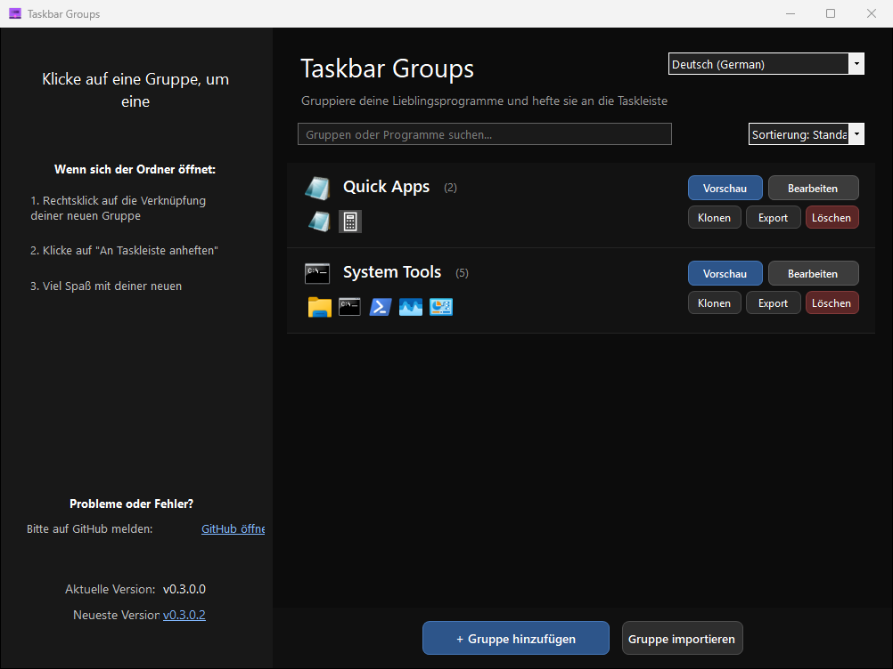
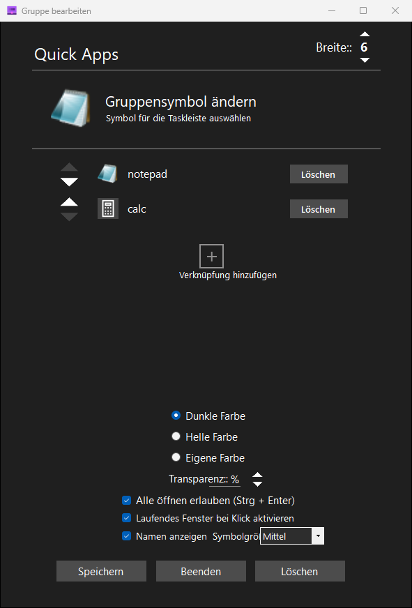

  <a href="../README.md">🇬🇧&nbsp;English</a> · <b>🇩🇪&nbsp;Deutsch&nbsp;(German)</b> · <a href="README.es.md">🇪🇸&nbsp;Español&nbsp;(Spanish)</a> · <a href="README.fr.md">🇫🇷&nbsp;Français&nbsp;(French)</a> · <a href="README.it.md">🇮🇹&nbsp;Italiano&nbsp;(Italian)</a> · <a href="README.nl.md">🇳🇱&nbsp;Nederlands&nbsp;(Dutch)</a> · <a href="README.pl.md">🇵🇱&nbsp;Polski&nbsp;(Polish)</a> · <a href="README.pt-BR.md">🇧🇷&nbsp;Português&nbsp;(Brasil)&nbsp;(Portuguese)</a> · <a href="README.ru.md">🇷🇺&nbsp;Русский&nbsp;(Russian)</a> · <a href="README.uk.md">🇺🇦&nbsp;Українська&nbsp;(Ukrainian)</a> · <a href="README.tr.md">🇹🇷&nbsp;Türkçe&nbsp;(Turkish)</a> · <a href="README.az.md">🇦🇿&nbsp;Azərbaycanca&nbsp;(Azerbaijani)</a> · <a href="README.hr.md">🇭🇷&nbsp;Hrvatski&nbsp;(Croatian)</a> · <a href="README.id.md">🇮🇩&nbsp;Bahasa&nbsp;Indonesia&nbsp;(Indonesian)</a> · <a href="README.vi.md">🇻🇳&nbsp;Tiếng&nbsp;Việt&nbsp;(Vietnamese)</a> · <a href="README.th.md">🇹🇭&nbsp;ไทย&nbsp;(Thai)</a> · <a href="README.ja.md">🇯🇵&nbsp;日本語&nbsp;(Japanese)</a> · <a href="README.ko.md">🇰🇷&nbsp;한국어&nbsp;(Korean)</a> · <a href="README.zh-CN.md">🇨🇳&nbsp;简体中文&nbsp;(Chinese&nbsp;Simplified)</a> · <a href="README.zh-TW.md">🇹🇼&nbsp;繁體中文&nbsp;(Chinese&nbsp;Traditional)</a> · <a href="README.ar.md">🇸🇦&nbsp;العربية&nbsp;(Arabic)</a> · <a href="README.he.md">🇮🇱&nbsp;עברית&nbsp;(Hebrew)</a> · <a href="README.fa.md">🇮🇷&nbsp;فارسی&nbsp;(Persian)</a> · <a href="README.hi.md">🇮🇳&nbsp;हिन्दी&nbsp;(Hindi)</a> · <a href="README.ur.md">🇵🇰&nbsp;اردو&nbsp;(Urdu)</a> · <a href="README.bn.md">🇧🇩&nbsp;বাংলা&nbsp;(Bengali)</a>

  

<h1 align="center">Taskbar Groups</h1>

  <b>Taskbar Groups ist ein leichtgewichtiges Windows-Tool zum Erstellen von Verknüpfungsgruppen in der Taskleiste.</b>

  <a href="https://github.com/bigman2000/taskbar-groups-updated/releases">Download & Versionshinweise</a>

> ℹ️ **Hinweis:** Dieses Projekt ist ein aktiv gepflegter Fork von [tjackenpacken/taskbar-groups](https://github.com/tjackenpacken/taskbar-groups). Da das Original-Repository lange nicht aktualisiert wurde und verlassen scheint, wurde dieser Fork erstellt, um Fehler zu beheben und neue Funktionen hinzuzufügen.

---

## 📖 Inhaltsverzeichnis

* ➤ Installation
* ➤ Erste Gruppe erstellen
* ➤ Fenster-Dokumentation
  * Hauptfenster
  * Gruppeneditor
  * Zusätzliche Hinweise
* ➤ Icon-Caching
* ➤ Tastenkombinationen
* ➤ Ordnerstruktur
* ➤ Letzte Änderungen
* ➤ Lizenz

---

## 🔽 Taskbar Groups herunterladen
1. Laden Sie die `.zip`-Datei aus dem neuesten Release herunter (Link oben)
2. Entpacken Sie das Archiv in einen gewünschten Ordner
3. Starten Sie `TaskbarGroups.exe` im entpackten Ordner

---

## 🛠️ Erste Gruppe erstellen
1. Klicken Sie auf **"Gruppe hinzufügen"**
2. Geben Sie der Gruppe einen Namen und wählen Sie ein Symbol
3. Klicken Sie auf **"Verknüpfung hinzufügen"** und wählen Sie `.exe`- oder `.lnk`-Dateien aus (oder per Drag & Drop)
4. Speichern Sie die Gruppe
5. Klicken Sie links auf die Gruppenkarte, um den Ordner `Shortcuts` zu öffnen
6. Rechtsklicken Sie auf die markierte Verknüpfung und wählen Sie **"An Taskleiste anheften"**

---

## 🖥️ Fenster-Dokumentation
Nachfolgend finden Sie eine Übersicht über alle Fenster und deren Funktionen.

#### Hauptfenster

Das Hauptfenster öffnet sich beim Start von `TaskbarGroups.exe`. Hier können Sie Gruppen erstellen, importieren, suchen, sortieren, in der Vorschau anzeigen, bearbeiten, klonen, exportieren, löschen und die Sprache wechseln (26 Sprachen).

#### Gruppeneditor

Im Gruppeneditor konfigurieren Sie Aussehen und Verknüpfungen Ihrer Gruppe:

* **Gruppenname** — Beliebiger Name (inkl. Unicode/Kyrillisch, bis zu 49 Zeichen).
* **Breite** — Anzahl der Verknüpfungen pro Zeile.
* **Gruppensymbol ändern** — Klicken Sie auf (+) oder ziehen Sie `.png`, `.jpg`, `.ico`, `.exe` oder `.lnk` per Drag & Drop darauf.
* **Verknüpfung hinzufügen** — Unterstützt `.exe`, `.lnk`, `.url`, Ordner, Windows Store-Apps und Steam-Spiele.
* **Alle gleichzeitig öffnen** — Erlaubt das Starten aller Verknüpfungen per `Strg + Eingabe`.
* **Laufendes Fenster aktivieren** — Wechselt zu einem bereits geöffneten Fenster statt eine neue Instanz zu starten.
* **Namen anzeigen / Symbolgröße** — Optionale Beschriftungen sowie die Größen *Kompakt*, *Mittel* und *Groß*.
* **Arbeitsverzeichnis & Argumente** — Passen Sie Arbeitsverzeichnis, Startparameter oder ein eigenes Symbol (auch aus `.exe`/`.dll`) pro Eintrag an.
* **Hintergrundfarbe & Deckkraft** — Dunkel, Hell oder Benutzerdefiniert mit 0–100 % Transparenz.

#### Zusätzliche Hinweise
Bei `.exe`-Dateien wird das Symbol direkt ausgelesen; bei `.lnk`-Verknüpfungen und Microsoft Store-Apps wird automatisch das Ziel- oder Paket-Symbol ermittelt.

---

## 📦 Icon-Caching
Symbole werden lokal unter `/config/<Gruppenname>/Icons` zwischengespeichert, sodass das Startmenü sofort öffnet. Beim Speichern wird der Cache neu aufgebaut.

---

## ⌨️ Tastenkombinationen
* **Zifferntasten `1`–`9`, `0`** — Startet die Verknüpfung an Position 1–10.
* **Pfeiltasten / `Eingabe` / `Esc`** — Navigieren, starten oder Fenster schließen.
* **`Strg + Eingabe`** — Öffnet alle Verknüpfungen der Gruppe gleichzeitig (sofern aktiviert).
* **Rechtsklick auf eine Verknüpfung** — Kontextmenü: *Zum Fenster wechseln*, *Fenster schließen*, *Neue Instanz öffnen*, *Als Administrator ausführen*, *Dateipfad öffnen*.

---

## 📁 Ordnerstruktur
* **`/config`** — Enthält die Konfigurationsordner aller Gruppen.
* **`/config/<Group_Name>/Icons`** — Lokaler Icon-Cache der Gruppe.
* **`/config/<Group_Name>/GroupIcon.ico / GroupImage.png`** — Erzeugtes Gruppensymbol.
* **`/config/<Group_Name>/ObjectData.xml`** — XML-Datei mit allen Einstellungen und Verknüpfungen.
* **`/config/lang.txt`** — Speichert die gewählte Sprache.
* **`/JITComp`** — Zwischengespeicherte Profile für schnelleren Start.
* **`/Shortcuts`** — Erzeugte `.lnk`-Dateien zum Anheften an die Taskleiste.

---

## ✨ Letzte Änderungen
* **Lokalisierung (26 Sprachen)**: Vollständige UI-Übersetzung mit Sprachauswahl im Hauptfenster sowie synchronisierte READMEs in allen 26 Sprachen.
* **Startleiste (`frmMain`)**: Tooltips, Erkennung laufender Apps, Option zum Aktivieren laufender Fenster, Kontextmenü, wählbare Symbolgrößen, Beschriftungen, Windows-11-Rundungen und Tastaturnavigation.
* **Gruppeneditor (`frmGroup`)**: Drag-and-Drop-Sortierung mit Auto-Scroll, Icon-Auswahl aus `.exe`/`.dll`/Bildern und Unicode-Unterstützung.
* **Hauptfenster (`frmClient`)**: Fixierte Kopf-/Fußleiste, Suche & Sortierung, Vorschau, Klonen, Export/Import (`.tgroup`/`.zip`), schnelles Löschen, mehrzeiliger Icon-Umbruch bei Fenstergrößenänderung und Drag-and-Drop-Sortierung direkt auf der Karte.

---

## 📜 Lizenz
Dieses Projekt steht unter der [MIT-Lizenz](https://github.com/bigman2000/taskbar-groups-updated/blob/master/LICENSE).

---
