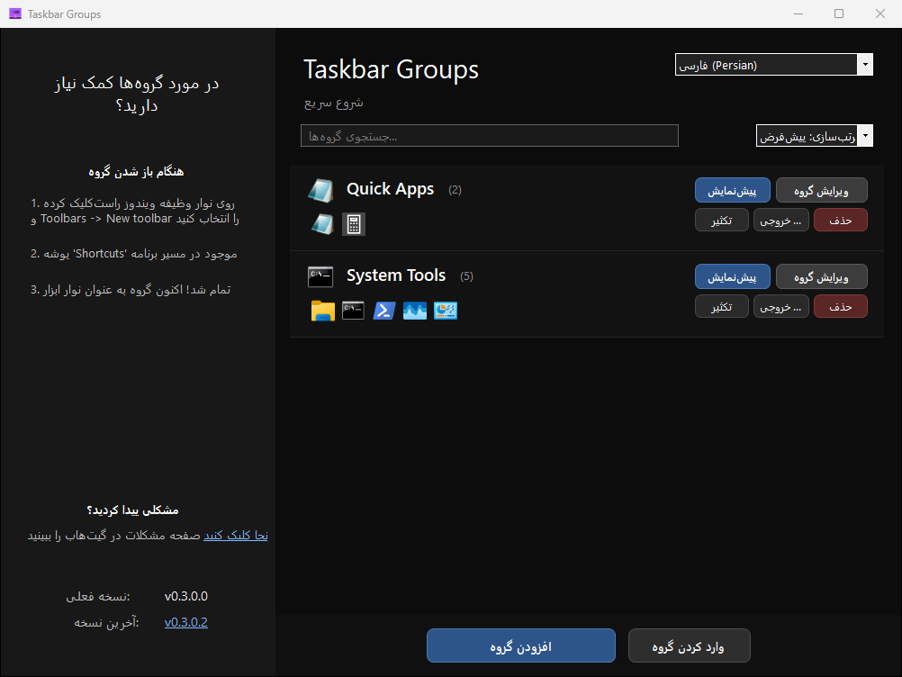
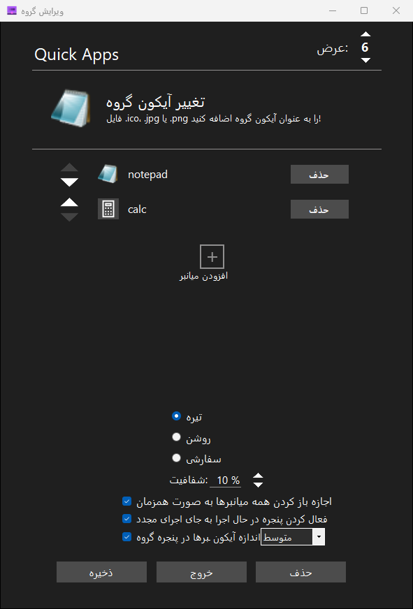

  <a href="../README.md">🇬🇧&nbsp;English</a> · <a href="README.de.md">🇩🇪&nbsp;Deutsch&nbsp;(German)</a> · <a href="README.es.md">🇪🇸&nbsp;Español&nbsp;(Spanish)</a> · <a href="README.fr.md">🇫🇷&nbsp;Français&nbsp;(French)</a> · <a href="README.it.md">🇮🇹&nbsp;Italiano&nbsp;(Italian)</a> · <a href="README.nl.md">🇳🇱&nbsp;Nederlands&nbsp;(Dutch)</a> · <a href="README.pl.md">🇵🇱&nbsp;Polski&nbsp;(Polish)</a> · <a href="README.pt-BR.md">🇧🇷&nbsp;Português&nbsp;(Brasil)&nbsp;(Portuguese)</a> · <a href="README.ru.md">🇷🇺&nbsp;Русский&nbsp;(Russian)</a> · <a href="README.uk.md">🇺🇦&nbsp;Українська&nbsp;(Ukrainian)</a> · <a href="README.tr.md">🇹🇷&nbsp;Türkçe&nbsp;(Turkish)</a> · <a href="README.az.md">🇦🇿&nbsp;Azərbaycanca&nbsp;(Azerbaijani)</a> · <a href="README.hr.md">🇭🇷&nbsp;Hrvatski&nbsp;(Croatian)</a> · <a href="README.id.md">🇮🇩&nbsp;Bahasa&nbsp;Indonesia&nbsp;(Indonesian)</a> · <a href="README.vi.md">🇻🇳&nbsp;Tiếng&nbsp;Việt&nbsp;(Vietnamese)</a> · <a href="README.th.md">🇹🇭&nbsp;ไทย&nbsp;(Thai)</a> · <a href="README.ja.md">🇯🇵&nbsp;日本語&nbsp;(Japanese)</a> · <a href="README.ko.md">🇰🇷&nbsp;한국어&nbsp;(Korean)</a> · <a href="README.zh-CN.md">🇨🇳&nbsp;简体中文&nbsp;(Chinese&nbsp;Simplified)</a> · <a href="README.zh-TW.md">🇹🇼&nbsp;繁體中文&nbsp;(Chinese&nbsp;Traditional)</a> · <a href="README.ar.md">🇸🇦&nbsp;العربية&nbsp;(Arabic)</a> · <a href="README.he.md">🇮🇱&nbsp;עברית&nbsp;(Hebrew)</a> · <b>🇮🇷&nbsp;فارسی&nbsp;(Persian)</b> · <a href="README.hi.md">🇮🇳&nbsp;हिन्दी&nbsp;(Hindi)</a> · <a href="README.ur.md">🇵🇰&nbsp;اردو&nbsp;(Urdu)</a> · <a href="README.bn.md">🇧🇩&nbsp;বাংলা&nbsp;(Bengali)</a>

  

<h1 align="center">Taskbar Groups</h1>

  <b>Taskbar Groups یک ابزار سبک برای ویندوز است که امکان ساخت گروه‌های میانبر در نوار وظیفه را فراهم می‌کند.</b>

  <a href="https://github.com/bigman2000/taskbar-groups-updated/releases">دانلود و یادداشت‌های انتشار</a>

> ℹ️ **توجه:** این پروژه یک انشعاب (Fork) فعال از [tjackenpacken/taskbar-groups](https://github.com/tjackenpacken/taskbar-groups) است. مخزن اصلی مدت‌هاست به‌روزرسانی نشده و رها شده به نظر می‌رسد؛ بنابراین این فورک برای رفع اشکال‌ها و افزودن قابلیت‌های جدید ساخته شده است.

---

## 📖 فهرست مطالب

* ➤ نصب
* ➤ ساخت اولین گروه
* ➤ مستندات پنجره‌ها
  * پنجره اصلی
  * پنجره ساخت گروه
  * نکات تکمیلی
* ➤ حافظه نهان آیکون‌ها
* ➤ کلیدهای میانبر
* ➤ ساختار پوشه‌ها
* ➤ به‌روزرسانی‌های اخیر
* ➤ مجوز

---

## 🔽 نحوه دانلود Taskbar Groups
1. فایل `.zip` را از آخرین انتشار دانلود کنید (لینک بالا)
2. فایل `.zip` را در مسیر دلخواه استخراج کنید
3. فایل `TaskbarGroups.exe` را در پوشه استخراج‌شده اجرا کنید

---

## 🛠️ ساخت اولین گروه
1. روی **"افزودن گروه"** کلیک کنید
2. برای گروه یک نام و آیکون انتخاب کنید
3. روی **"افزودن میانبر"** کلیک کرده و فایل‌های `.exe` یا `.lnk` را انتخاب کنید (یا بکشید و رها کنید)
4. گروه را ذخیره کنید
5. برای باز کردن پوشه `Shortcuts` روی کارت گروه کلیک چپ کنید
6. روی میانبر انتخاب‌شده راست‌کلیک کرده و **"Pin to taskbar"** را بزنید

---

## 🖥️ مستندات پنجره‌ها
در ادامه توضیح هر پنجره و اجزای آن آمده است.

#### پنجره اصلی

پنجره اصلی هنگام اجرای `TaskbarGroups.exe`. می‌توانید گروه‌ها را بسازید، وارد کنید، جستجو و مرتب‌سازی کنید، پیش‌نمایش بگیرید، ویرایش، تکثیر، خروجی یا حذف کنید و زبان رابط کاربری را تغییر دهید (۲۶ زبان).

#### پنجره ساخت گروه

در پنجره ساخت و ویرایش گروه می‌توانید موارد زیر را تنظیم کنید:

* **نام گروه** — هر نام دلخواه (پشتیبانی از Unicode و حروف فارسی/سیریلیک، حداکثر ۴۹ نویسه).
* **عرض** — تعداد میانبرها در هر ردیف.
* **تغییر آیکون گروه** — روی (+) کلیک کنید یا فایل `.png`، `.jpg`، `.ico`، `.exe` یا `.lnk` را بکشید.
* **افزودن میانبر** — پشتیبانی از `.exe`، `.lnk`، `.url`، پوشه‌ها، برنامه‌های Microsoft Store و بازی‌های Steam.
* **باز کردن همه به‌صورت همزمان** — اجرای تمام میانبرهای گروه با `Ctrl + Enter`.
* **فعال‌سازی پنجره در حال اجرا** — به‌جای اجرای نمونه جدید، پنجره باز را فعال می‌کند.
* **نمایش برچسب / اندازه آیکون** — برچسب اختیاری و اندازه‌های *فشرده*، *متوسط* یا *بزرگ*.
* **پوشه کاری، مسیر فایل و آرگومان‌ها** — ویرایش مسیر فایل اجرایی (مفید هنگام انتقال برنامه به پوشه جدید در به‌روزرسانی)، پوشه کاری، پارامترها و آیکون سفارشی (شامل استخراج از `.exe`/`.dll`).
* **رنگ پس‌زمینه و شفافیت** — تیره، روشن یا سفارشی با شفافیت ۰ تا ۱۰۰ درصد.

#### نکات تکمیلی
آیکون فایل‌های `.exe` مستقیماً استخراج می‌شود؛ برای `.lnk` و برنامه‌های Microsoft Store به‌صورت خودکار شناسایی می‌شود.

---

## 📦 حافظه نهان آیکون‌ها
آیکون‌ها در `/config/<نام_گروه>/Icons` ذخیره می‌شوند تا منو فوراً باز شود. با ذخیره گروه، کش بازسازی می‌شود.

---

## ⌨️ کلیدهای میانبر
* **کلیدهای عددی `1`–`9`، `0`** — اجرای میانبر در جایگاه ۱ تا ۱۰.
* **کلیدهای جهت‌نما / `Enter` / `Esc`** — جابه‌جایی، اجرا یا بستن پنجره.
* **`Ctrl + Enter`** — باز کردن تمام میانبرهای گروه به‌طور همزمان (در صورت فعال بودن).
* **راست‌کلیک روی میانبر** — منوی زمینه: *تغییر به پنجره*، *بستن پنجره*، *باز کردن نمونه جدید*، *اجرا به عنوان مدیر*، *باز کردن مسیر فایل*.

---

## 📁 ساختار پوشه‌ها
* **`/config`** — پوشه تنظیمات گروه‌های ساخته‌شده.
* **`/config/<Group_Name>/Icons`** — حافظه نهان محلی آیکون‌های گروه.
* **`/config/<Group_Name>/GroupIcon.ico / GroupImage.png`** — فایل‌های آیکون ساخته‌شده برای گروه.
* **`/config/<Group_Name>/ObjectData.xml`** — فایل XML شامل میانبرها و تنظیمات گروه.
* **`/config/lang.txt`** — کد زبان انتخاب‌شده رابط کاربری را نگه می‌دارد.
* **`/JITComp`** — پروفایل‌های کامپایل‌شده برای اجرای سریع‌تر.
* **`/Shortcuts`** — میانبرهای `.lnk` برای سنجاق کردن به نوار وظیفه ویندوز.

---

## ✨ به‌روزرسانی‌های اخیر
* **بومی‌سازی (۲۶ زبان)**: ترجمه کامل رابط کاربری با انتخابگر زبان در پنجره اصلی و فایل‌های README همگام‌سازی‌شده به ۲۶ زبان.
* **پنل اجرا (`frmMain`)**: راهنمای ابزار، تشخیص برنامه‌های در حال اجرا، فعال‌سازی پنجره باز، منوی راست‌کلیک، اندازه‌های آیکون، برچسب‌ها، گوشه‌های گرد ویندوز ۱۱ و ناوبری با صفحه‌کلید.
* **ویرایشگر گروه (`frmGroup`)**: مرتب‌سازی کشیدن و رها کردن با اسکرول خودکار، ویرایش مسیر فایل اجرایی، انتخابگر آیکون از `.exe`/`.dll`/تصاویر و پشتیبانی از Unicode.
* **پنجره اصلی (`frmClient`)**: چیدمان ثابت، جستجو و مرتب‌سازی، پیش‌نمایش، تکثیر، خروجی/ورودی (`.tgroup`/`.zip`)، حذف سریع، شکستن خودکار آیکون‌ها در چند خط متناسب با اندازه پنجره و مرتب‌سازی کشیدن و رها کردن روی کارت.

---

## 📜 مجوز
این پروژه تحت [مجوز MIT](https://github.com/bigman2000/taskbar-groups-updated/blob/master/LICENSE) منتشر شده است.

---
