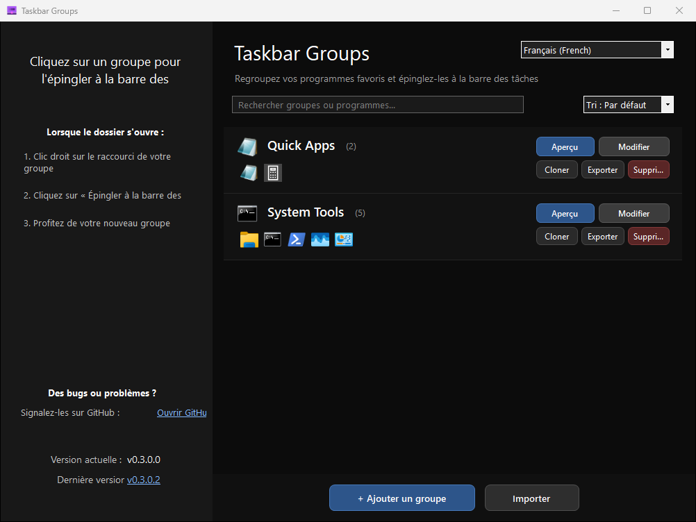
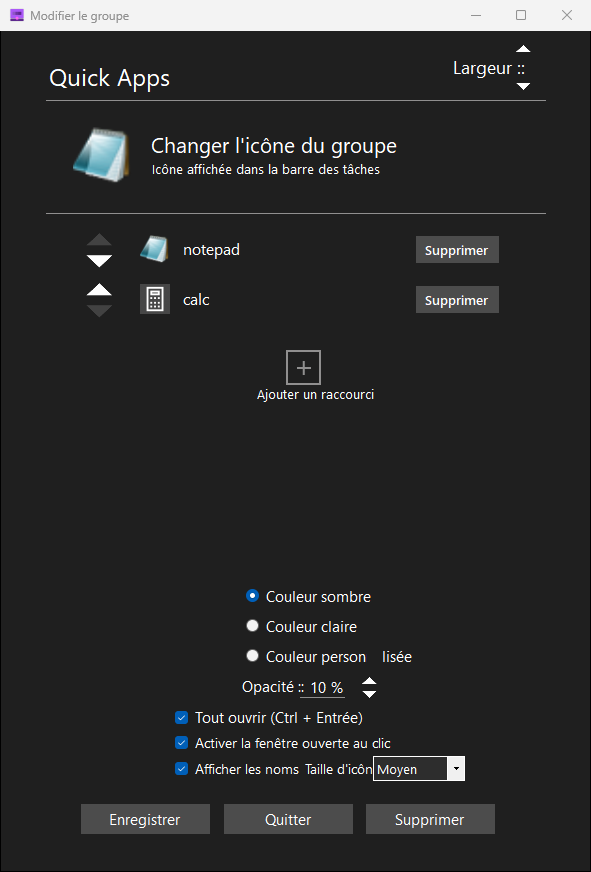

  <a href="../README.md">🇬🇧&nbsp;English</a> · <a href="README.de.md">🇩🇪&nbsp;Deutsch&nbsp;(German)</a> · <a href="README.es.md">🇪🇸&nbsp;Español&nbsp;(Spanish)</a> · <b>🇫🇷&nbsp;Français&nbsp;(French)</b> · <a href="README.it.md">🇮🇹&nbsp;Italiano&nbsp;(Italian)</a> · <a href="README.nl.md">🇳🇱&nbsp;Nederlands&nbsp;(Dutch)</a> · <a href="README.pl.md">🇵🇱&nbsp;Polski&nbsp;(Polish)</a> · <a href="README.pt-BR.md">🇧🇷&nbsp;Português&nbsp;(Brasil)&nbsp;(Portuguese)</a> · <a href="README.ru.md">🇷🇺&nbsp;Русский&nbsp;(Russian)</a> · <a href="README.uk.md">🇺🇦&nbsp;Українська&nbsp;(Ukrainian)</a> · <a href="README.tr.md">🇹🇷&nbsp;Türkçe&nbsp;(Turkish)</a> · <a href="README.az.md">🇦🇿&nbsp;Azərbaycanca&nbsp;(Azerbaijani)</a> · <a href="README.hr.md">🇭🇷&nbsp;Hrvatski&nbsp;(Croatian)</a> · <a href="README.id.md">🇮🇩&nbsp;Bahasa&nbsp;Indonesia&nbsp;(Indonesian)</a> · <a href="README.vi.md">🇻🇳&nbsp;Tiếng&nbsp;Việt&nbsp;(Vietnamese)</a> · <a href="README.th.md">🇹🇭&nbsp;ไทย&nbsp;(Thai)</a> · <a href="README.ja.md">🇯🇵&nbsp;日本語&nbsp;(Japanese)</a> · <a href="README.ko.md">🇰🇷&nbsp;한국어&nbsp;(Korean)</a> · <a href="README.zh-CN.md">🇨🇳&nbsp;简体中文&nbsp;(Chinese&nbsp;Simplified)</a> · <a href="README.zh-TW.md">🇹🇼&nbsp;繁體中文&nbsp;(Chinese&nbsp;Traditional)</a> · <a href="README.ar.md">🇸🇦&nbsp;العربية&nbsp;(Arabic)</a> · <a href="README.he.md">🇮🇱&nbsp;עברית&nbsp;(Hebrew)</a> · <a href="README.fa.md">🇮🇷&nbsp;فارسی&nbsp;(Persian)</a> · <a href="README.hi.md">🇮🇳&nbsp;हिन्दी&nbsp;(Hindi)</a> · <a href="README.ur.md">🇵🇰&nbsp;اردو&nbsp;(Urdu)</a> · <a href="README.bn.md">🇧🇩&nbsp;বাংলা&nbsp;(Bengali)</a>

  

<h1 align="center">Taskbar Groups</h1>

  <b>Taskbar Groups est un utilitaire léger pour Windows permettant de créer des groupes de raccourcis dans la barre des tâches.</b>

  <a href="https://github.com/bigman2000/taskbar-groups-updated/releases">Téléchargement et notes de version</a>

> ℹ️ **Note :** Ce projet est un fork activement maintenu de [tjackenpacken/taskbar-groups](https://github.com/tjackenpacken/taskbar-groups). Le dépôt d'origine n'ayant pas été mis à jour depuis longtemps et semblant abandonné, ce fork a été créé pour corriger des bugs et ajouter de nouvelles fonctionnalités.

---

## 📖 Table des matières

* ➤ Installation
* ➤ Créer votre premier groupe
* ➤ Documentation des fenêtres
  * Fenêtre principale
  * Création de groupe
  * Notes supplémentaires
* ➤ Cache d'icônes
* ➤ Raccourcis clavier
* ➤ Structure des dossiers
* ➤ Mises à jour récentes
* ➤ Licence

---

## 🔽 Télécharger Taskbar Groups
1. Téléchargez l'archive `.zip` de la dernière version (lien ci-dessus)
2. Extrayez le fichier `.zip` à l'emplacement de votre choix
3. Lancez `TaskbarGroups.exe` dans le dossier extrait

---

## 🛠️ Créer votre premier groupe
1. Cliquez sur **"Ajouter un groupe"**
2. Donnez un nom au groupe et choisissez une icône
3. Cliquez sur **"Ajouter un raccourci"** et sélectionnez des fichiers `.exe` ou `.lnk` (ou glissez-déposez-les)
4. Enregistrez le groupe
5. Cliquez sur la carte du groupe pour ouvrir le dossier `Shortcuts`
6. Faites un clic droit sur le raccourci sélectionné et cliquez sur **"Épingler à la barre des tâches"**

---

## 🖥️ Documentation des fenêtres
Voici la description de chaque fenêtre et de ses fonctionnalités.

#### Fenêtre principale

Fenêtre principale ouverte au lancement de `TaskbarGroups.exe`. Permet de créer, importer, rechercher, trier, prévisualiser, modifier, cloner, exporter ou supprimer des groupes et de changer la langue (26 langues).

#### Création de groupe

Fenêtre de création et d'édition d'un groupe :

* **Nom du groupe** — Tout nom souhaité (y compris Unicode/cyrillique, 49 caractères max.).
* **Largeur** — Nombre de raccourcis affichés par ligne.
* **Icône du groupe** — Cliquez sur (+) ou glissez-déposez un fichier `.png`, `.jpg`, `.ico`, `.exe` ou `.lnk`.
* **Ajouter un raccourci** — Prend en charge `.exe`, `.lnk`, `.url`, dossiers, apps Microsoft Store et jeux Steam.
* **Tout ouvrir simultanément** — Permet de lancer tous les raccourcis du groupe avec `Ctrl + Entrée`.
* **Activer la fenêtre en cours** — Bascule vers la fenêtre déjà ouverte au lieu de relancer l'application.
* **Afficher les noms / Taille des icônes** — Libellés optionnels et tailles *Compact*, *Moyen* ou *Grand*.
* **Répertoire de travail et arguments** — Personnalisez le dossier de travail, les arguments et l'icône (y compris depuis `.exe`/`.dll`).
* **Couleur et opacité** — Sombre, Clair ou Personnalisé avec transparence de 0 % à 100 %.

#### Notes supplémentaires
Les icônes sont extraites directement des exécutables, ou résolues automatiquement pour les `.lnk` et les applications du Microsoft Store.

---

## 📦 Cache d'icônes
Le cache local dans `/config/<Nom_du_groupe>/Icons` permet une ouverture instantanée. Enregistrer le groupe régénère le cache.

---

## ⌨️ Raccourcis clavier
* **Touches `1`–`9`, `0`** — Lance le raccourci correspondant (1 à 10).
* **Flèches / `Entrée` / `Échap`** — Naviguer, lancer ou fermer le menu.
* **`Ctrl + Entrée`** — Ouvre tous les raccourcis du groupe en même temps (si activé).
* **Clic droit sur un raccourci** — Menu contextuel : *Basculer vers la fenêtre*, *Fermer la fenêtre*, *Nouvelle instance*, *Exécuter en tant qu'administrateur*, *Ouvrir l'emplacement du fichier*.

---

## 📁 Structure des dossiers
* **`/config`** — Contient les dossiers de configuration de chaque groupe.
* **`/config/<Group_Name>/Icons`** — Cache local des icônes du groupe.
* **`/config/<Group_Name>/GroupIcon.ico / GroupImage.png`** — Icônes générées pour le groupe.
* **`/config/<Group_Name>/ObjectData.xml`** — Paramètres XML du groupe et de ses raccourcis.
* **`/config/lang.txt`** — Enregistre la langue sélectionnée.
* **`/JITComp`** — Profils compilés pour accélérer le démarrage.
* **`/Shortcuts`** — Raccourcis `.lnk` générés pour l'épinglage à la barre des tâches.

---

## ✨ Mises à jour récentes
* **Localisation (26 langues)** : Traduction complète de l'interface avec sélecteur de langue et READMEs synchronisés dans 26 langues.
* **Panneau de lancement (`frmMain`)** : Infobulles, détection des apps actives, activation de fenêtre existante, menu contextuel, tailles d'icônes, libellés, coins arrondis Windows 11 et navigation clavier.
* **Éditeur de groupe (`frmGroup`)** : Réorganisation par glisser-déposer avec défilement automatique, sélecteur d'icônes `.exe`/`.dll`/images et support Unicode.
* **Fenêtre principale (`frmClient`)** : Mise en page fixe, recherche et tri, Aperçu, Cloner, Exporter/Importer (`.tgroup`/`.zip`), Suppression rapide, retour à la ligne adaptatif des icônes et réorganisation directe sur la carte.

---

## 📜 Licence
Ce projet est distribué sous [Licence MIT](https://github.com/bigman2000/taskbar-groups-updated/blob/master/LICENSE).

---
