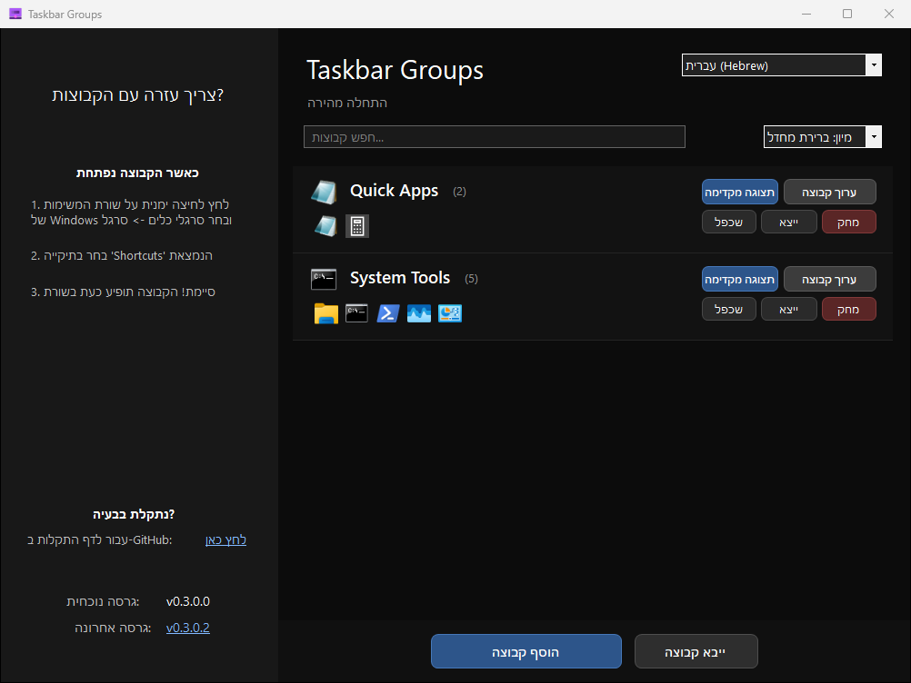
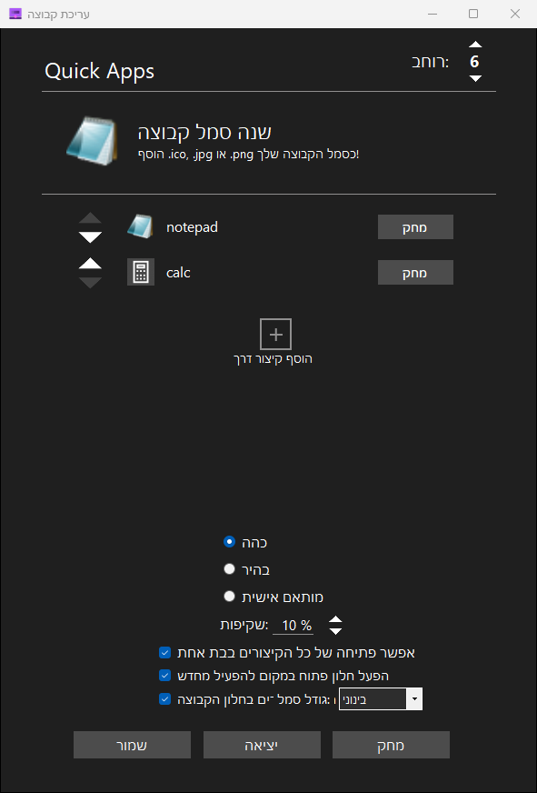

  <a href="../README.md">🇬🇧&nbsp;English</a> · <a href="README.de.md">🇩🇪&nbsp;Deutsch&nbsp;(German)</a> · <a href="README.es.md">🇪🇸&nbsp;Español&nbsp;(Spanish)</a> · <a href="README.fr.md">🇫🇷&nbsp;Français&nbsp;(French)</a> · <a href="README.it.md">🇮🇹&nbsp;Italiano&nbsp;(Italian)</a> · <a href="README.nl.md">🇳🇱&nbsp;Nederlands&nbsp;(Dutch)</a> · <a href="README.pl.md">🇵🇱&nbsp;Polski&nbsp;(Polish)</a> · <a href="README.pt-BR.md">🇧🇷&nbsp;Português&nbsp;(Brasil)&nbsp;(Portuguese)</a> · <a href="README.ru.md">🇷🇺&nbsp;Русский&nbsp;(Russian)</a> · <a href="README.uk.md">🇺🇦&nbsp;Українська&nbsp;(Ukrainian)</a> · <a href="README.tr.md">🇹🇷&nbsp;Türkçe&nbsp;(Turkish)</a> · <a href="README.az.md">🇦🇿&nbsp;Azərbaycanca&nbsp;(Azerbaijani)</a> · <a href="README.hr.md">🇭🇷&nbsp;Hrvatski&nbsp;(Croatian)</a> · <a href="README.id.md">🇮🇩&nbsp;Bahasa&nbsp;Indonesia&nbsp;(Indonesian)</a> · <a href="README.vi.md">🇻🇳&nbsp;Tiếng&nbsp;Việt&nbsp;(Vietnamese)</a> · <a href="README.th.md">🇹🇭&nbsp;ไทย&nbsp;(Thai)</a> · <a href="README.ja.md">🇯🇵&nbsp;日本語&nbsp;(Japanese)</a> · <a href="README.ko.md">🇰🇷&nbsp;한국어&nbsp;(Korean)</a> · <a href="README.zh-CN.md">🇨🇳&nbsp;简体中文&nbsp;(Chinese&nbsp;Simplified)</a> · <a href="README.zh-TW.md">🇹🇼&nbsp;繁體中文&nbsp;(Chinese&nbsp;Traditional)</a> · <a href="README.ar.md">🇸🇦&nbsp;العربية&nbsp;(Arabic)</a> · <b>🇮🇱&nbsp;עברית&nbsp;(Hebrew)</b> · <a href="README.fa.md">🇮🇷&nbsp;فارسی&nbsp;(Persian)</a> · <a href="README.hi.md">🇮🇳&nbsp;हिन्दी&nbsp;(Hindi)</a> · <a href="README.ur.md">🇵🇰&nbsp;اردو&nbsp;(Urdu)</a> · <a href="README.bn.md">🇧🇩&nbsp;বাংলা&nbsp;(Bengali)</a>

  

<h1 align="center">Taskbar Groups</h1>

  <b>Taskbar Groups היא תוכנה קלת משקל ל-Windows ליצירת קבוצות קיצורי דרך בשורת המשימות.</b>

  <a href="https://github.com/bigman2000/taskbar-groups-updated/releases">הורדה והערות שחרור</a>

> ℹ️ **הערה:** פרויקט זה הוא פיצול (Fork) המתוחזק באופן פעיל של [tjackenpacken/taskbar-groups](https://github.com/tjackenpacken/taskbar-groups). המאגר המקורי לא עודכן זמן רב ונראה נטוש, ולכן נוצר פיצול זה לתיקון באגים והוספת תכונות חדשות.

---

## 📖 תוכן עניינים

* ➤ התקנה
* ➤ יצירת הקבוצה הראשונה
* ➤ תיעוד חלונות
  * מסך ראשי
  * מסך יצירת קבוצה
  * הערות נוספות
* ➤ מטמון סמלים
* ➤ קיצורי מקלדת
* ➤ מבנה תיקיות
* ➤ עדכונים אחרונים
* ➤ רישיון

---

## 🔽 כיצד להוריד את Taskbar Groups
1. הורד את קובץ ה-`.zip` מהגרסה האחרונה (קישור למעלה)
2. חלץ את קובץ ה-`.zip` לתיקייה הרצויה
3. הפעל את `TaskbarGroups.exe` מתוך התיקייה שחולצה

---

## 🛠️ יצירת הקבוצה הראשונה שלך
1. לחץ על **"הוסף קבוצה"**
2. תן שם לקבוצה ובחר סמל
3. לחץ על **"הוסף קיצור דרך"** ובחר קובצי `.exe` או `.lnk` (או גרור ושחרר)
4. שמור את הקבוצה
5. לחץ לחיצה שמאלית על כרטיס הקבוצה כדי לפתוח את תיקיית `Shortcuts`
6. לחץ לחיצה ימנית על קיצור הדרך המסומן ובחר **"הצמד לשורת המשימות"**

---

## 🖥️ תיעוד חלונות
להלן תיאור של כל חלון והרכיבים שלו.

#### מסך ראשי

המסך הראשי הנפתח בהפעלת `TaskbarGroups.exe`. ניתן ליצור, לייבא, לחפש, למיין, להציג בתצוגה מקדימה, לערוך, לשכפל, לייצא, למחוק קבוצות ולהחליף שפה (26 שפות).

#### מסך יצירת קבוצה

במסך יצירת/עריכת הקבוצה ניתן להגדיר את הקבוצה:

* **שם הקבוצה** — כל שם שתרצה (תומך Unicode ועברית, עד 49 תווים).
* **רוחב** — מספר קיצורי הדרך בכל שורה.
* **שנה סמל קבוצה** — לחץ (+) או גרור קובצי `.png`, `.jpg`, `.ico`, `.exe` או `.lnk`.
* **הוסף קיצור דרך** — תומך ב-`.exe`, `.lnk`, `.url`, תיקיות, אפליקציות Microsoft Store ומשחקי Steam.
* **פתח הכל בבת אחת** — מאפשר לפתוח את כל קיצורי הקבוצה יחד עם `Ctrl + Enter`.
* **הפעל חלון פתוח** — עובר לחלון שכבר פועל במקום לפתוח מופע חדש.
* **הצג תוויות / גודל סמל** — תוויות אופציונליות וגדלים *דחוס*, *בינוני* או *גדול*.
* **תיקיית עבודה, נתיב קובץ ופרמטרים** — עריכת נתיב קובץ ההפעלה (שימושי כשתוכנה מתעדכנת לתיקייה חדשה), תיקיית עבודה, פרמטרים וסמל מותאם אישית (כולל חילוץ מ-`.exe`/`.dll`).
* **צבע רקע ושקיפות** — כהה, בהיר או מותאם אישית עם שקיפות 0%–100%.

#### הערות נוספות
מקובצי `.exe` הסמל מחולץ ישירות; עבור `.lnk` ו-Microsoft Store הסמל מזוהה אוטומטית.

---

## 📦 מטמון סמלים
הסמלים נשמרים במטמון המקומי ב-`/config/<שם_קבוצה>/Icons` לפתיחה מיידית. שמירת הקבוצה מחדשת את המטמון.

---

## ⌨️ קיצורי מקלדת
* **מקשי ספרות `1`–`9`, `0`** — מפעיל את קיצור הדרך במיקום 1–10.
* **חיצים / `Enter` / `Esc`** — ניווט, הפעלה או סגירת התפריט.
* **`Ctrl + Enter`** — פותח את כל קיצורי הקבוצה יחד (כאשר מופעל).
* **לחיצה ימנית על קיצור** — תפריט הקשר: *עבור לחלון*, *סגור חלון*, *פתח מופע חדש*, *הפעל כמנהל*, *פתח מיקום קובץ*.

---

## 📁 מבנה תיקיות
* **`/config`** — מכיל את תיקיות ההגדרות של כל קבוצה.
* **`/config/<Group_Name>/Icons`** — מטמון הסמלים המקומי של הקבוצה.
* **`/config/<Group_Name>/GroupIcon.ico / GroupImage.png`** — קובצי הסמל שנוצרו לקבוצה.
* **`/config/<Group_Name>/ObjectData.xml`** — קובץ XML השומר את הקיצורים והגדרות הקבוצה.
* **`/config/lang.txt`** — שומר את קוד השפה שנבחר.
* **`/JITComp`** — פרופילים מקומפלים להפעלה מהירה יותר.
* **`/Shortcuts`** — קיצורי `.lnk` להצמדה לשורת המשימות של Windows.

---

## ✨ עדכונים אחרונים
* **לוקליזציה (26 שפות)**: תרגום מלא של הממשק עם בורר שפה בחלון הראשי וקובצי README מסונכרנים ב-26 שפות.
* **חלון ההפעלה (`frmMain`)**: תיאורי כלים, זיהוי יישומים פעילים, הפעלת חלון פתוח, תפריט ימני, גדלי סמלים, תוויות, פינות מעוגלות ב-Windows 11 וניווט מקלדת.
* **עורך הקבוצה (`frmGroup`)**: סידור בגרירה ושחרור עם גלילה אוטומטית, עריכת נתיב קובץ ההפעלה, בוחר סמלים מ-`.exe`/`.dll`/תמונות ותמיכת Unicode.
* **חלון ראשי (`frmClient`)**: פריסה קבועה, חיפוש ומיון, תצוגה מקדימה, שכפול, ייצוא/ייבוא (`.tgroup`/`.zip`), מחיקה מהירה, גלישת סמלים רספונסיבית למספר שורות וסידור בגרירה ישירות בכרטיס.

---

## 📜 רישיון
פרויקט זה מורשה תחת [רישיון MIT](https://github.com/bigman2000/taskbar-groups-updated/blob/master/LICENSE).

---
