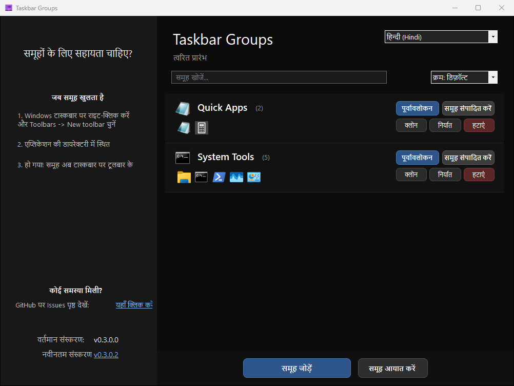
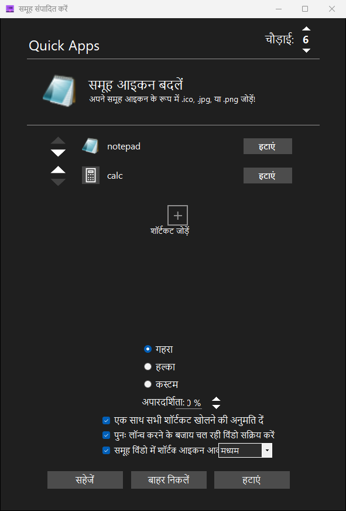

  <a href="../README.md">🇬🇧&nbsp;English</a> · <a href="README.de.md">🇩🇪&nbsp;Deutsch&nbsp;(German)</a> · <a href="README.es.md">🇪🇸&nbsp;Español&nbsp;(Spanish)</a> · <a href="README.fr.md">🇫🇷&nbsp;Français&nbsp;(French)</a> · <a href="README.it.md">🇮🇹&nbsp;Italiano&nbsp;(Italian)</a> · <a href="README.nl.md">🇳🇱&nbsp;Nederlands&nbsp;(Dutch)</a> · <a href="README.pl.md">🇵🇱&nbsp;Polski&nbsp;(Polish)</a> · <a href="README.pt-BR.md">🇧🇷&nbsp;Português&nbsp;(Brasil)&nbsp;(Portuguese)</a> · <a href="README.ru.md">🇷🇺&nbsp;Русский&nbsp;(Russian)</a> · <a href="README.uk.md">🇺🇦&nbsp;Українська&nbsp;(Ukrainian)</a> · <a href="README.tr.md">🇹🇷&nbsp;Türkçe&nbsp;(Turkish)</a> · <a href="README.az.md">🇦🇿&nbsp;Azərbaycanca&nbsp;(Azerbaijani)</a> · <a href="README.hr.md">🇭🇷&nbsp;Hrvatski&nbsp;(Croatian)</a> · <a href="README.id.md">🇮🇩&nbsp;Bahasa&nbsp;Indonesia&nbsp;(Indonesian)</a> · <a href="README.vi.md">🇻🇳&nbsp;Tiếng&nbsp;Việt&nbsp;(Vietnamese)</a> · <a href="README.th.md">🇹🇭&nbsp;ไทย&nbsp;(Thai)</a> · <a href="README.ja.md">🇯🇵&nbsp;日本語&nbsp;(Japanese)</a> · <a href="README.ko.md">🇰🇷&nbsp;한국어&nbsp;(Korean)</a> · <a href="README.zh-CN.md">🇨🇳&nbsp;简体中文&nbsp;(Chinese&nbsp;Simplified)</a> · <a href="README.zh-TW.md">🇹🇼&nbsp;繁體中文&nbsp;(Chinese&nbsp;Traditional)</a> · <a href="README.ar.md">🇸🇦&nbsp;العربية&nbsp;(Arabic)</a> · <a href="README.he.md">🇮🇱&nbsp;עברית&nbsp;(Hebrew)</a> · <a href="README.fa.md">🇮🇷&nbsp;فارسی&nbsp;(Persian)</a> · <b>🇮🇳&nbsp;हिन्दी&nbsp;(Hindi)</b> · <a href="README.ur.md">🇵🇰&nbsp;اردو&nbsp;(Urdu)</a> · <a href="README.bn.md">🇧🇩&nbsp;বাংলা&nbsp;(Bengali)</a>

  

<h1 align="center">Taskbar Groups</h1>

  <b>Taskbar Groups Windows के लिए एक हल्का टूल है जो टास्कबार पर शॉर्टकट समूह बनाने की सुविधा देता है।</b>

  <a href="https://github.com/bigman2000/taskbar-groups-updated/releases">डाउनलोड और रिलीज़ नोट्स</a>

> ℹ️ **नोट:** यह प्रोजेक्ट [tjackenpacken/taskbar-groups](https://github.com/tjackenpacken/taskbar-groups) का सक्रिय रूप से रखरखाव किया गया फोर्क है। मूल रिपॉजिटरी लंबे समय से अपडेट नहीं हुई है, इसलिए बग ठीक करने और नई सुविधाएँ जोड़ने के लिए यह फोर्क बनाया गया है।

---

## 📖 विषय-सूची

* ➤ इंस्टॉलेशन
* ➤ पहला समूह बनाना
* ➤ विंडो दस्तावेज़ीकरण
  * मुख्य स्क्रीन
  * समूह निर्माण स्क्रीन
  * अतिरिक्त नोट्स
* ➤ आइकन कैशिंग
* ➤ कीबोर्ड शॉर्टकट
* ➤ फ़ोल्डर संरचना
* ➤ हाल के अपडेट
* ➤ लाइसेंस

---

## 🔽 Taskbar Groups कैसे डाउनलोड करें
1. नवीनतम रिलीज़ से `.zip` फ़ाइल डाउनलोड करें (ऊपर दिए लिंक से)
2. `.zip` फ़ाइल को अपनी पसंद के फ़ोल्डर में अनज़िप करें
3. निकाले गए फ़ोल्डर में `TaskbarGroups.exe` चलाएं

---

## 🛠️ अपना पहला समूह बनाना
1. **"समूह जोड़ें"** पर क्लिक करें
2. समूह को एक नाम दें और आइकन चुनें
3. **"शॉर्टकट जोड़ें"** पर क्लिक करें और `.exe` या `.lnk` फ़ाइलें चुनें (या ड्रैग-एंड-ड्रॉप करें)
4. समूह सहेजें
5. `Shortcuts` फ़ोल्डर खोलने के लिए समूह कार्ड पर बायाँ क्लिक करें
6. हाइलाइट किए गए शॉर्टकट पर राइट-क्लिक करें और **"टास्कबार पर पिन करें"** चुनें

---

## 🖥️ विंडो दस्तावेज़ीकरण
नीचे प्रत्येक विंडो और उसके घटकों का विवरण दिया गया है।

#### मुख्य स्क्रीन

`TaskbarGroups.exe` चलाने पर खुलने वाली मुख्य स्क्रीन। यहाँ आप समूह बना सकते हैं, आयात, खोज, क्रमबद्ध, पूर्वावलोकन, संपादित, क्लोन, निर्यात, हटा सकते हैं और भाषा बदल सकते हैं (26 भाषाएँ)।

#### समूह निर्माण स्क्रीन

समूह निर्माण/संपादन स्क्रीन में आप निम्नलिखित सेटिंग्स कर सकते हैं:

* **समूह का नाम** — कोई भी नाम लिखें (Unicode/देवनागरी समर्थित, अधिकतम 49 अक्षर)।
* **चौड़ाई** — प्रत्येक पंक्ति में दिखने वाले शॉर्टकट की संख्या।
* **समूह आइकन बदलें** — (+) पर क्लिक करें या `.png`, `.jpg`, `.ico`, `.exe`, `.lnk` फ़ाइल खींचकर छोड़ें।
* **शॉर्टकट जोड़ें** — `.exe`, `.lnk`, `.url`, फ़ोल्डर, Microsoft Store ऐप्स और Steam गेम्स का समर्थन करता है।
* **एक साथ सभी खोलें** — `Ctrl + Enter` से समूह के सभी शॉर्टकट एक साथ लॉन्च करता है।
* **चल रही विंडो सक्रिय करें** — नया इंस्टेंस खोलने के बजाय पहले से खुली विंडो पर स्विच करता है।
* **लेबल दिखाएं / आइकन आकार** — वैकल्पिक लेबल तथा *कॉम्पैक्ट*, *मध्यम*, या *बड़ा* आकार चुनें।
* **कार्य निर्देशिका, फ़ाइल पथ और आर्गुमेंट्स** — निष्पादन योग्य फ़ाइल का पथ संपादित करें (अपडेट पर नया फ़ोल्डर बनने पर उपयोगी), कार्य निर्देशिका, लॉन्च पैरामीटर और कस्टम आइकन (`.exe`/`.dll` सहित) सेट करें।
* **पृष्ठभूमि रंग और अपारदर्शिता** — गहरा, हल्का या कस्टम रंग और 0%–100% पारदर्शिता।

#### अतिरिक्त नोट्स
`.exe` फ़ाइलों से आइकन सीधे निकाला जाता है; `.lnk` और Microsoft Store ऐप्स के लिए यह स्वतः हल हो जाता है।

---

## 📦 आइकन कैशिंग
आइकन `/config/<समूह_नाम>/Icons` में स्थानीय रूप से कैश होते हैं ताकि पॉपअप तुरंत खुले। समूह सहेजने पर कैश फिर से बनता है।

---

## ⌨️ कीबोर्ड शॉर्टकट
* **संख्या कुंजियाँ `1`–`9`, `0`** — 1–10वें स्थान का शॉर्टकट खोलती हैं।
* **तीर कुंजियाँ / `Enter` / `Esc`** — नेविगेट करें, लॉन्च करें या मेनू बंद करें।
* **`Ctrl + Enter`** — समूह के सभी शॉर्टकट एक साथ खोलता है (सक्रिय होने पर)।
* **शॉर्टकट पर राइट-क्लिक** — संदर्भ मेनू: *विंडो पर स्विच करें*, *विंडो बंद करें*, *नया उदाहरण खोलें*, *व्यवस्थापक के रूप में चलाएं*, *फ़ाइल स्थान खोलें*।

---

## 📁 फ़ोल्डर संरचना
* **`/config`** — प्रत्येक बनाए गए समूह के कॉन्फ़िगरेशन फ़ोल्डर।
* **`/config/<Group_Name>/Icons`** — समूह के शॉर्टकट के लिए स्थानीय आइकन कैश।
* **`/config/<Group_Name>/GroupIcon.ico / GroupImage.png`** — समूह के लिए बनाई गई आइकन फ़ाइलें।
* **`/config/<Group_Name>/ObjectData.xml`** — समूह और शॉर्टकट सेटिंग्स सहेजने वाली XML फ़ाइल।
* **`/config/lang.txt`** — चयनित UI भाषा कोड सहेजता है।
* **`/JITComp`** — तेज़ स्टार्टअप के लिए संकलित प्रोफ़ाइल।
* **`/Shortcuts`** — Windows टास्कबार पर पिन करने के लिए `.lnk` शॉर्टकट।

---

## ✨ हाल के अपडेट
* **स्थानीयकरण (26 भाषाएँ)**: मुख्य विंडो में भाषा चयनकर्ता के साथ पूर्ण UI अनुवाद और 26 भाषाओं में सिंक्रनाइज़ README।
* **लॉन्च पैनल (`frmMain`)**: टूलटिप्स, सक्रिय ऐप पहचान, चल रही विंडो सक्रिय करना, राइट-क्लिक मेनू, आइकन आकार, लेबल, Windows 11 गोल कोने और कीबोर्ड नेविगेशन।
* **समूह संपादक (`frmGroup`)**: ऑटो-स्क्रॉल के साथ ड्रैग-एंड-ड्रॉप पुनर्व्यवस्था, फ़ाइल पथ संपादन, `.exe`/`.dll`/छवि आइकन चयनकर्ता और Unicode समर्थन।
* **मुख्य विंडो (`frmClient`)**: स्थिर लेआउट, खोज व क्रमबद्धता, पूर्वावलोकन, क्लोन, निर्यात/आयात (`.tgroup`/`.zip`), त्वरित हटाना, विंडो आकार के अनुसार बहु-पंक्ति आइकन रैपिंग और कार्ड के भीतर ड्रैग-एंड-ड्रॉप।

---

## 📜 लाइसेंस
यह प्रोजेक्ट [MIT लाइसेंस](https://github.com/bigman2000/taskbar-groups-updated/blob/master/LICENSE) के अंतर्गत लाइसेंस प्राप्त है।

---
