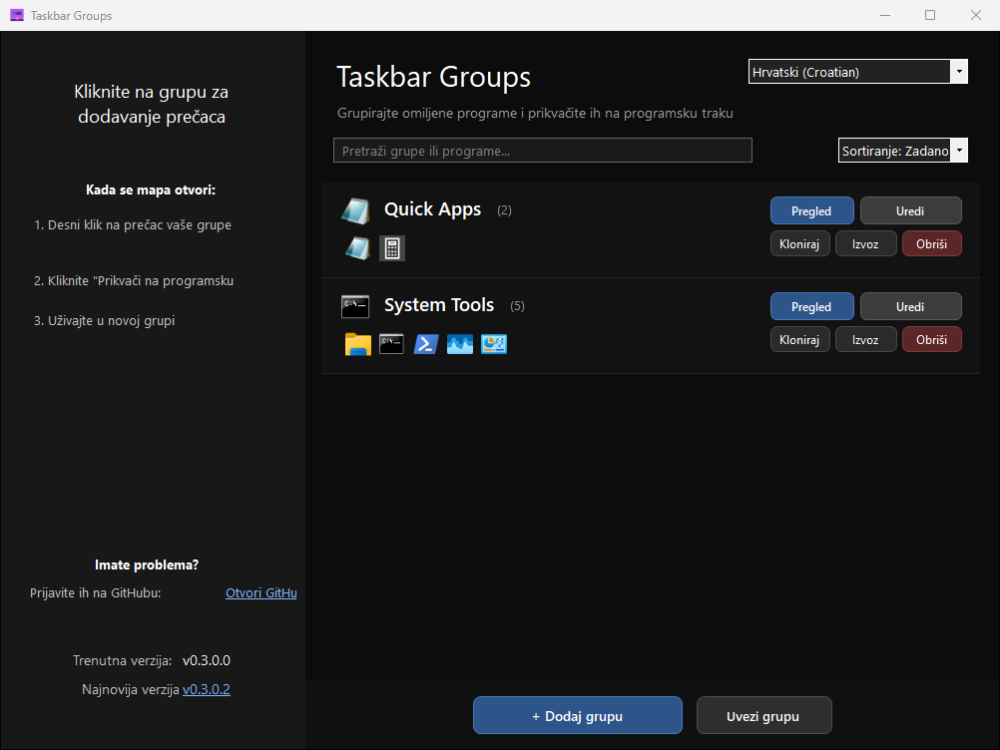
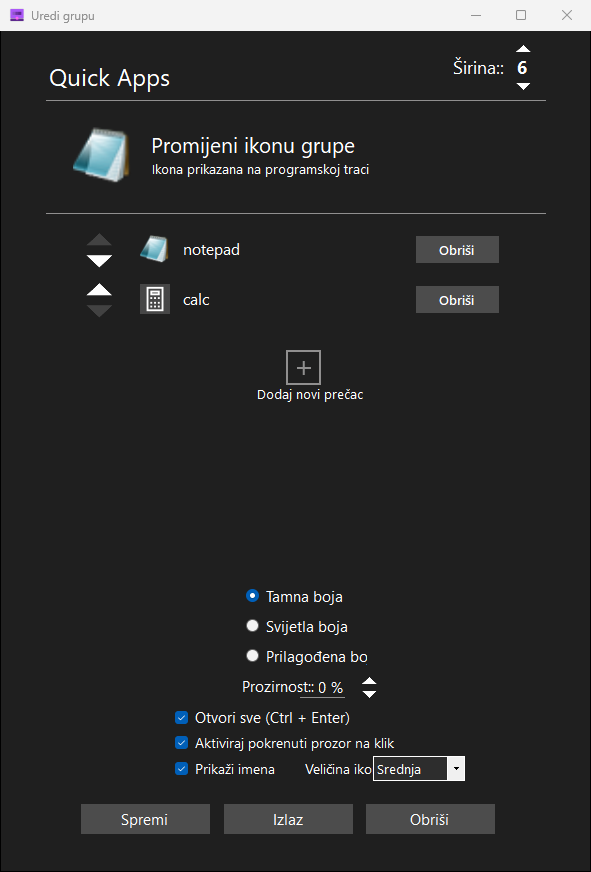

  <a href="../README.md">🇬🇧&nbsp;English</a> · <a href="README.de.md">🇩🇪&nbsp;Deutsch&nbsp;(German)</a> · <a href="README.es.md">🇪🇸&nbsp;Español&nbsp;(Spanish)</a> · <a href="README.fr.md">🇫🇷&nbsp;Français&nbsp;(French)</a> · <a href="README.it.md">🇮🇹&nbsp;Italiano&nbsp;(Italian)</a> · <a href="README.nl.md">🇳🇱&nbsp;Nederlands&nbsp;(Dutch)</a> · <a href="README.pl.md">🇵🇱&nbsp;Polski&nbsp;(Polish)</a> · <a href="README.pt-BR.md">🇧🇷&nbsp;Português&nbsp;(Brasil)&nbsp;(Portuguese)</a> · <a href="README.ru.md">🇷🇺&nbsp;Русский&nbsp;(Russian)</a> · <a href="README.uk.md">🇺🇦&nbsp;Українська&nbsp;(Ukrainian)</a> · <a href="README.tr.md">🇹🇷&nbsp;Türkçe&nbsp;(Turkish)</a> · <a href="README.az.md">🇦🇿&nbsp;Azərbaycanca&nbsp;(Azerbaijani)</a> · <b>🇭🇷&nbsp;Hrvatski&nbsp;(Croatian)</b> · <a href="README.id.md">🇮🇩&nbsp;Bahasa&nbsp;Indonesia&nbsp;(Indonesian)</a> · <a href="README.vi.md">🇻🇳&nbsp;Tiếng&nbsp;Việt&nbsp;(Vietnamese)</a> · <a href="README.th.md">🇹🇭&nbsp;ไทย&nbsp;(Thai)</a> · <a href="README.ja.md">🇯🇵&nbsp;日本語&nbsp;(Japanese)</a> · <a href="README.ko.md">🇰🇷&nbsp;한국어&nbsp;(Korean)</a> · <a href="README.zh-CN.md">🇨🇳&nbsp;简体中文&nbsp;(Chinese&nbsp;Simplified)</a> · <a href="README.zh-TW.md">🇹🇼&nbsp;繁體中文&nbsp;(Chinese&nbsp;Traditional)</a> · <a href="README.ar.md">🇸🇦&nbsp;العربية&nbsp;(Arabic)</a> · <a href="README.he.md">🇮🇱&nbsp;עברית&nbsp;(Hebrew)</a> · <a href="README.fa.md">🇮🇷&nbsp;فارسی&nbsp;(Persian)</a> · <a href="README.hi.md">🇮🇳&nbsp;हिन्दी&nbsp;(Hindi)</a> · <a href="README.ur.md">🇵🇰&nbsp;اردو&nbsp;(Urdu)</a> · <a href="README.bn.md">🇧🇩&nbsp;বাংলা&nbsp;(Bengali)</a>

  

<h1 align="center">Taskbar Groups</h1>

  <b>Taskbar Groups je lagani alat za Windows koji omogućuje stvaranje grupa prečaca na programskoj traci.</b>

  <a href="https://github.com/bigman2000/taskbar-groups-updated/releases">Preuzimanje i bilješke o izdanju</a>

> ℹ️ **Napomena:** Ovaj projekt je aktivno održavani fork repozitorija [tjackenpacken/taskbar-groups](https://github.com/tjackenpacken/taskbar-groups). Izvorni projekt dugo nije ažuriran i čini se napuštenim, pa je ovaj fork stvoren radi ispravaka i novih značajki.

---

## 📖 Sadržaj

* ➤ Instalacija
* ➤ Stvaranje prve grupe
* ➤ Dokumentacija prozora
  * Glavni prozor
  * Uređivač grupe
  * Dodatne napomene
* ➤ Predmemorija ikona
* ➤ Tipkovnički prečaci
* ➤ Struktura mapa
* ➤ Nedavna ažuriranja
* ➤ Licenca

---

## 🔽 Kako preuzeti Taskbar Groups
1. Preuzmite `.zip` datoteku iz najnovijeg izdanja (poveznica iznad)
2. Raspakirajte `.zip` arhivu u željenu mapu
3. Pokrenite `TaskbarGroups.exe` iz raspakirane mape

---

## 🛠️ Stvaranje prve grupe
1. Kliknite **"Dodaj grupu"**
2. Unesite naziv grupe i odaberite ikonu
3. Kliknite **"Dodaj prečac"** i odaberite `.exe` ili `.lnk` datoteke (ili ih povucite i ispustite)
4. Spremite grupu
5. Kliknite lijevom tipkom na karticu grupe za otvaranje mape `Shortcuts`
6. Kliknite desnom tipkom na označeni prečac i odaberite **"Prikvači na programsku traku"**

---

## 🖥️ Dokumentacija prozora
U nastavku je opis svakog prozora i njegovih mogućnosti.

#### Glavni prozor

Glavni prozor koji se otvara pokretanjem `TaskbarGroups.exe`. Omogućuje stvaranje, uvoz, pretraživanje, sortiranje, pretpregled, uređivanje, kloniranje, izvoz, brisanje grupa i promjenu jezika sučelja (26 jezika).

#### Uređivač grupe

U prozoru za stvaranje i uređivanje možete konfigurirati sve postavke grupe:

* **Naziv grupe** — Bilo koji naziv (podržava Unicode i ćirilicu, do 49 znakova).
* **Širina** — Broj prečaca po retku.
* **Promjena ikone grupe** — Kliknite (+) ili povucite `.png`, `.jpg`, `.ico`, `.exe` ili `.lnk` datoteku.
* **Dodaj prečac** — Podržava `.exe`, `.lnk`, `.url`, mape, Microsoft Store aplikacije i Steam igre.
* **Otvori sve odjednom** — Omogućuje pokretanje svih prečaca u grupi pomoću `Ctrl + Enter`.
* **Aktiviraj pokrenuti prozor** — Prebacuje na već otvoreni prozor umjesto pokretanja nove instance.
* **Prikaži nazive / Veličina ikona** — Opcionalne oznake i veličine *Kompaktno*, *Srednje* ili *Veliko*.
* **Radna mapa, putanja datoteke i argumenti** — Uredite putanju izvršne datoteke (korisno kad se program ažurira u novu mapu), radnu mapu, argumente i prilagođenu ikonu (uključujući `.exe`/`.dll`).
* **Boja pozadine i prozirnost** — Tamna, Svijetla ili Prilagođena tema s prozirnošću od 0% do 100%.

#### Dodatne napomene
Za izvršne datoteke ikone se učitavaju izravno; za `.lnk` i Microsoft Store aplikacije rješavaju se automatski.

---

## 📦 Predmemorija ikona
Ikone se spremaju u `/config/<Naziv_grupe>/Icons` za trenutačno otvaranje izbornika. Spremanjem grupe predmemorija se obnavlja.

---

## ⌨️ Tipkovnički prečaci
* **Brojčane tipke `1`–`9`, `0`** — Pokreće prečac na poziciji 1–10.
* **Strelice / `Enter` / `Esc`** — Kretanje, pokretanje ili zatvaranje izbornika.
* **`Ctrl + Enter`** — Otvara sve prečace u grupi odjednom (ako je uključeno).
* **Desni klik na prečac** — Kontekstni izbornik: *Prebaci na prozor*, *Zatvori prozor*, *Otvori novu instancu*, *Pokreni kao administrator*, *Otvori lokaciju datoteke*.

---

## 📁 Struktura mapa
* **`/config`** — Sadrži konfiguracijske mape svih grupa.
* **`/config/<Group_Name>/Icons`** — Lokalna predmemorija ikona grupe.
* **`/config/<Group_Name>/GroupIcon.ico / GroupImage.png`** — Generirane ikone grupe.
* **`/config/<Group_Name>/ObjectData.xml`** — XML datoteka s postavkama i prečacima grupe.
* **`/config/lang.txt`** — Sprema odabrani kod jezika sučelja.
* **`/JITComp`** — Kompilirani profili za brže pokretanje.
* **`/Shortcuts`** — Generirani `.lnk` prečaci za prikvačivanje na programsku traku.

---

## ✨ Nedavna ažuriranja
* **Lokalizacija (26 jezika)**: Potpuni prijevod sučelja s odabirom jezika u glavnom prozoru i sinkronizirane README datoteke na 26 jezika.
* **Ploča za pokretanje (`frmMain`)**: Opisi elemenata, prepoznavanje aktivnih aplikacija, aktivacija postojećeg prozora, kontekstni izbornik, veličine ikona, oznake, zaobljeni kutovi za Windows 11 i tipkovnička navigacija.
* **Uređivač grupe (`frmGroup`)**: Povuci-i-ispusti promjena redoslijeda s automatskim pomicanjem, uređivanje putanje izvršne datoteke, odabir ikona iz `.exe`/`.dll`/slika i Unicode podrška.
* **Glavni prozor (`frmClient`)**: Fiksni raspored, pretraživanje i sortiranje, Pretpregled, Kloniranje, Izvoz/Uvoz (`.tgroup`/`.zip`), brzo Brisanje, prilagodljivo prelamanje svih ikona u više redaka bez skrivanja i povuci-i-ispusti unutar kartice.

---

## 📜 Licenca
Ovaj projekt je licenciran pod [MIT licencom](https://github.com/bigman2000/taskbar-groups-updated/blob/master/LICENSE).

---
