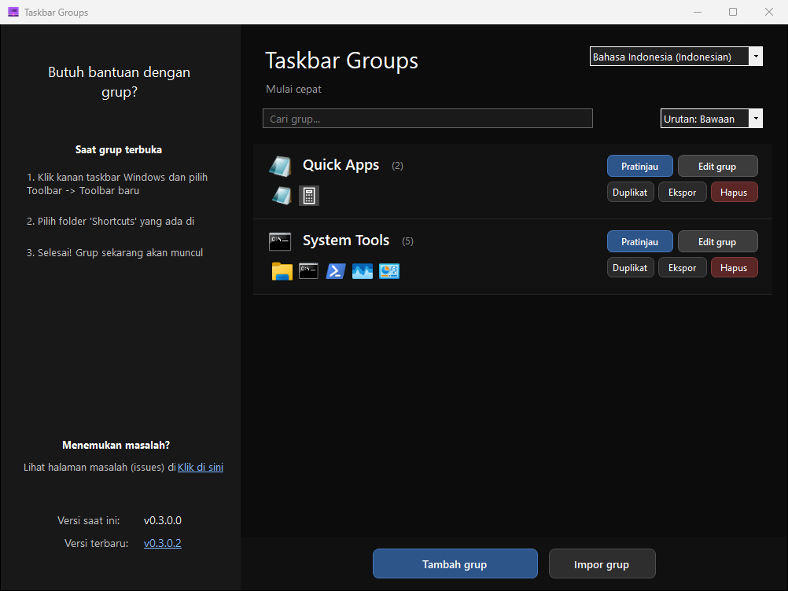
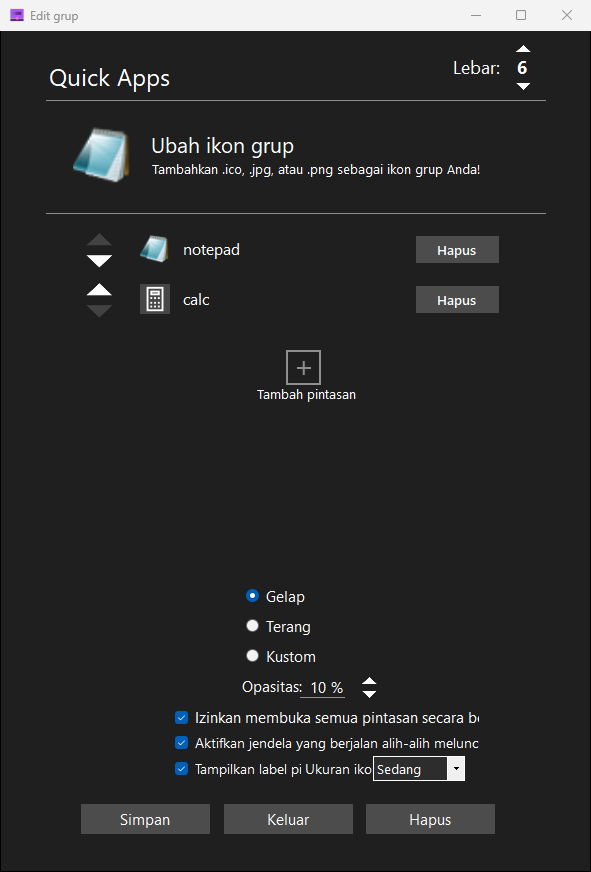

  <a href="../README.md">🇬🇧&nbsp;English</a> · <a href="README.de.md">🇩🇪&nbsp;Deutsch&nbsp;(German)</a> · <a href="README.es.md">🇪🇸&nbsp;Español&nbsp;(Spanish)</a> · <a href="README.fr.md">🇫🇷&nbsp;Français&nbsp;(French)</a> · <a href="README.it.md">🇮🇹&nbsp;Italiano&nbsp;(Italian)</a> · <a href="README.nl.md">🇳🇱&nbsp;Nederlands&nbsp;(Dutch)</a> · <a href="README.pl.md">🇵🇱&nbsp;Polski&nbsp;(Polish)</a> · <a href="README.pt-BR.md">🇧🇷&nbsp;Português&nbsp;(Brasil)&nbsp;(Portuguese)</a> · <a href="README.ru.md">🇷🇺&nbsp;Русский&nbsp;(Russian)</a> · <a href="README.uk.md">🇺🇦&nbsp;Українська&nbsp;(Ukrainian)</a> · <a href="README.tr.md">🇹🇷&nbsp;Türkçe&nbsp;(Turkish)</a> · <a href="README.az.md">🇦🇿&nbsp;Azərbaycanca&nbsp;(Azerbaijani)</a> · <a href="README.hr.md">🇭🇷&nbsp;Hrvatski&nbsp;(Croatian)</a> · <b>🇮🇩&nbsp;Bahasa&nbsp;Indonesia&nbsp;(Indonesian)</b> · <a href="README.vi.md">🇻🇳&nbsp;Tiếng&nbsp;Việt&nbsp;(Vietnamese)</a> · <a href="README.th.md">🇹🇭&nbsp;ไทย&nbsp;(Thai)</a> · <a href="README.ja.md">🇯🇵&nbsp;日本語&nbsp;(Japanese)</a> · <a href="README.ko.md">🇰🇷&nbsp;한국어&nbsp;(Korean)</a> · <a href="README.zh-CN.md">🇨🇳&nbsp;简体中文&nbsp;(Chinese&nbsp;Simplified)</a> · <a href="README.zh-TW.md">🇹🇼&nbsp;繁體中文&nbsp;(Chinese&nbsp;Traditional)</a> · <a href="README.ar.md">🇸🇦&nbsp;العربية&nbsp;(Arabic)</a> · <a href="README.he.md">🇮🇱&nbsp;עברית&nbsp;(Hebrew)</a> · <a href="README.fa.md">🇮🇷&nbsp;فارسی&nbsp;(Persian)</a> · <a href="README.hi.md">🇮🇳&nbsp;हिन्दी&nbsp;(Hindi)</a> · <a href="README.ur.md">🇵🇰&nbsp;اردو&nbsp;(Urdu)</a> · <a href="README.bn.md">🇧🇩&nbsp;বাংলা&nbsp;(Bengali)</a>

  

<h1 align="center">Taskbar Groups</h1>

  <b>Taskbar Groups adalah utilitas ringan untuk Windows guna membuat grup pintasan di taskbar.</b>

  <a href="https://github.com/bigman2000/taskbar-groups-updated/releases">Unduh & Catatan Rilis</a>

> ℹ️ **Catatan:** Proyek ini adalah fork yang dikelola secara aktif dari [tjackenpacken/taskbar-groups](https://github.com/tjackenpacken/taskbar-groups). Repositori asli sudah lama tidak diperbarui dan tampak terbengkalai, sehingga fork ini dibuat untuk memperbaiki bug dan menambah fitur baru.

---

## 📖 Daftar Isi

* ➤ Instalasi
* ➤ Membuat grup pertama
* ➤ Dokumentasi Jendela
  * Layar Utama
  * Layar Pembuatan Grup
  * Catatan Tambahan
* ➤ Cache Ikon
* ➤ Pintasan Keyboard
* ➤ Struktur Folder
* ➤ Pembaruan Terbaru
* ➤ Lisensi

---

## 🔽 Cara mengunduh Taskbar Groups
1. Unduh file `.zip` dari rilis terbaru (tautan di atas)
2. Ekstrak file `.zip` ke lokasi yang diinginkan
3. Jalankan `TaskbarGroups.exe` di folder hasil ekstrak

---

## 🛠️ Membuat grup pertama Anda
1. Klik **"Tambah grup"**
2. Beri nama grup dan pilih ikon
3. Klik **"Tambah pintasan"** dan pilih file `.exe` atau `.lnk` (atau seret dan lepas)
4. Simpan grup
5. Klik kiri kartu grup untuk membuka folder `Shortcuts`
6. Klik kanan pintasan yang disorot lalu pilih **"Sematkan ke taskbar"**

---

## 🖥️ Dokumentasi Jendela
Berikut adalah penjelasan setiap jendela dan komponennya.

#### Layar Utama

Layar utama saat membuka `TaskbarGroups.exe`. Anda dapat membuat, mengimpor, mencari, mengurutkan, melihat pratinjau, mengedit, menduplikat, mengekspor, menghapus grup, serta mengganti bahasa antarmuka (26 bahasa).

#### Layar Pembuatan Grup

Di layar pembuatan/pengeditan grup, Anda dapat mengonfigurasi grup:

* **Nama grup** — Masukkan nama apa saja (mendukung Unicode/Sirilik, maksimal 49 karakter).
* **Lebar** — Menentukan jumlah pintasan per baris.
* **Ubah ikon grup** — Klik (+) atau seret file `.png`, `.jpg`, `.ico`, `.exe`, atau `.lnk`.
* **Tambah pintasan** — Mendukung `.exe`, `.lnk`, `.url`, folder, aplikasi Microsoft Store, dan game Steam.
* **Buka semua sekaligus** — Membuka seluruh pintasan dalam grup menggunakan `Ctrl + Enter`.
* **Aktifkan jendela berjalan** — Beralih ke jendela yang sudah terbuka alih-alih membuka instans baru.
* **Tampilkan label / Ukuran ikon** — Label opsional serta ukuran *Ringkas*, *Sedang*, atau *Besar*.
* **Direktori kerja, jalur file & argumen** — Ubah jalur file program (berguna saat pembaruan aplikasi pindah folder), direktori kerja, argumen, dan ikon kustom (termasuk dari `.exe`/`.dll`).
* **Warna latar & opasitas** — Gelap, Terang, atau Kustom dengan transparansi 0%–100%.

#### Catatan Tambahan
Ikon dari file `.exe` diambil langsung; untuk `.lnk` dan aplikasi Microsoft Store diselesaikan secara otomatis.

---

## 📦 Cache Ikon
Ikon disimpan secara lokal di `/config/<Nama_Grup>/Icons` agar menu terbuka seketika. Menyimpan grup akan membuat ulang cache.

---

## ⌨️ Pintasan Keyboard
* **Tombol angka `1`–`9`, `0`** — Membuka pintasan pada posisi 1–10.
* **Tombol panah / `Enter` / `Esc`** — Navigasi, jalankan, atau tutup menu.
* **`Ctrl + Enter`** — Membuka semua pintasan dalam grup sekaligus (jika diaktifkan).
* **Klik kanan pada pintasan** — Menu konteks: *Beralih ke jendela*, *Tutup jendela*, *Buka instans baru*, *Jalankan sebagai administrator*, *Buka lokasi file*.

---

## 📁 Struktur Folder
* **`/config`** — Menyimpan folder konfigurasi untuk setiap grup.
* **`/config/<Group_Name>/Icons`** — Cache ikon lokal untuk grup.
* **`/config/<Group_Name>/GroupIcon.ico / GroupImage.png`** — Ikon yang dihasilkan untuk grup.
* **`/config/<Group_Name>/ObjectData.xml`** — Konfigurasi XML untuk pintasan dan pengaturan grup.
* **`/config/lang.txt`** — Menyimpan kode bahasa yang dipilih.
* **`/JITComp`** — Profil terkompilasi untuk startup lebih cepat.
* **`/Shortcuts`** — Pintasan `.lnk` untuk disematkan ke taskbar Windows.

---

## ✨ Pembaruan Terbaru
* **Lokalisasi (26 Bahasa)**: Terjemahan antarmuka lengkap dengan pemilih bahasa di jendela utama serta README yang disinkronkan dalam 26 bahasa.
* **Panel Peluncuran (`frmMain`)**: Tooltip, deteksi aplikasi aktif, opsi aktifkan jendela berjalan, menu konteks klik kanan, ukuran ikon, label, sudut membulat Windows 11, dan navigasi keyboard.
* **Editor Grup (`frmGroup`)**: Pengurutan seret-dan-lepas dengan gulir otomatis, pengeditan jalur file program, pemilih ikon `.exe`/`.dll`/gambar, dan dukungan Unicode.
* **Jendela Utama (`frmClient`)**: Tata letak tetap, pencarian & pengurutan, Pratinjau, Duplikat, Ekspor/Impor (`.tgroup`/`.zip`), Hapus cepat, pembungkusan ikon multi-baris responsif tanpa pemotongan, dan pengurutan seret-dan-lepas di kartu.

---

## 📜 Lisensi
Proyek ini dilisensikan di bawah [Lisensi MIT](https://github.com/bigman2000/taskbar-groups-updated/blob/master/LICENSE).

---
