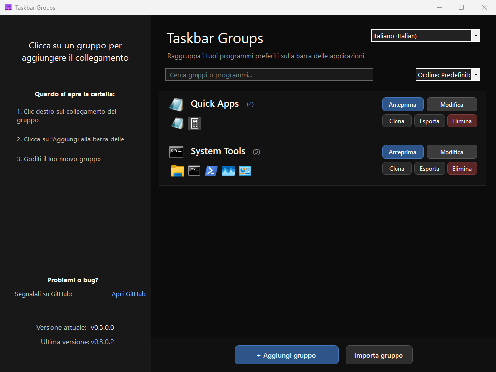
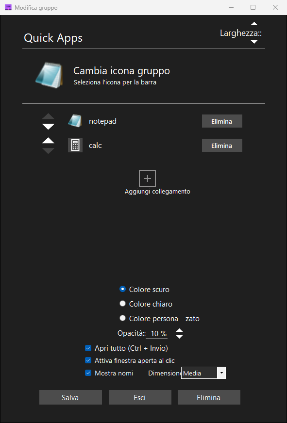

  <a href="../README.md">🇬🇧&nbsp;English</a> · <a href="README.de.md">🇩🇪&nbsp;Deutsch&nbsp;(German)</a> · <a href="README.es.md">🇪🇸&nbsp;Español&nbsp;(Spanish)</a> · <a href="README.fr.md">🇫🇷&nbsp;Français&nbsp;(French)</a> · <b>🇮🇹&nbsp;Italiano&nbsp;(Italian)</b> · <a href="README.nl.md">🇳🇱&nbsp;Nederlands&nbsp;(Dutch)</a> · <a href="README.pl.md">🇵🇱&nbsp;Polski&nbsp;(Polish)</a> · <a href="README.pt-BR.md">🇧🇷&nbsp;Português&nbsp;(Brasil)&nbsp;(Portuguese)</a> · <a href="README.ru.md">🇷🇺&nbsp;Русский&nbsp;(Russian)</a> · <a href="README.uk.md">🇺🇦&nbsp;Українська&nbsp;(Ukrainian)</a> · <a href="README.tr.md">🇹🇷&nbsp;Türkçe&nbsp;(Turkish)</a> · <a href="README.az.md">🇦🇿&nbsp;Azərbaycanca&nbsp;(Azerbaijani)</a> · <a href="README.hr.md">🇭🇷&nbsp;Hrvatski&nbsp;(Croatian)</a> · <a href="README.id.md">🇮🇩&nbsp;Bahasa&nbsp;Indonesia&nbsp;(Indonesian)</a> · <a href="README.vi.md">🇻🇳&nbsp;Tiếng&nbsp;Việt&nbsp;(Vietnamese)</a> · <a href="README.th.md">🇹🇭&nbsp;ไทย&nbsp;(Thai)</a> · <a href="README.ja.md">🇯🇵&nbsp;日本語&nbsp;(Japanese)</a> · <a href="README.ko.md">🇰🇷&nbsp;한국어&nbsp;(Korean)</a> · <a href="README.zh-CN.md">🇨🇳&nbsp;简体中文&nbsp;(Chinese&nbsp;Simplified)</a> · <a href="README.zh-TW.md">🇹🇼&nbsp;繁體中文&nbsp;(Chinese&nbsp;Traditional)</a> · <a href="README.ar.md">🇸🇦&nbsp;العربية&nbsp;(Arabic)</a> · <a href="README.he.md">🇮🇱&nbsp;עברית&nbsp;(Hebrew)</a> · <a href="README.fa.md">🇮🇷&nbsp;فارسی&nbsp;(Persian)</a> · <a href="README.hi.md">🇮🇳&nbsp;हिन्दी&nbsp;(Hindi)</a> · <a href="README.ur.md">🇵🇰&nbsp;اردو&nbsp;(Urdu)</a> · <a href="README.bn.md">🇧🇩&nbsp;বাংলা&nbsp;(Bengali)</a>

  

<h1 align="center">Taskbar Groups</h1>

  <b>Taskbar Groups è un'utility leggera per Windows che consente di creare gruppi di collegamenti sulla barra delle applicazioni.</b>

  <a href="https://github.com/bigman2000/taskbar-groups-updated/releases">Download e note di rilascio</a>

> ℹ️ **Nota:** Questo progetto è un fork mantenuto attivamente di [tjackenpacken/taskbar-groups](https://github.com/tjackenpacken/taskbar-groups). Il repository originale non viene aggiornato da molto tempo e sembra abbandonato; questo fork nasce per correggere bug e aggiungere nuove funzioni.

---

## 📖 Indice

* ➤ Installazione
* ➤ Creare il primo gruppo
* ➤ Documentazione finestre
  * Schermata principale
  * Creazione gruppo
  * Note aggiuntive
* ➤ Cache icone
* ➤ Scorciatoie da tastiera
* ➤ Struttura cartelle
* ➤ Aggiornamenti recenti
* ➤ Licenza

---

## 🔽 Come scaricare Taskbar Groups
1. Scarica il file `.zip` dall'ultima release (link sopra)
2. Estrai l'archivio nella cartella desiderata
3. Avvia `TaskbarGroups.exe` dalla cartella estratta

---

## 🛠️ Creare il primo gruppo
1. Clicca su **"Aggiungi gruppo"**
2. Assegna un nome e un'icona al gruppo
3. Clicca su **"Aggiungi collegamento"** e seleziona `.exe` o `.lnk` (oppure trascinali)
4. Salva il gruppo
5. Clicca sulla scheda del gruppo per aprire la cartella `Shortcuts`
6. Fai clic destro sul collegamento selezionato e scegli **"Aggiungi alla barra delle applicazioni"**

---

## 🖥️ Documentazione delle finestre
Di seguito la descrizione di ogni finestra e dei suoi componenti.

#### Schermata principale

Finestra principale aperta all'avvio di `TaskbarGroups.exe`. Consente di creare, importare, cercare, ordinare, visualizzare in anteprima, modificare, clonare, esportare o eliminare gruppi e cambiare lingua (26 lingue).

#### Creazione gruppo

Finestra di creazione e modifica di un gruppo:

* **Nome del gruppo** — Qualsiasi nome (incluso Unicode/cirillico, max 49 caratteri).
* **Larghezza** — Numero di collegamenti per riga.
* **Cambia icona gruppo** — Clicca (+) o trascina file `.png`, `.jpg`, `.ico`, `.exe` o `.lnk`.
* **Aggiungi collegamento** — Supporta `.exe`, `.lnk`, `.url`, cartelle, app Microsoft Store e giochi Steam.
* **Apri tutti insieme** — Consente di avviare tutti i collegamenti con `Ctrl + Invio`.
* **Attiva finestra in esecuzione** — Passa alla finestra già aperta invece di avviare una nuova istanza.
* **Mostra etichette / Dimensione icona** — Etichette opzionali e dimensioni *Compatta*, *Media* o *Grande*.
* **Directory di lavoro e argomenti** — Personalizza directory, parametri e icona (anche da `.exe`/`.dll`).
* **Colore e opacità** — Scuro, Chiaro o Personalizzato con trasparenza da 0% a 100%.

#### Note aggiuntive
Le icone degli eseguibili vengono estratte direttamente; per `.lnk` e app Microsoft Store vengono risolte automaticamente.

---

## 📦 Cache icone
Le icone sono memorizzate in `/config/<Nome_Gruppo>/Icons` per un'apertura istantanea. Il salvataggio rigenera la cache.

---

## ⌨️ Scorciatoie da tastiera
* **Tasti numerici `1`–`9`, `0`** — Avvia il collegamento alle posizioni 1–10.
* **Frecce / `Invio` / `Esc`** — Naviga, avvia o chiudi il menu.
* **`Ctrl + Invio`** — Apre tutti i collegamenti del gruppo contemporaneamente.
* **Clic destro su un collegamento** — Menu contestuale: *Passa alla finestra*, *Chiudi finestra*, *Nuova istanza*, *Esegui come amministratore*, *Apri percorso file*.

---

## 📁 Struttura delle cartelle
* **`/config`** — Contiene le cartelle di configurazione dei gruppi.
* **`/config/<Group_Name>/Icons`** — Cache locale delle icone del gruppo.
* **`/config/<Group_Name>/GroupIcon.ico / GroupImage.png`** — Icone generate per il gruppo.
* **`/config/<Group_Name>/ObjectData.xml`** — Configurazione XML del gruppo.
* **`/config/lang.txt`** — Salva la lingua selezionata.
* **`/JITComp`** — Profili compilati per avvio rapido.
* **`/Shortcuts`** — Collegamenti `.lnk` da fissare alla barra delle applicazioni.

---

## ✨ Aggiornamenti recenti
* **Localizzazione (26 lingue)**: Traduzione completa dell'interfaccia con selettore lingua e README sincronizzati in 26 lingue.
* **Pannello di avvio (`frmMain`)**: Tooltip, rilevamento app attive, attivazione finestra esistente, menu contestuale, dimensioni icone, etichette, angoli arrotondati Windows 11 e navigazione da tastiera.
* **Editor gruppo (`frmGroup`)**: Riordino drag-and-drop con scorrimento automatico, selettore icone da `.exe`/`.dll`/immagini e supporto Unicode.
* **Finestra principale (`frmClient`)**: Layout fisso, ricerca e ordinamento, Anteprima, Clona, Esporta/Importa (`.tgroup`/`.zip`), Eliminazione rapida, disposizione su più righe adattiva delle icone e riordino diretto nella scheda.

---

## 📜 Licenza
Questo progetto è distribuito con [Licenza MIT](https://github.com/bigman2000/taskbar-groups-updated/blob/master/LICENSE).

---
