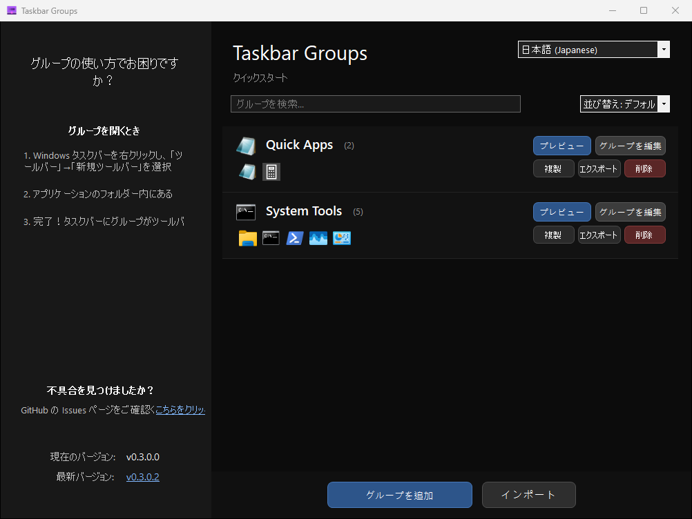
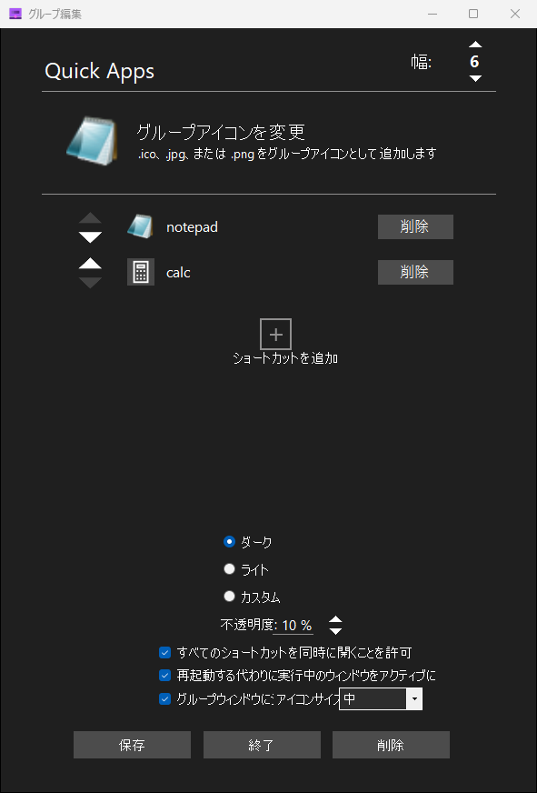

  <a href="../README.md">🇬🇧&nbsp;English</a> · <a href="README.de.md">🇩🇪&nbsp;Deutsch&nbsp;(German)</a> · <a href="README.es.md">🇪🇸&nbsp;Español&nbsp;(Spanish)</a> · <a href="README.fr.md">🇫🇷&nbsp;Français&nbsp;(French)</a> · <a href="README.it.md">🇮🇹&nbsp;Italiano&nbsp;(Italian)</a> · <a href="README.nl.md">🇳🇱&nbsp;Nederlands&nbsp;(Dutch)</a> · <a href="README.pl.md">🇵🇱&nbsp;Polski&nbsp;(Polish)</a> · <a href="README.pt-BR.md">🇧🇷&nbsp;Português&nbsp;(Brasil)&nbsp;(Portuguese)</a> · <a href="README.ru.md">🇷🇺&nbsp;Русский&nbsp;(Russian)</a> · <a href="README.uk.md">🇺🇦&nbsp;Українська&nbsp;(Ukrainian)</a> · <a href="README.tr.md">🇹🇷&nbsp;Türkçe&nbsp;(Turkish)</a> · <a href="README.az.md">🇦🇿&nbsp;Azərbaycanca&nbsp;(Azerbaijani)</a> · <a href="README.hr.md">🇭🇷&nbsp;Hrvatski&nbsp;(Croatian)</a> · <a href="README.id.md">🇮🇩&nbsp;Bahasa&nbsp;Indonesia&nbsp;(Indonesian)</a> · <a href="README.vi.md">🇻🇳&nbsp;Tiếng&nbsp;Việt&nbsp;(Vietnamese)</a> · <a href="README.th.md">🇹🇭&nbsp;ไทย&nbsp;(Thai)</a> · <b>🇯🇵&nbsp;日本語&nbsp;(Japanese)</b> · <a href="README.ko.md">🇰🇷&nbsp;한국어&nbsp;(Korean)</a> · <a href="README.zh-CN.md">🇨🇳&nbsp;简体中文&nbsp;(Chinese&nbsp;Simplified)</a> · <a href="README.zh-TW.md">🇹🇼&nbsp;繁體中文&nbsp;(Chinese&nbsp;Traditional)</a> · <a href="README.ar.md">🇸🇦&nbsp;العربية&nbsp;(Arabic)</a> · <a href="README.he.md">🇮🇱&nbsp;עברית&nbsp;(Hebrew)</a> · <a href="README.fa.md">🇮🇷&nbsp;فارسی&nbsp;(Persian)</a> · <a href="README.hi.md">🇮🇳&nbsp;हिन्दी&nbsp;(Hindi)</a> · <a href="README.ur.md">🇵🇰&nbsp;اردو&nbsp;(Urdu)</a> · <a href="README.bn.md">🇧🇩&nbsp;বাংলা&nbsp;(Bengali)</a>

  

<h1 align="center">Taskbar Groups</h1>

  <b>Taskbar Groups は、Windows のタスクバーにショートカットグループを作成できる軽量ユーティリティです。</b>

  <a href="https://github.com/bigman2000/taskbar-groups-updated/releases">ダウンロードとリリースノート</a>

> ℹ️ **注記:** このプロジェクトは [tjackenpacken/taskbar-groups](https://github.com/tjackenpacken/taskbar-groups) のフォークです。元のリポジトリは長期間更新されておらず開発が停止しているように見えるため、バグ修正と新機能追加のために作成されました。

---

## 📖 目次

* ➤ インストール
* ➤ 最初のグループを作成する
* ➤ 画面ドキュメント
  * メイン画面
  * グループ作成画面
  * 補足事項
* ➤ アイコンキャッシュ
* ➤ ショートカットキー
* ➤ フォルダー構成
* ➤ 最近の更新
* ➤ ライセンス

---

## 🔽 Taskbar Groups のダウンロード方法
1. 最新リリースから `.zip` ファイルをダウンロードします（上のリンク）
2. `.zip` ファイルを任意のフォルダーに展開します
3. 展開したフォルダー内の `TaskbarGroups.exe` を実行します

---

## 🛠️ 最初のグループを作成する
1. 「**グループを追加**」をクリックします
2. グループ名とアイコンを設定します
3. 「**ショートカットを追加**」をクリックし、`.exe` または `.lnk` ファイルを選択します（ドラッグ＆ドロップも可）
4. グループを保存します
5. グループカードを左クリックして `Shortcuts` フォルダーを開きます
6. 選択されたショートカットを右クリックし、「**タスクバーにピン留めする**」を選択します

---

## 🖥️ 画面ドキュメント
各ウィンドウとその機能についての説明です。

#### メイン画面

`TaskbarGroups.exe` 起動時に表示されるメイン画面です。グループの作成、インポート、検索、並び替え、プレビュー、編集、複製、エクスポート、削除、および表示言語の切り替え（26言語対応）が行えます。

#### グループ作成画面

グループ作成・編集画面では以下の項目を設定できます：

* **グループ名** — 任意の名前を入力できます（Unicode・キリル文字・日本語対応、最大49文字）。
* **幅** — 1行あたりに表示するショートカットの数を指定します。
* **グループアイコンを変更** — (+) をクリックするか、`.png`、`.jpg`、`.ico`、`.exe`、`.lnk` ファイルをドラッグ＆ドロップします。
* **ショートカットを追加** — `.exe`、`.lnk`、`.url`、フォルダー、Microsoft Store アプリ、Steam ゲームに対応しています。
* **すべて同時に開く** — `Ctrl + Enter` でグループ内のすべてのショートカットを一度に起動できます。
* **実行中のウィンドウをアクティブにする** — 新しいインスタンスを起動する代わりに、既に開いているウィンドウへ切り替えます。
* **名前を表示 / アイコンサイズ** — アイコン下のラベル表示の有無や、*コンパクト*・*中*・*大* のサイズを選べます。
* **作業フォルダー、実行ファイルパス、引数** — 実行ファイルのパス編集（アプリ更新でフォルダーが変わった際に便利）、作業フォルダー、起動引数、カスタムアイコン（`.exe`/`.dll` からの抽出含む）を設定できます。
* **背景色と不透明度** — ダーク、ライト、カスタムカラーおよび 0%〜100% の透明度を指定できます。

#### 補足事項
実行ファイルからはアイコンを直接抽出し、`.lnk` や Microsoft Store アプリは対象アイコンを自動解決します。

---

## 📦 アイコンキャッシュ
アイコンは `/config/<グループ名>/Icons` にキャッシュされ、ポップアップを瞬時に開けます。グループを保存するとキャッシュが再生成されます。

---

## ⌨️ ショートカットキー
* **数字キー `1`〜`9`, `0`** — 1〜10番目のショートカットを起動します。
* **矢印キー / `Enter` / `Esc`** — 項目間の移動、起動、またはメニューを閉じます。
* **`Ctrl + Enter`** — グループ内のすべてのショートカットを同時に開きます（有効時）。
* **ショートカットを右クリック** — コンテキストメニュー：*ウィンドウに切り替え*、*ウィンドウを閉じる*、*新しいインスタンスを開く*、*管理者として実行*、*ファイルの場所を開く*。

---

## 📁 フォルダー構成
* **`/config`** — 作成した各グループの設定フォルダーを保存します。
* **`/config/<Group_Name>/Icons`** — グループ内のショートカット用ローカルアイコンキャッシュです。
* **`/config/<Group_Name>/GroupIcon.ico / GroupImage.png`** — グループ用に生成されたアイコンファイルです。
* **`/config/<Group_Name>/ObjectData.xml`** — ショートカットや外観設定を保存する XML ファイルです。
* **`/config/lang.txt`** — 選択された表示言語コードを保存します。
* **`/JITComp`** — 起動高速化のためのコンパイル済みプロファイルです。
* **`/Shortcuts`** — タスクバーにピン留めするための `.lnk` ショートカットを格納します。

---

## ✨ 最近の更新
* **多言語対応（26言語）**: メイン画面の言語セレクターと全26言語の同期済み README を追加しました。
* **ランチャーパネル (`frmMain`)**: ツールチップ、実行中アプリの検出、既存ウィンドウのアクティブ化、右クリックメニュー、アイコンサイズ設定、ラベル表示、Windows 11 角丸、キーボード操作に対応しました。
* **グループエディター (`frmGroup`)**: 自動スクロール付きドラッグ＆ドロップ並び替え、実行ファイルパスの編集、`.exe`/`.dll`/画像からのアイコン選択、Unicode 対応を追加しました。
* **メイン画面 (`frmClient`)**: 固定レイアウト、検索・並び替え、プレビュー、複製、エクスポート/インポート (`.tgroup`/`.zip`)、クイック削除、ウィンドウ幅に応じたアイコンの複数行折り返し表示、カード内でのドラッグ＆ドロップ並び替えに対応しました。

---

## 📜 ライセンス
本プロジェクトは [MIT ライセンス](https://github.com/bigman2000/taskbar-groups-updated/blob/master/LICENSE) の下で公開されています。

---
