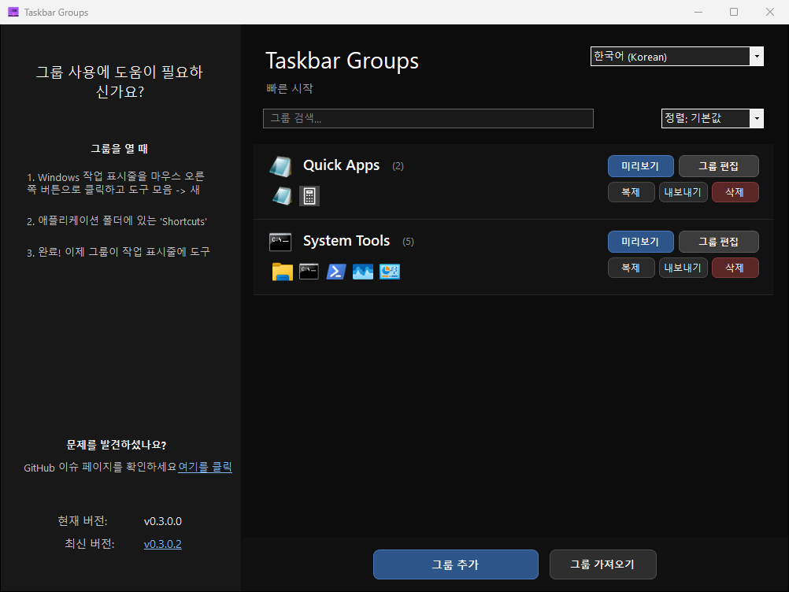
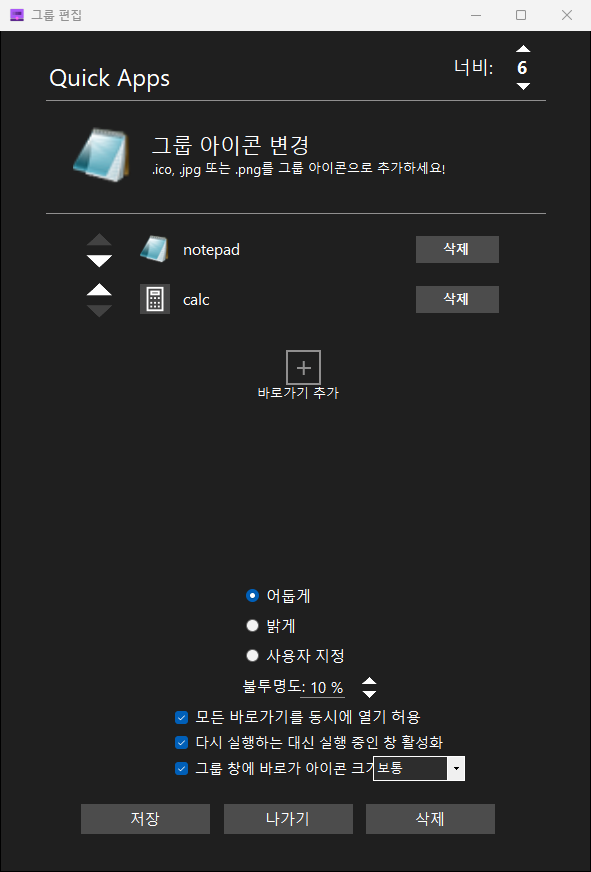

  <a href="../README.md">🇬🇧&nbsp;English</a> · <a href="README.de.md">🇩🇪&nbsp;Deutsch&nbsp;(German)</a> · <a href="README.es.md">🇪🇸&nbsp;Español&nbsp;(Spanish)</a> · <a href="README.fr.md">🇫🇷&nbsp;Français&nbsp;(French)</a> · <a href="README.it.md">🇮🇹&nbsp;Italiano&nbsp;(Italian)</a> · <a href="README.nl.md">🇳🇱&nbsp;Nederlands&nbsp;(Dutch)</a> · <a href="README.pl.md">🇵🇱&nbsp;Polski&nbsp;(Polish)</a> · <a href="README.pt-BR.md">🇧🇷&nbsp;Português&nbsp;(Brasil)&nbsp;(Portuguese)</a> · <a href="README.ru.md">🇷🇺&nbsp;Русский&nbsp;(Russian)</a> · <a href="README.uk.md">🇺🇦&nbsp;Українська&nbsp;(Ukrainian)</a> · <a href="README.tr.md">🇹🇷&nbsp;Türkçe&nbsp;(Turkish)</a> · <a href="README.az.md">🇦🇿&nbsp;Azərbaycanca&nbsp;(Azerbaijani)</a> · <a href="README.hr.md">🇭🇷&nbsp;Hrvatski&nbsp;(Croatian)</a> · <a href="README.id.md">🇮🇩&nbsp;Bahasa&nbsp;Indonesia&nbsp;(Indonesian)</a> · <a href="README.vi.md">🇻🇳&nbsp;Tiếng&nbsp;Việt&nbsp;(Vietnamese)</a> · <a href="README.th.md">🇹🇭&nbsp;ไทย&nbsp;(Thai)</a> · <a href="README.ja.md">🇯🇵&nbsp;日本語&nbsp;(Japanese)</a> · <b>🇰🇷&nbsp;한국어&nbsp;(Korean)</b> · <a href="README.zh-CN.md">🇨🇳&nbsp;简体中文&nbsp;(Chinese&nbsp;Simplified)</a> · <a href="README.zh-TW.md">🇹🇼&nbsp;繁體中文&nbsp;(Chinese&nbsp;Traditional)</a> · <a href="README.ar.md">🇸🇦&nbsp;العربية&nbsp;(Arabic)</a> · <a href="README.he.md">🇮🇱&nbsp;עברית&nbsp;(Hebrew)</a> · <a href="README.fa.md">🇮🇷&nbsp;فارسی&nbsp;(Persian)</a> · <a href="README.hi.md">🇮🇳&nbsp;हिन्दी&nbsp;(Hindi)</a> · <a href="README.ur.md">🇵🇰&nbsp;اردو&nbsp;(Urdu)</a> · <a href="README.bn.md">🇧🇩&nbsp;বাংলা&nbsp;(Bengali)</a>

  

<h1 align="center">Taskbar Groups</h1>

  <b>Taskbar Groups는 Windows 작업 표시줄에 바로가기 그룹을 만들 수 있는 가벼운 유틸리티입니다.</b>

  <a href="https://github.com/bigman2000/taskbar-groups-updated/releases">다운로드 및 릴리스 정보</a>

> ℹ️ **참고:** 이 프로젝트는 [tjackenpacken/taskbar-groups](https://github.com/tjackenpacken/taskbar-groups)의 포크입니다. 원본 저장소가 오랫동안 업데이트되지 않아 방치된 것으로 보여 버그 수정 및 새 기능 추가를 위해 제작되었습니다.

---

## 📖 목차

* ➤ 설치
* ➤ 첫 번째 그룹 만들기
* ➤ 화면 설명서
  * 메인 화면
  * 그룹 생성 화면
  * 추가 참고 사항
* ➤ 아이콘 캐싱
* ➤ 단축키
* ➤ 폴더 구조
* ➤ 최근 업데이트
* ➤ 라이선스

---

## 🔽 Taskbar Groups 다운로드 방법
1. 최신 릴리스에서 `.zip` 파일을 다운로드합니다 (위 링크)
2. 원하는 위치에 `.zip` 파일의 압축을 풉니다
3. 압축을 푼 폴더에서 `TaskbarGroups.exe`를 실행합니다

---

## 🛠️ 첫 번째 그룹 만들기
1. **"그룹 추가"**를 클릭합니다
2. 그룹 이름과 아이콘을 지정합니다
3. **"바로가기 추가"**를 클릭하고 `.exe` 또는 `.lnk` 파일을 선택합니다 (드래그 앤 드롭 가능)
4. 그룹을 저장합니다
5. 그룹 카드를 왼쪽 클릭하여 `Shortcuts` 폴더를 엽니다
6. 선택된 바로가기를 마우스 오른쪽 버튼으로 클릭하고 **"작업 표시줄에 고정"**을 선택합니다

---

## 🖥️ 화면 설명서
각 창과 기능에 대한 설명입니다.

#### 메인 화면

`TaskbarGroups.exe`를 실행하면 열리는 메인 화면입니다. 그룹 생성, 가져오기, 검색, 정렬, 미리보기, 편집, 복제, 내보내기, 삭제 및 UI 언어 전환(26개 언어 지원)을 수행할 수 있습니다.

#### 그룹 생성 화면

그룹 생성/편집 창에서 다음 항목을 설정할 수 있습니다:

* **그룹 이름** — 원하는 이름을 입력합니다 (Unicode 및 한글/키릴 문자 지원, 최대 49자).
* **너비** — 한 줄에 표시할 바로가기 개수입니다.
* **그룹 아이콘 변경** — (+)를 클릭하거나 `.png`, `.jpg`, `.ico`, `.exe`, `.lnk` 파일을 끌어다 놓습니다.
* **바로가기 추가** — `.exe`, `.lnk`, `.url`, 폴더, Microsoft Store 앱 및 Steam 게임을 지원합니다.
* **모두 동시에 열기** — `Ctrl + Enter`로 그룹 내 모든 바로가기를 한 번에 실행합니다.
* **실행 중인 창 활성화** — 새로 실행하는 대신 이미 열려 있는 창으로 전환합니다.
* **이름 표시 / 아이콘 크기** — 아이콘 아래 이름 표시 여부와 *작게*, *보통*, *크게* 크기를 선택합니다.
* **작업 디렉터리, 실행 파일 경로 및 인수** — 실행 파일 경로 편집(업데이트로 폴더가 바뀔 때 유용), 작업 디렉터리, 실행 인수, 사용자 지정 아이콘(`.exe`/`.dll` 추출 포함)을 설정합니다.
* **배경색 및 불투명도** — 어둡게, 밝게, 사용자 지정 색상과 0%~100% 투명도를 설정합니다.

#### 추가 참고 사항
실행 파일은 아이콘을 직접 추출하며, `.lnk` 및 Microsoft Store 앱은 대상 아이콘을 자동으로 찾습니다.

---

## 📦 아이콘 캐싱
아이콘은 `/config/<그룹_이름>/Icons`에 로컬 캐시되어 팝업이 즉시 열립니다. 그룹을 저장하면 캐시가 다시 생성됩니다.

---

## ⌨️ 단축키
* **숫자 키 `1`–`9`, `0`** — 1~10번째 바로가기를 실행합니다.
* **방향키 / `Enter` / `Esc`** — 항목 이동, 실행 또는 메뉴 닫기.
* **`Ctrl + Enter`** — 그룹 내 모든 바로가기를 한 번에 엽니다 (설정 시).
* **바로가기 우클릭** — 컨텍스트 메뉴: *창으로 전환*, *창 닫기*, *새 인스턴스 열기*, *관리자 권한으로 실행*, *파일 위치 열기*.

---

## 📁 폴더 구조
* **`/config`** — 생성된 각 그룹의 설정 폴더를 저장합니다.
* **`/config/<Group_Name>/Icons`** — 그룹 바로가기의 로컬 아이콘 캐시입니다.
* **`/config/<Group_Name>/GroupIcon.ico / GroupImage.png`** — 그룹용으로 생성된 아이콘 파일입니다.
* **`/config/<Group_Name>/ObjectData.xml`** — 바로가기 및 그룹 설정을 저장하는 XML 파일입니다.
* **`/config/lang.txt`** — 선택한 UI 언어 코드를 저장합니다.
* **`/JITComp`** — 빠른 시작을 위한 컴파일된 프로필 데이터입니다.
* **`/Shortcuts`** — 작업 표시줄에 고정하기 위한 `.lnk` 바로가기입니다.

---

## ✨ 최근 업데이트
* **다국어 지원 (26개 언어)**: 메인 창 언어 선택기와 26개 언어의 동기화된 README를 추가했습니다.
* **실행 패널 (`frmMain`)**: 툴팁, 실행 중인 앱 감지, 실행 창 활성화, 우클릭 컨텍스트 메뉴, 아이콘 크기 설정, 이름 레이블, Windows 11 둥근 모서리 및 키보드 탐색을 추가했습니다.
* **그룹 편집기 (`frmGroup`)**: 자동 스크롤 드래그 앤 드롭 순서 변경, 실행 파일 경로 편집, `.exe`/`.dll`/이미지 아이콘 선택기, Unicode 지원을 추가했습니다.
* **메인 창 (`frmClient`)**: 고정 레이아웃, 검색 및 정렬, 미리보기, 복제, 내보내기/가져오기(`.tgroup`/`.zip`), 빠른 삭제, 창 크기에 맞춘 다중 행 아이콘 줄바꿈 및 카드 내 드래그 앤 드롭 순서 변경을 지원합니다.

---

## 📜 라이선스
이 프로젝트는 [MIT 라이선스](https://github.com/bigman2000/taskbar-groups-updated/blob/master/LICENSE)에 따라 배포됩니다.

---
