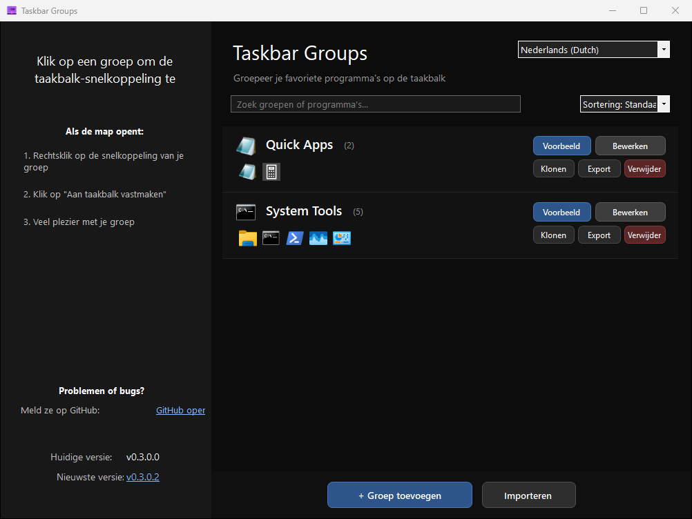
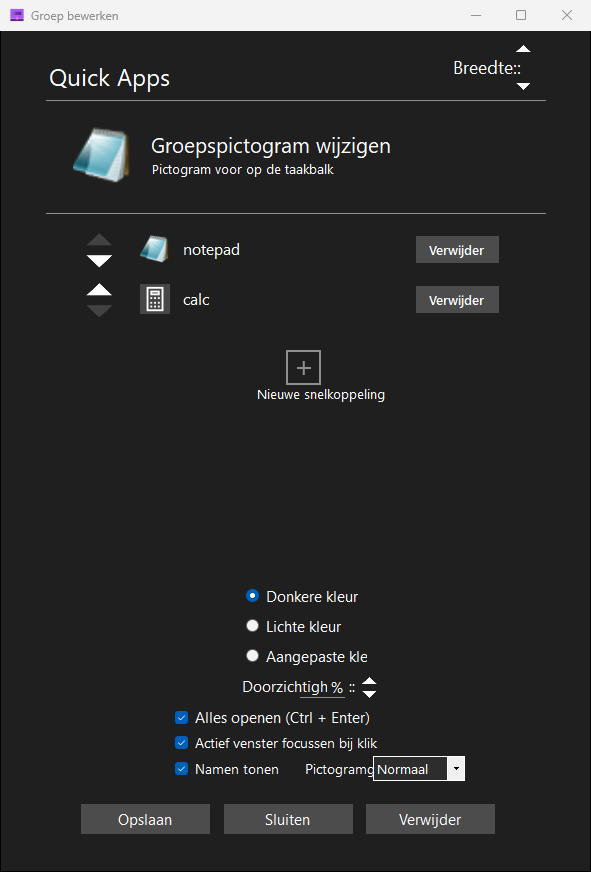

  <a href="../README.md">🇬🇧&nbsp;English</a> · <a href="README.de.md">🇩🇪&nbsp;Deutsch&nbsp;(German)</a> · <a href="README.es.md">🇪🇸&nbsp;Español&nbsp;(Spanish)</a> · <a href="README.fr.md">🇫🇷&nbsp;Français&nbsp;(French)</a> · <a href="README.it.md">🇮🇹&nbsp;Italiano&nbsp;(Italian)</a> · <b>🇳🇱&nbsp;Nederlands&nbsp;(Dutch)</b> · <a href="README.pl.md">🇵🇱&nbsp;Polski&nbsp;(Polish)</a> · <a href="README.pt-BR.md">🇧🇷&nbsp;Português&nbsp;(Brasil)&nbsp;(Portuguese)</a> · <a href="README.ru.md">🇷🇺&nbsp;Русский&nbsp;(Russian)</a> · <a href="README.uk.md">🇺🇦&nbsp;Українська&nbsp;(Ukrainian)</a> · <a href="README.tr.md">🇹🇷&nbsp;Türkçe&nbsp;(Turkish)</a> · <a href="README.az.md">🇦🇿&nbsp;Azərbaycanca&nbsp;(Azerbaijani)</a> · <a href="README.hr.md">🇭🇷&nbsp;Hrvatski&nbsp;(Croatian)</a> · <a href="README.id.md">🇮🇩&nbsp;Bahasa&nbsp;Indonesia&nbsp;(Indonesian)</a> · <a href="README.vi.md">🇻🇳&nbsp;Tiếng&nbsp;Việt&nbsp;(Vietnamese)</a> · <a href="README.th.md">🇹🇭&nbsp;ไทย&nbsp;(Thai)</a> · <a href="README.ja.md">🇯🇵&nbsp;日本語&nbsp;(Japanese)</a> · <a href="README.ko.md">🇰🇷&nbsp;한국어&nbsp;(Korean)</a> · <a href="README.zh-CN.md">🇨🇳&nbsp;简体中文&nbsp;(Chinese&nbsp;Simplified)</a> · <a href="README.zh-TW.md">🇹🇼&nbsp;繁體中文&nbsp;(Chinese&nbsp;Traditional)</a> · <a href="README.ar.md">🇸🇦&nbsp;العربية&nbsp;(Arabic)</a> · <a href="README.he.md">🇮🇱&nbsp;עברית&nbsp;(Hebrew)</a> · <a href="README.fa.md">🇮🇷&nbsp;فارسی&nbsp;(Persian)</a> · <a href="README.hi.md">🇮🇳&nbsp;हिन्दी&nbsp;(Hindi)</a> · <a href="README.ur.md">🇵🇰&nbsp;اردو&nbsp;(Urdu)</a> · <a href="README.bn.md">🇧🇩&nbsp;বাংলা&nbsp;(Bengali)</a>

  

<h1 align="center">Taskbar Groups</h1>

  <b>Taskbar Groups is een lichtgewicht Windows-hulpprogramma om snelkoppelingsgroepen op de taakbalk te maken.</b>

  <a href="https://github.com/bigman2000/taskbar-groups-updated/releases">Downloaden & release-opmerkingen</a>

> ℹ️ **Opmerking:** Dit project is een actief onderhouden fork van [tjackenpacken/taskbar-groups](https://github.com/tjackenpacken/taskbar-groups). De oorspronkelijke repository is al lange tijd niet bijgewerkt en lijkt verlaten; deze fork is gemaakt om bugs op te lossen en nieuwe functies toe te voegen.

---

## 📖 Inhoudsopgave

* ➤ Installatie
* ➤ Eerste groep maken
* ➤ Vensterdocumentatie
  * Hoofdscherm
  * Groepseditor
  * Extra opmerkingen
* ➤ Pictogramcache
* ➤ Sneltoetsen
* ➤ Mappenstructuur
* ➤ Recente updates
* ➤ Licentie

---

## 🔽 Taskbar Groups downloaden
1. Download het `.zip`-bestand van de nieuwste release (link hierboven)
2. Pak het `.zip`-bestand uit naar een gewenste map
3. Start `TaskbarGroups.exe` in de uitgepakte map

---

## 🛠️ Je eerste groep maken
1. Klik op **"Groep toevoegen"**
2. Geef de groep een naam en kies een pictogram
3. Klik op **"Snelkoppeling toevoegen"** en selecteer `.exe`- of `.lnk`-bestanden (of sleep ze)
4. Sla de groep op
5. Klik op de groepskaart om de map `Shortcuts` te openen
6. Klik met de rechtermuisknop op de snelkoppeling en kies **"Aan taakbalk vastmaken"**

---

## 🖥️ Vensterdocumentatie
Hieronder vindt u uitleg over elk venster en de onderdelen.

#### Hoofdscherm

Het hoofdscherm van `TaskbarGroups.exe`. Hier kunt u groepen maken, importeren, zoeken, sorteren, bekijken, bewerken, klonen, exporteren, verwijderen en de taal wijzigen (26 talen).

#### Groepseditor

In de groepseditor configureert u uw groep:

* **Groepsnaam** — Elke gewenste naam (inclusief Unicode/Cyrillisch, max. 49 tekens).
* **Breedte** — Aantal snelkoppelingen per rij.
* **Groepspictogram wijzigen** — Klik op (+) of sleep `.png`, `.jpg`, `.ico`, `.exe` of `.lnk`.
* **Snelkoppeling toevoegen** — Ondersteunt `.exe`, `.lnk`, `.url`, mappen, Windows Store-apps en Steam-games.
* **Alles tegelijk openen** — Opent alle snelkoppelingen met `Ctrl + Enter`.
* **Actief venster activeren** — Schakelt over naar het geopende venster in plaats van opnieuw te starten.
* **Labels tonen / Pictogramgrootte** — Optionele labels en groottes *Compact*, *Normaal* of *Groot*.
* **Werkmap en argumenten** — Pas werkmap, startparameters en eigen pictogram (ook uit `.exe`/`.dll`) aan.
* **Kleur en dekking** — Donker, Licht of Aangepast met 0–100% transparantie.

#### Extra opmerkingen
Pictogrammen van `.exe`-bestanden worden direct opgehaald; voor `.lnk` en Microsoft Store-apps gebeurt dit automatisch.

---

## 📦 Pictogramcache
Pictogrammen worden lokaal opgeslagen in `/config/<Groepsnaam>/Icons` zodat het menu direct opent. Opslaan vernieuwt de cache.

---

## ⌨️ Sneltoetsen
* **Cijfertoetsen `1`–`9`, `0`** — Opent snelkoppeling 1–10.
* **Pijltjestoetsen / `Enter` / `Esc`** — Navigeren, starten of sluiten.
* **`Ctrl + Enter`** — Opent alle snelkoppelingen tegelijk (indien ingeschakeld).
* **Rechtermuisklik op snelkoppeling** — Contextmenu: *Naar venster schakelen*, *Venster sluiten*, *Nieuwe instantie*, *Als administrator uitvoeren*, *Bestandslocatie openen*.

---

## 📁 Mappenstructuur
* **`/config`** — Bevat de configuratiemappen van alle groepen.
* **`/config/<Group_Name>/Icons`** — Lokale pictogramcache van de groep.
* **`/config/<Group_Name>/GroupIcon.ico / GroupImage.png`** — Gegenereerd groepspictogram.
* **`/config/<Group_Name>/ObjectData.xml`** — XML-instellingen van de groep.
* **`/config/lang.txt`** — Slaat de geselecteerde taal op.
* **`/JITComp`** — Gecompileerde opstartprofielen.
* **`/Shortcuts`** — `.lnk`-snelkoppelingen om vast te maken aan de taakbalk.

---

## ✨ Recente updates
* **Lokalisatie (26 talen)**: Volledige UI-vertaling met taalkiezer en gesynchroniseerde README's in 26 talen.
* **Startpaneel (`frmMain`)**: Tooltips, detectie van actieve apps, actief venster activeren, contextmenu, pictogramgroottes, labels, Windows 11 afgeronde hoeken en toetsenbordnavigatie.
* **Groepseditor (`frmGroup`)**: Slepen en neerzetten om te herordenen met auto-scroll, pictogramkiezer voor `.exe`/`.dll`/afbeeldingen en Unicode-ondersteuning.
* **Hoofdvenster (`frmClient`)**: Vast kop-/voetpaneel, zoeken & sorteren, Voorbeeld, Klonen, Exporteren/Importeren (`.tgroup`/`.zip`), snel Verwijderen, automatische terugloop van pictogrammen over meerdere rijen en direct herordenen op kaarten.

---

## 📜 Licentie
Dit project valt onder de [MIT-licentie](https://github.com/bigman2000/taskbar-groups-updated/blob/master/LICENSE).

---
