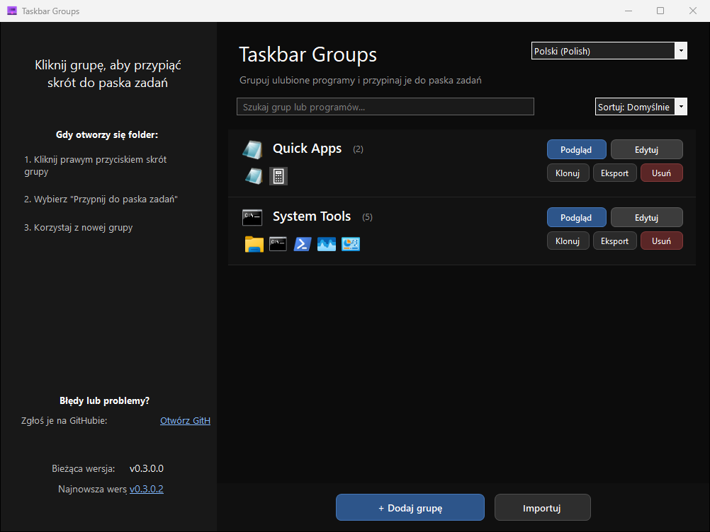
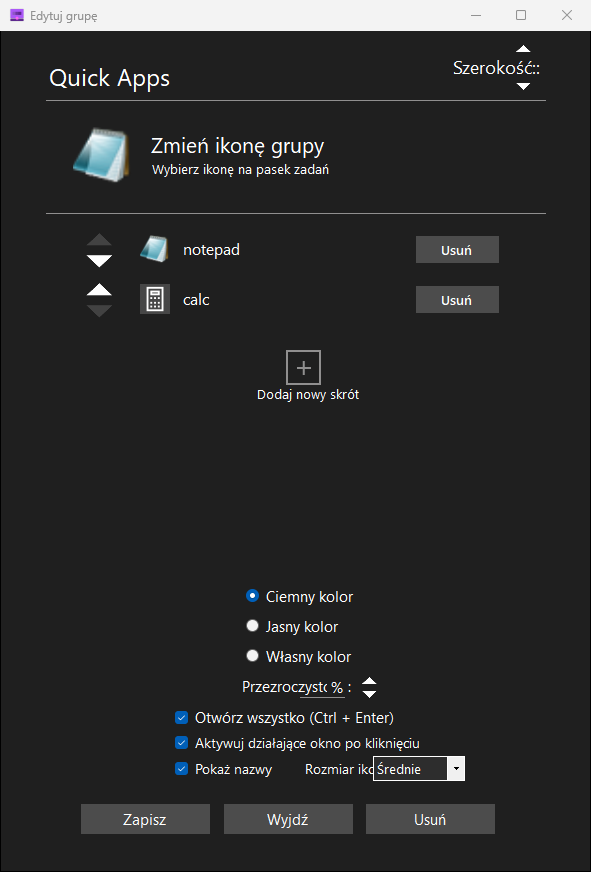

  <a href="../README.md">🇬🇧&nbsp;English</a> · <a href="README.de.md">🇩🇪&nbsp;Deutsch&nbsp;(German)</a> · <a href="README.es.md">🇪🇸&nbsp;Español&nbsp;(Spanish)</a> · <a href="README.fr.md">🇫🇷&nbsp;Français&nbsp;(French)</a> · <a href="README.it.md">🇮🇹&nbsp;Italiano&nbsp;(Italian)</a> · <a href="README.nl.md">🇳🇱&nbsp;Nederlands&nbsp;(Dutch)</a> · <b>🇵🇱&nbsp;Polski&nbsp;(Polish)</b> · <a href="README.pt-BR.md">🇧🇷&nbsp;Português&nbsp;(Brasil)&nbsp;(Portuguese)</a> · <a href="README.ru.md">🇷🇺&nbsp;Русский&nbsp;(Russian)</a> · <a href="README.uk.md">🇺🇦&nbsp;Українська&nbsp;(Ukrainian)</a> · <a href="README.tr.md">🇹🇷&nbsp;Türkçe&nbsp;(Turkish)</a> · <a href="README.az.md">🇦🇿&nbsp;Azərbaycanca&nbsp;(Azerbaijani)</a> · <a href="README.hr.md">🇭🇷&nbsp;Hrvatski&nbsp;(Croatian)</a> · <a href="README.id.md">🇮🇩&nbsp;Bahasa&nbsp;Indonesia&nbsp;(Indonesian)</a> · <a href="README.vi.md">🇻🇳&nbsp;Tiếng&nbsp;Việt&nbsp;(Vietnamese)</a> · <a href="README.th.md">🇹🇭&nbsp;ไทย&nbsp;(Thai)</a> · <a href="README.ja.md">🇯🇵&nbsp;日本語&nbsp;(Japanese)</a> · <a href="README.ko.md">🇰🇷&nbsp;한국어&nbsp;(Korean)</a> · <a href="README.zh-CN.md">🇨🇳&nbsp;简体中文&nbsp;(Chinese&nbsp;Simplified)</a> · <a href="README.zh-TW.md">🇹🇼&nbsp;繁體中文&nbsp;(Chinese&nbsp;Traditional)</a> · <a href="README.ar.md">🇸🇦&nbsp;العربية&nbsp;(Arabic)</a> · <a href="README.he.md">🇮🇱&nbsp;עברית&nbsp;(Hebrew)</a> · <a href="README.fa.md">🇮🇷&nbsp;فارسی&nbsp;(Persian)</a> · <a href="README.hi.md">🇮🇳&nbsp;हिन्दी&nbsp;(Hindi)</a> · <a href="README.ur.md">🇵🇰&nbsp;اردو&nbsp;(Urdu)</a> · <a href="README.bn.md">🇧🇩&nbsp;বাংলা&nbsp;(Bengali)</a>

  

<h1 align="center">Taskbar Groups</h1>

  <b>Taskbar Groups to lekkie narzędzie dla systemu Windows umożliwiające tworzenie grup skrótów na pasku zadań.</b>

  <a href="https://github.com/bigman2000/taskbar-groups-updated/releases">Pobieranie i informacje o wydaniu</a>

> ℹ️ **Uwaga:** Ten projekt jest aktywnie rozwijanym forkiem [tjackenpacken/taskbar-groups](https://github.com/tjackenpacken/taskbar-groups). Oryginalne repozytorium od dawna nie było aktualizowane i wygląda na porzucone, dlatego powstał ten fork, aby naprawić błędy i dodać nowe funkcje.

---

## 📖 Spis treści

* ➤ Instalacja
* ➤ Tworzenie pierwszej grupy
* ➤ Dokumentacja okien
  * Okno główne
  * Edytor grupy
  * Dodatkowe informacje
* ➤ Pamięć podręczna ikon
* ➤ Skróty klawiszowe
* ➤ Struktura folderów
* ➤ Ostatnie zmiany
* ➤ Licencja

---

## 🔽 Jak pobrać Taskbar Groups
1. Pobierz plik `.zip` z najnowszego wydania (link powyżej)
2. Rozpakuj archiwum do wybranego folderu
3. Uruchom `TaskbarGroups.exe` z rozpakowanego folderu

---

## 🛠️ Tworzenie pierwszej grupy
1. Kliknij **"Dodaj grupę"**
2. Nadaj grupie nazwę i wybierz ikonę
3. Kliknij **"Dodaj skrót"** i wybierz pliki `.exe` lub `.lnk` (lub przeciągnij je)
4. Zapisz grupę
5. Kliknij kartę grupy, aby otworzyć folder `Shortcuts`
6. Kliknij prawym przyciskiem wyróżniony skrót i wybierz **"Przypnij do paska zadań"**

---

## 🖥️ Dokumentacja okien
Poniżej znajduje się opis poszczególnych okien i ich funkcji.

#### Okno główne

Okno główne uruchamiane przez `TaskbarGroups.exe`. Pozwala tworzyć, importować, wyszukiwać, sortować, podglądać, edytować, klonować, eksportować i usuwać grupy oraz zmieniać język (26 języków).

#### Edytor grupy

Okno tworzenia i edycji grupy:

* **Nazwa grupy** — Dowolna nazwa (w tym Unicode/cyrylica/polskie znaki, do 49 znaków).
* **Szerokość** — Liczba skrótów w jednym wierszu.
* **Zmień ikonę grupy** — Kliknij (+) lub przeciągnij plik `.png`, `.jpg`, `.ico`, `.exe` lub `.lnk`.
* **Dodaj skrót** — Obsługuje `.exe`, `.lnk`, `.url`, foldery, aplikacje Microsoft Store i gry Steam.
* **Otwórz wszystkie naraz** — Uruchamia wszystkie skróty w grupie za pomocą `Ctrl + Enter`.
* **Aktywuj działające okno** — Przełącza na uruchomione okno zamiast otwierać nową instancję.
* **Pokaż nazwy / Rozmiar ikon** — Opcjonalne etykiety oraz rozmiary *Kompaktowy*, *Średni* lub *Duży*.
* **Katalog roboczy i argumenty** — Konfiguracja katalogu roboczego, parametrów oraz własnej ikony (także z `.exe`/`.dll`).
* **Kolor tła i przezroczystość** — Ciemny, Jasny lub Własny oraz przezroczystość od 0% do 100%.

#### Dodatkowe informacje
Ikony plików `.exe` są pobierane bezpośrednio; dla `.lnk` i aplikacji Microsoft Store są wykrywane automatycznie.

---

## 📦 Pamięć podręczna ikon
Ikony są buforowane w `/config/<Nazwa_Grupy>/Icons`, co zapewnia natychmiastowe otwieranie menu. Zapis grupy odświeża pamięć podręczną.

---

## ⌨️ Skróty klawiszowe
* **Klawisze `1`–`9`, `0`** — Uruchamia skrót na pozycji 1–10.
* **Strzałki / `Enter` / `Esc`** — Nawigacja, uruchomienie lub zamknięcie okna.
* **`Ctrl + Enter`** — Otwiera wszystkie skróty w grupie jednocześnie (jeśli włączono).
* **Prawy przycisk myszy na skrócie** — Menu kontekstowe: *Przełącz do okna*, *Zamknij okno*, *Otwórz nową instancję*, *Uruchom jako administrator*, *Otwórz lokalizację pliku*.

---

## 📁 Struktura folderów
* **`/config`** — Zawiera foldery konfiguracyjne grup.
* **`/config/<Group_Name>/Icons`** — Lokalna pamięć podręczna ikon grupy.
* **`/config/<Group_Name>/GroupIcon.ico / GroupImage.png`** — Wygenerowane ikony grupy.
* **`/config/<Group_Name>/ObjectData.xml`** — Konfiguracja XML grupy i skrótów.
* **`/config/lang.txt`** — Zapisuje wybrany język interfejsu.
* **`/JITComp`** — Profile przyspieszające uruchamianie.
* **`/Shortcuts`** — Skróty `.lnk` do przypięcia na pasku zadań.

---

## ✨ Ostatnie zmiany
* **Lokalizacja (26 języków)**: Pełne tłumaczenie interfejsu z wyborem języka w oknie głównym oraz zsynchronizowane pliki README w 26 językach.
* **Panel uruchamiania (`frmMain`)**: Podpowiedzi, wykrywanie uruchomionych aplikacji, aktywacja istniejącego okna, menu kontekstowe, rozmiary ikon, etykiety, zaokrąglenia Windows 11 i obsługa klawiatury.
* **Edytor grupy (`frmGroup`)**: Zmiana kolejności metodą przeciągnij i upuść z automatycznym przewijaniem, wybór ikon z `.exe`/`.dll`/obrazów oraz obsługa Unicode.
* **Okno główne (`frmClient`)**: Stały nagłówek i stopka, wyszukiwanie i sortowanie, Podgląd, Klonowanie, Eksport/Import (`.tgroup`/`.zip`), szybkie Usuwanie, zawijanie ikon do kolejnych wierszy przy zmianie rozmiaru okna i zmiana kolejności ikon na karcie.

---

## 📜 Licencja
Projekt udostępniany na [licencji MIT](https://github.com/bigman2000/taskbar-groups-updated/blob/master/LICENSE).

---
