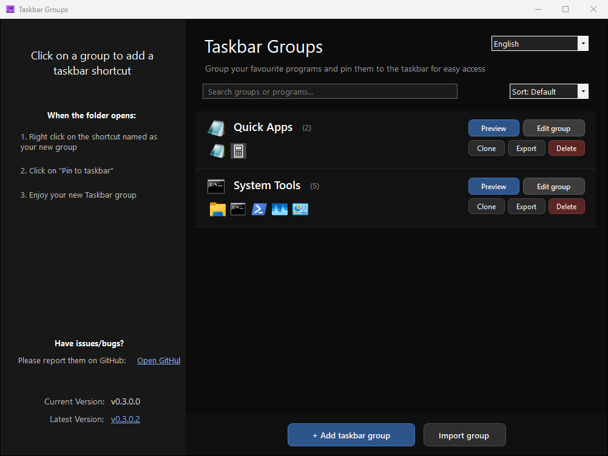
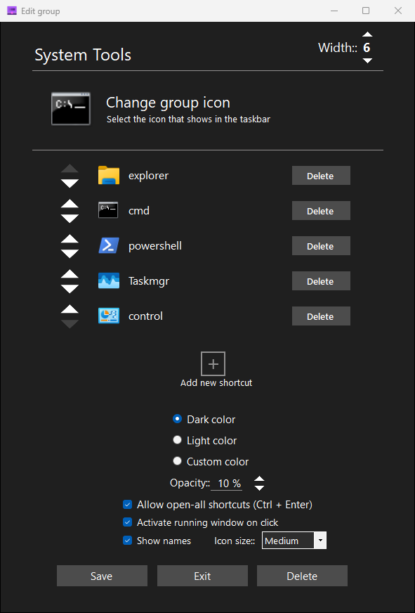

  <a href="../README.md">🇬🇧 English</a> · <a href="README.de.md">🇩🇪 Deutsch</a> · <a href="README.es.md">🇪🇸 Español</a> · <a href="README.fr.md">🇫🇷 Français</a> · <a href="README.it.md">🇮🇹 Italiano</a> · <a href="README.nl.md">🇳🇱 Nederlands</a> · <a href="README.pl.md">🇵🇱 Polski</a> · <a href="README.pt-BR.md">🇧🇷 Português (Brasil)</a> · <b>🇷🇺 Русский</b> · <a href="README.uk.md">🇺🇦 Українська</a> · <a href="README.tr.md">🇹🇷 Türkçe</a> · <a href="README.az.md">🇦🇿 Azərbaycanca</a> · <a href="README.hr.md">🇭🇷 Hrvatski</a> · <a href="README.id.md">🇮🇩 Bahasa Indonesia</a> · <a href="README.vi.md">🇻🇳 Tiếng Việt</a> · <a href="README.th.md">🇹🇭 ไทย</a> · <a href="README.ja.md">🇯🇵 日本語</a> · <a href="README.ko.md">🇰🇷 한국어</a> · <a href="README.zh-CN.md">🇨🇳 简体中文</a> · <a href="README.zh-TW.md">🇹🇼 繁體中文</a> · <a href="README.ar.md">🇸🇦 العربية</a> · <a href="README.he.md">🇮🇱 עברית</a> · <a href="README.fa.md">🇮🇷 فارسی</a> · <a href="README.hi.md">🇮🇳 हिन्दी</a> · <a href="README.ur.md">🇵🇰 اردو</a> · <a href="README.bn.md">🇧🇩 বাংলা</a>

  

<h1 align="center">Taskbar Groups</h1>

  <b>Taskbar Groups — лёгкая утилита для Windows, позволяющая создавать группы ярлыков на панели задач.</b>

  <a href="https://github.com/bigman2000/taskbar-groups-updated/releases">Скачать и список изменений</a>

> ℹ️ **Примечание:** Этот проект является активно развиваемым форком [tjackenpacken/taskbar-groups](https://github.com/tjackenpacken/taskbar-groups). Оригинальный проект давно не обновлялся и выглядит заброшенным, поэтому был создан данный форк для исправления ошибок и добавления новых возможностей.

---

## 📖 Оглавление

* ➤ Установка
* ➤ Создание первой группы
* ➤ Документация по окнам
  * Главное окно
  * Окно создания группы
  * Дополнительно
* ➤ Кэширование иконок
* ➤ Горячие клавиши
* ➤ Структура папок
* ➤ Недавние обновления
* ➤ Лицензия

---

## 🔽 Как скачать Taskbar Groups
1. Скачайте `.zip`-архив последнего релиза (ссылка выше)
2. Распакуйте `.zip`-архив в удобную папку
3. Запустите `TaskbarGroups.exe` из распакованной папки

---

## 🛠️ Создание первой группы
1. Нажмите **"Добавить группу"**
2. Укажите имя группы и выберите иконку
3. Нажмите **"Добавить ярлык"** и выберите `.exe` или `.lnk` (или перетащите их в область ярлыков)
4. Сохраните группу
5. Нажмите левой кнопкой на карточку группы, чтобы открыть папку `Shortcuts`
6. Нажмите правой кнопкой по выделенному ярлыку и выберите **"Закрепить на панели задач"**

---

## 🖥️ Документация по окнам
Ниже описаны все окна программы и их элементы.

#### Главное окно

Главное окно управления группами при запуске `TaskbarGroups.exe`. Здесь можно создавать, импортировать, искать, сортировать, просматривать, редактировать, клонировать, экспортировать и удалять группы, а также переключать язык интерфейса (26 языков).

#### Окно создания группы

В окне создания и редактирования настраиваются все параметры группы:

* **Название группы** — Любое имя (поддерживаются кириллица и Unicode, до 49 символов).
* **Ширина** — Количество ярлыков в одном ряду.
* **Изменить иконку группы** — Нажмите (+) или перетащите `.png`, `.jpg`, `.ico`, `.exe` или `.lnk`.
* **Добавить ярлык** — Поддерживаются `.exe`, `.lnk`, `.url`, папки, приложения Microsoft Store и игры Steam.
* **Открывать все ярлыки сразу** — Позволяет запускать все элементы группы комбинацией `Ctrl + Enter`.
* **Активировать запущенное окно** — Переключает на уже открытое окно вместо запуска новой копии.
* **Показывать подписи / Размер иконок** — Опциональные подписи и размеры *Компактный*, *Средний*, *Крупный*.
* **Рабочая директория и аргументы** — Настройка рабочего каталога, параметров запуска и собственной иконки (включая выбор из `.exe`/`.dll`).
* **Цвет фона и прозрачность** — Тёмная, Светлая или Своя тема и прозрачность от 0% до 100%.

#### Дополнительно
Для `.exe` иконка извлекается напрямую; для `.lnk` и приложений Microsoft Store приложение автоматически находит иконку цели или пакета.

---

## 📦 Кэширование иконок
Иконки кэшируются в `/config/<Имя_группы>/Icons`, благодаря чему меню открывается мгновенно. Сохранение группы обновляет кэш.

---

## ⌨️ Горячие клавиши
* **Цифры `1`–`9`, `0`** — Запускает ярлык на позиции 1–10.
* **Стрелки / `Enter` / `Esc`** — Навигация, запуск выбранного ярлыка или закрытие окна.
* **`Ctrl + Enter`** — Открывает все ярлыки группы сразу (если включено в настройках).
* **Правый клик по ярлыку** — Контекстное меню: *Переключиться на окно*, *Закрыть окно*, *Открыть новый экземпляр*, *Запуск от имени администратора*, *Открыть расположение файла*.

---

## 📁 Структура папок
* **`/config`** — Папки конфигурации всех созданных групп.
* **`/config/<Group_Name>/Icons`** — Локальный кэш иконок группы.
* **`/config/<Group_Name>/GroupIcon.ico / GroupImage.png`** — Иконки самой группы.
* **`/config/<Group_Name>/ObjectData.xml`** — XML-файл со списком ярлыков и настройками группы.
* **`/config/lang.txt`** — Хранит выбранный код языка интерфейса.
* **`/JITComp`** — Профили компиляции для ускорения запуска.
* **`/Shortcuts`** — Готовые `.lnk`-ярлыки для закрепления на панели задач.

---

## ✨ Недавние обновления
* **Локализация (26 языков)**: Добавлена полная локализация интерфейса и выбор языка в главном окне, а также синхронизированы README на 26 языках.
* **Панель запуска (`frmMain`)**: Подсказки при наведении, подсветка запущенных приложений, активация открытого окна, контекстное меню, настройка размера иконок, подписи, скругление углов Windows 11 и навигация с клавиатуры.
* **Редактор группы (`frmGroup`)**: Перетаскивание ярлыков с автопрокруткой, выбор иконок из `.exe`/`.dll`/изображений, поддержка кириллицы и Unicode.
* **Главное окно (`frmClient`)**: Фиксированные шапка и низ окна, поиск и сортировка, Предпросмотр, Клонирование, Экспорт/Импорт (`.tgroup`/`.zip`), быстрое Удаление, бейдж `+N` и перетаскивание иконок прямо на карточке группы.

---

## 📜 Лицензия
Проект распространяется под [лицензией MIT](https://github.com/bigman2000/taskbar-groups-updated/blob/master/LICENSE).

---
