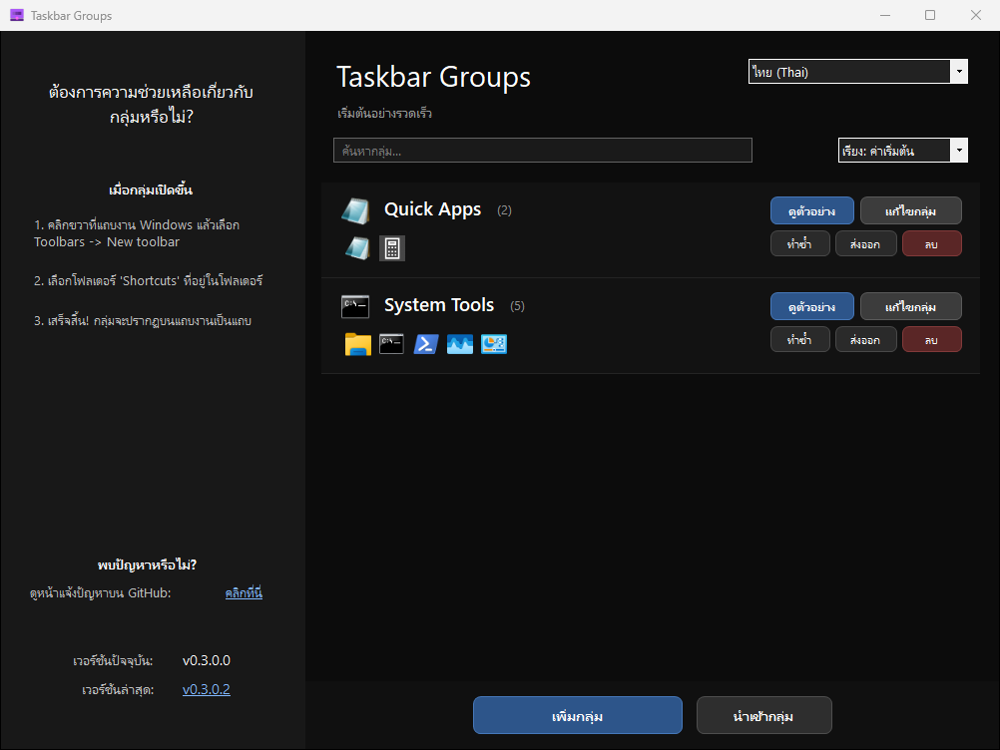
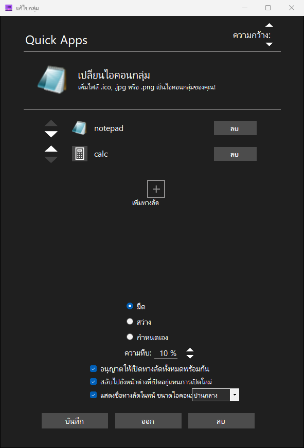

  <a href="../README.md">🇬🇧&nbsp;English</a> · <a href="README.de.md">🇩🇪&nbsp;Deutsch&nbsp;(German)</a> · <a href="README.es.md">🇪🇸&nbsp;Español&nbsp;(Spanish)</a> · <a href="README.fr.md">🇫🇷&nbsp;Français&nbsp;(French)</a> · <a href="README.it.md">🇮🇹&nbsp;Italiano&nbsp;(Italian)</a> · <a href="README.nl.md">🇳🇱&nbsp;Nederlands&nbsp;(Dutch)</a> · <a href="README.pl.md">🇵🇱&nbsp;Polski&nbsp;(Polish)</a> · <a href="README.pt-BR.md">🇧🇷&nbsp;Português&nbsp;(Brasil)&nbsp;(Portuguese)</a> · <a href="README.ru.md">🇷🇺&nbsp;Русский&nbsp;(Russian)</a> · <a href="README.uk.md">🇺🇦&nbsp;Українська&nbsp;(Ukrainian)</a> · <a href="README.tr.md">🇹🇷&nbsp;Türkçe&nbsp;(Turkish)</a> · <a href="README.az.md">🇦🇿&nbsp;Azərbaycanca&nbsp;(Azerbaijani)</a> · <a href="README.hr.md">🇭🇷&nbsp;Hrvatski&nbsp;(Croatian)</a> · <a href="README.id.md">🇮🇩&nbsp;Bahasa&nbsp;Indonesia&nbsp;(Indonesian)</a> · <a href="README.vi.md">🇻🇳&nbsp;Tiếng&nbsp;Việt&nbsp;(Vietnamese)</a> · <b>🇹🇭&nbsp;ไทย&nbsp;(Thai)</b> · <a href="README.ja.md">🇯🇵&nbsp;日本語&nbsp;(Japanese)</a> · <a href="README.ko.md">🇰🇷&nbsp;한국어&nbsp;(Korean)</a> · <a href="README.zh-CN.md">🇨🇳&nbsp;简体中文&nbsp;(Chinese&nbsp;Simplified)</a> · <a href="README.zh-TW.md">🇹🇼&nbsp;繁體中文&nbsp;(Chinese&nbsp;Traditional)</a> · <a href="README.ar.md">🇸🇦&nbsp;العربية&nbsp;(Arabic)</a> · <a href="README.he.md">🇮🇱&nbsp;עברית&nbsp;(Hebrew)</a> · <a href="README.fa.md">🇮🇷&nbsp;فارسی&nbsp;(Persian)</a> · <a href="README.hi.md">🇮🇳&nbsp;हिन्दी&nbsp;(Hindi)</a> · <a href="README.ur.md">🇵🇰&nbsp;اردو&nbsp;(Urdu)</a> · <a href="README.bn.md">🇧🇩&nbsp;বাংলা&nbsp;(Bengali)</a>

  

<h1 align="center">Taskbar Groups</h1>

  <b>Taskbar Groups เป็นโปรแกรมขนาดเบาสำหรับ Windows เพื่อสร้างกลุ่มทางลัดบนแถบงาน</b>

  <a href="https://github.com/bigman2000/taskbar-groups-updated/releases">ดาวน์โหลดและบันทึกการเผยแพร่</a>

> ℹ️ **หมายเหตุ:** โปรเจกต์นี้เป็น fork ที่พัฒนาต่ออย่างต่อเนื่องจาก [tjackenpacken/taskbar-groups](https://github.com/tjackenpacken/taskbar-groups) เนื่องจากโปรเจกต์ต้นฉบับไม่ได้อัปเดตมานานและดูเหมือนถูกทิ้งร้าง จึงสร้าง fork นี้ขึ้นเพื่อแก้ไขบั๊กและเพิ่มฟีเจอร์ใหม่

---

## 📖 สารบัญ

* ➤ การติดตั้ง
* ➤ การสร้างกลุ่มแรก
* ➤ เอกสารประกอบหน้าต่าง
  * หน้าจอหลัก
  * หน้าจอสร้างกลุ่ม
  * หมายเหตุเพิ่มเติม
* ➤ การแคชไอคอน
* ➤ ปุ่มลัด
* ➤ โครงสร้างโฟลเดอร์
* ➤ อัปเดตล่าสุด
* ➤ สัญญาอนุญาต

---

## 🔽 วิธีดาวน์โหลด Taskbar Groups
1. ดาวน์โหลดไฟล์ `.zip` จากรุ่นล่าสุด (ลิงก์ด้านบน)
2. แตกไฟล์ `.zip` ไปยังตำแหน่งที่ต้องการ
3. เรียกใช้ `TaskbarGroups.exe` ในโฟลเดอร์ที่แตกไฟล์

---

## 🛠️ การสร้างกลุ่มแรกของคุณ
1. คลิก **"เพิ่มกลุ่ม"**
2. ตั้งชื่อกลุ่มและเลือกไอคอน
3. คลิก **"เพิ่มทางลัด"** แล้วเลือกไฟล์ `.exe` หรือ `.lnk` (หรือลากและวาง)
4. บันทึกกลุ่ม
5. คลิกซ้ายที่การ์ดกลุ่มเพื่อเปิดโฟลเดอร์ `Shortcuts`
6. คลิกขวาที่ทางลัดที่เลือกแล้วเลือก **"ปักหมุดที่แถบงาน"**

---

## 🖥️ เอกสารประกอบหน้าต่าง
ด้านล่างนี้คือคำอธิบายของแต่ละหน้าต่างและส่วนประกอบต่างๆ

#### หน้าจอหลัก

หน้าจอหลักเมื่อเปิด `TaskbarGroups.exe` คุณสามารถสร้าง นำเข้า ค้นหา เรียงลำดับ ดูตัวอย่าง แก้ไข ทำซ้ำ ส่งออก ลบกลุ่ม และเปลี่ยนภาษาของโปรแกรมได้ (รองรับ 26 ภาษา)

#### หน้าจอสร้างกลุ่ม

ในหน้าจอสร้าง/แก้ไขกลุ่ม คุณสามารถตั้งค่าต่างๆ ได้ดังนี้:

* **ชื่อกลุ่ม** — ตั้งชื่อได้ตามต้องการ (รองรับ Unicode และตัวอักษรต่างๆ สูงสุด 49 ตัวอักษร)
* **ความกว้าง** — กำหนดจำนวนทางลัดต่อแถว
* **เปลี่ยนไอคอนกลุ่ม** — คลิก (+) หรือลากไฟล์ `.png`, `.jpg`, `.ico`, `.exe` หรือ `.lnk` มาวาง
* **เพิ่มทางลัด** — รองรับ `.exe`, `.lnk`, `.url`, โฟลเดอร์, แอป Microsoft Store และเกม Steam
* **เปิดทั้งหมดพร้อมกัน** — เปิดทางลัดทั้งหมดในกลุ่มพร้อมกันด้วย `Ctrl + Enter`
* **สลับไปยังหน้าต่างที่เปิดอยู่** — สลับไปยังหน้าต่างที่ทำงานอยู่แล้วแทนการเปิดใหม่
* **แสดงชื่อทางลัด / ขนาดไอคอน** — เลือกแสดงชื่อใต้ไอคอนและขนาด *กะทัดรัด*, *ปานกลาง* หรือ *ใหญ่*
* **โฟลเดอร์ทำงาน เส้นทางไฟล์ และอาร์กิวเมนต์** — แก้ไขเส้นทางไฟล์โปรแกรม (สะดวกเมื่ออัปเดตโปรแกรมแล้วย้ายโฟลเดอร์), โฟลเดอร์ทำงาน, พารามิเตอร์ และไอคอนกำหนดเอง (รวมถึงจาก `.exe`/`.dll`)
* **สีพื้นหลังและความทึบ** — มืด สว่าง หรือกำหนดเอง พร้อมความโปร่งใส 0%–100%

#### หมายเหตุเพิ่มเติม
สำหรับไฟล์ `.exe` ระบบจะดึงไอคอนโดยตรง ส่วน `.lnk` และแอป Microsoft Store จะค้นหาให้อัตโนมัติ

---

## 📦 การแคชไอคอน
ไอคอนจะถูกแคชไว้ใน `/config/<ชื่อกลุ่ม>/Icons` เพื่อการเปิดเมนูที่รวดเร็ว การบันทึกกลุ่มจะสร้างแคชใหม่

---

## ⌨️ ปุ่มลัด
* **ปุ่มตัวเลข `1`–`9`, `0`** — เปิดทางลัดในตำแหน่งที่ 1–10
* **ปุ่มลูกศร / `Enter` / `Esc`** — เลื่อนเลือก เปิดใช้งาน หรือปิดเมนู
* **`Ctrl + Enter`** — เปิดทางลัดทั้งหมดในกลุ่มพร้อมกัน (เมื่อเปิดใช้งาน)
* **คลิกขวาที่ทางลัด** — เมนูบริบท: *สลับไปยังหน้าต่าง*, *ปิดหน้าต่าง*, *เปิดหน้าต่างใหม่*, *เรียกใช้ในฐานะผู้ดูแลระบบ*, *เปิดตำแหน่งไฟล์*

---

## 📁 โครงสร้างโฟลเดอร์
* **`/config`** — เก็บโฟลเดอร์การตั้งค่าของแต่ละกลุ่ม
* **`/config/<Group_Name>/Icons`** — แคชไอคอนภายในของกลุ่ม
* **`/config/<Group_Name>/GroupIcon.ico / GroupImage.png`** — ไฟล์ไอคอนที่สร้างขึ้นสำหรับกลุ่ม
* **`/config/<Group_Name>/ObjectData.xml`** — ไฟล์ XML เก็บรายการทางลัดและการตั้งค่ากลุ่ม
* **`/config/lang.txt`** — เก็บรหัสภาษาที่เลือก
* **`/JITComp`** — โปรไฟล์ที่คอมไพล์แล้วเพื่อการเปิดโปรแกรมที่เร็วขึ้น
* **`/Shortcuts`** — ไฟล์ทางลัด `.lnk` สำหรับปักหมุดบนแถบงาน Windows

---

## ✨ อัปเดตล่าสุด
* **รองรับ 26 ภาษา**: แปลส่วนติดต่อผู้ใช้ครบทั้งโปรแกรมพร้อมตัวเลือกภาษาและไฟล์ README ที่ซิงค์กันทั้ง 26 ภาษา
* **หน้าต่างเรียกใช้ (`frmMain`)**: คำแนะนำเครื่องมือ, ตรวจจับแอปที่กำลังทำงาน, สลับไปยังหน้าต่างที่เปิดอยู่, เมนูคลิกขวา, ขนาดไอคอน, ป้ายชื่อ, มุมโค้ง Windows 11 และการควบคุมด้วยคีย์บอร์ด
* **ตัวแก้ไขกลุ่ม (`frmGroup`)**: ลากวางเพื่อจัดลำดับพร้อมเลื่อนอัตโนมัติ, แก้ไขเส้นทางไฟล์โปรแกรม, ตัวเลือกไอคอนจาก `.exe`/`.dll`/รูปภาพ และรองรับ Unicode
* **หน้าต่างหลัก (`frmClient`)**: เลย์เอาต์คงที่, ค้นหาและเรียงลำดับ, ดูตัวอย่าง, ทำซ้ำ, ส่งออก/นำเข้า (`.tgroup`/`.zip`), ลบด่วน, ปรับการตัดบรรทัดไอคอนอัตโนมัติเมื่อย่อขยายหน้าต่าง และลากวางจัดลำดับบนการ์ดโดยตรง

---

## 📜 สัญญาอนุญาต
โปรเจกต์นี้เผยแพร่ภายใต้ [สัญญาอนุญาต MIT](https://github.com/bigman2000/taskbar-groups-updated/blob/master/LICENSE)

---
