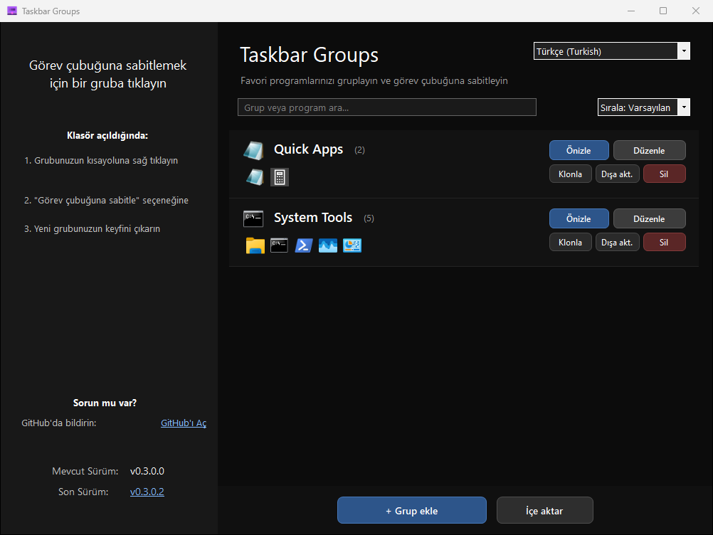
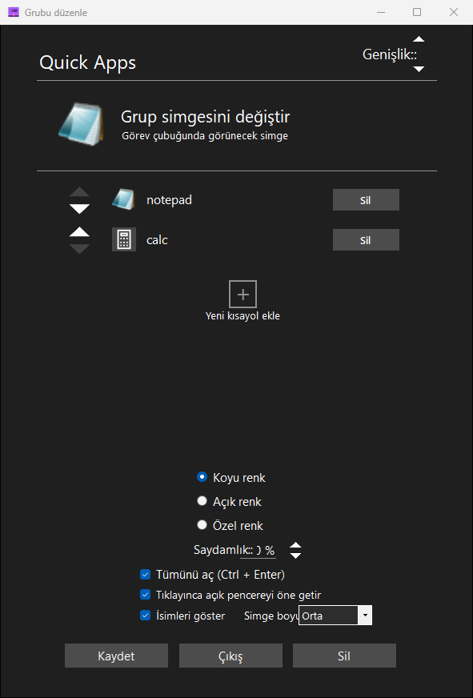

  <a href="../README.md">🇬🇧&nbsp;English</a> · <a href="README.de.md">🇩🇪&nbsp;Deutsch&nbsp;(German)</a> · <a href="README.es.md">🇪🇸&nbsp;Español&nbsp;(Spanish)</a> · <a href="README.fr.md">🇫🇷&nbsp;Français&nbsp;(French)</a> · <a href="README.it.md">🇮🇹&nbsp;Italiano&nbsp;(Italian)</a> · <a href="README.nl.md">🇳🇱&nbsp;Nederlands&nbsp;(Dutch)</a> · <a href="README.pl.md">🇵🇱&nbsp;Polski&nbsp;(Polish)</a> · <a href="README.pt-BR.md">🇧🇷&nbsp;Português&nbsp;(Brasil)&nbsp;(Portuguese)</a> · <a href="README.ru.md">🇷🇺&nbsp;Русский&nbsp;(Russian)</a> · <a href="README.uk.md">🇺🇦&nbsp;Українська&nbsp;(Ukrainian)</a> · <b>🇹🇷&nbsp;Türkçe&nbsp;(Turkish)</b> · <a href="README.az.md">🇦🇿&nbsp;Azərbaycanca&nbsp;(Azerbaijani)</a> · <a href="README.hr.md">🇭🇷&nbsp;Hrvatski&nbsp;(Croatian)</a> · <a href="README.id.md">🇮🇩&nbsp;Bahasa&nbsp;Indonesia&nbsp;(Indonesian)</a> · <a href="README.vi.md">🇻🇳&nbsp;Tiếng&nbsp;Việt&nbsp;(Vietnamese)</a> · <a href="README.th.md">🇹🇭&nbsp;ไทย&nbsp;(Thai)</a> · <a href="README.ja.md">🇯🇵&nbsp;日本語&nbsp;(Japanese)</a> · <a href="README.ko.md">🇰🇷&nbsp;한국어&nbsp;(Korean)</a> · <a href="README.zh-CN.md">🇨🇳&nbsp;简体中文&nbsp;(Chinese&nbsp;Simplified)</a> · <a href="README.zh-TW.md">🇹🇼&nbsp;繁體中文&nbsp;(Chinese&nbsp;Traditional)</a> · <a href="README.ar.md">🇸🇦&nbsp;العربية&nbsp;(Arabic)</a> · <a href="README.he.md">🇮🇱&nbsp;עברית&nbsp;(Hebrew)</a> · <a href="README.fa.md">🇮🇷&nbsp;فارسی&nbsp;(Persian)</a> · <a href="README.hi.md">🇮🇳&nbsp;हिन्दी&nbsp;(Hindi)</a> · <a href="README.ur.md">🇵🇰&nbsp;اردو&nbsp;(Urdu)</a> · <a href="README.bn.md">🇧🇩&nbsp;বাংলা&nbsp;(Bengali)</a>

  

<h1 align="center">Taskbar Groups</h1>

  <b>Taskbar Groups, Windows görev çubuğunda kısayol grupları oluşturmanızı sağlayan hafif bir araçtır.</b>

  <a href="https://github.com/bigman2000/taskbar-groups-updated/releases">İndirme ve Sürüm Notları</a>

> ℹ️ **Not:** Bu proje [tjackenpacken/taskbar-groups](https://github.com/tjackenpacken/taskbar-groups) projesinin aktif olarak sürdürülen bir çatalıdır (fork). Orijinal depo uzun süredir güncellenmediği ve terk edilmiş göründüğü için hataları düzeltmek ve yeni özellikler eklemek amacıyla bu fork oluşturulmuştur.

---

## 📖 İçindekiler

* ➤ Kurulum
* ➤ İlk grubunuzu oluşturma
* ➤ Pencere Dokümantasyonu
  * Ana Ekran
  * Grup Oluşturma
  * Ek Notlar
* ➤ Simge Önbellekleme
* ➤ Klavye Kısayolları
* ➤ Klasör Yapısı
* ➤ Son Güncellemeler
* ➤ Lisans

---

## 🔽 Taskbar Groups nasıl indirilir
1. En son sürümden `.zip` dosyasını indirin (yukarıdaki bağlantı)
2. `.zip` dosyasını istediğiniz bir klasöre çıkartın
3. Çıkartılan klasördeki `TaskbarGroups.exe` dosyasını çalıştırın

---

## 🛠️ İlk grubunuzu oluşturma
1. **"Grup ekle"** düğmesine tıklayın
2. Gruba bir ad ve simge verin
3. **"Kısayol ekle"** ye tıklayın ve `.exe` veya `.lnk` dosyalarını seçin (veya sürükleyip bırakın)
4. Grubu kaydedin
5. `Shortcuts` klasörünü açmak için grup kartına sol tıklayın
6. Seçili kısayola sağ tıklayın ve **"Görev çubuğuna sabitle"** yi seçin

---

## 🖥️ Pencere Dokümantasyonu
Aşağıda her pencere ve bileşenleri açıklanmıştır.

#### Ana Ekran

`TaskbarGroups.exe` açıldığında görünen ana ekran. Grup oluşturabilir, içe aktarabilir, arayabilir, sıralayabilir, önizleyebilir, düzenleyebilir, klonlayabilir, dışa aktarabilir, silebilir ve dili değiştirebilirsiniz (26 dil).

#### Grup Oluşturma

Grup oluşturma/düzenleme ekranında grubunuzu özelleştirebilirsiniz:

* **Grup adı** — İstediğiniz herhangi bir ad (Unicode destekli, en fazla 49 karakter).
* **Genişlik** — Her satırda görünecek kısayol sayısı.
* **Grup simgesini değiştir** — (+) simgesine tıklayın veya `.png`, `.jpg`, `.ico`, `.exe`, `.lnk` sürükleyin.
* **Kısayol ekle** — `.exe`, `.lnk`, `.url`, klasörler, Microsoft Store uygulamaları ve Steam oyunlarını destekler.
* **Tümünü aynı anda aç** — `Ctrl + Enter` ile gruptaki tüm kısayolları başlatır.
* **Çalışan pencereyi etkinleştir** — Yeni bir kopya açmak yerine açık olan pencereye geçer.
* **Etiketleri göster / Simge boyutu** — İsteğe bağlı ad etiketleri ve *Kompakt*, *Orta*, *Büyük* boyutları.
* **Çalışma dizini ve argümanlar** — Çalışma klasörü, başlatma parametreleri ve özel simge (`.exe`/`.dll` dahil) ayarlayın.
* **Renk ve opaklık** — Koyu, Açık veya Özel renk ve %0–%100 saydamlık.

#### Ek Notlar
`.exe` dosyalarından simge doğrudan alınır; `.lnk` ve Microsoft Store uygulamaları için otomatik çözümlenir.

---

## 📦 Simge Önbellekleme
Simgeler `/config/<Grup_Adı>/Icons` içinde önbelleğe alınır. Grubu kaydetmek önbelleği yeniler.

---

## ⌨️ Klavye Kısayolları
* **`1`–`9`, `0` tuşları** — 1–10. konumdaki kısayolu açar.
* **Ok tuşları / `Enter` / `Esc`** — Gezinme, başlatma veya pencereyi kapatma.
* **`Ctrl + Enter`** — Gruptaki tüm kısayolları aynı anda açar.
* **Kısayola sağ tıklama** — Bağlam menüsü: *Pencereye geç*, *Pencereyi kapat*, *Yeni örnek aç*, *Yönetici olarak çalıştır*, *Dosya konumunu aç*.

---

## 📁 Klasör Yapısı
* **`/config`** — Oluşturulan grupların yapılandırma klasörleri.
* **`/config/<Group_Name>/Icons`** — Grubun yerel simge önbelleği.
* **`/config/<Group_Name>/GroupIcon.ico / GroupImage.png`** — Grup için oluşturulan simge dosyaları.
* **`/config/<Group_Name>/ObjectData.xml`** — Grup ayarlarını ve kısayolları içeren XML dosyası.
* **`/config/lang.txt`** — Seçili arayüz dilini saklar.
* **`/JITComp`** — Daha hızlı açılış için derlenmiş profiller.
* **`/Shortcuts`** — Görev çubuğuna sabitlemek için `.lnk` kısayolları.

---

## ✨ Son Güncellemeler
* **Yerelleştirme (26 Dil)**: Ana pencerede dil seçici ile tam arayüz çevirisi ve 26 dilde senkronize README dosyaları.
* **Başlatma Paneli (`frmMain`)**: İpuçları, çalışan uygulama algılama, açık pencereyi etkinleştirme, sağ tık menüsü, simge boyutları, etiketler, Windows 11 yuvarlatılmış köşeler ve klavye gezinmesi.
* **Grup Düzenleyici (`frmGroup`)**: Otomatik kaydırmalı sürükle-bırak sıralama, `.exe`/`.dll`/resimlerden simge seçici ve Unicode desteği.
* **Ana Pencere (`frmClient`)**: Sabit düzen, arama ve sıralama, Önizleme, Klonla, Dışa/İçe Aktar (`.tgroup`/`.zip`), hızlı Silme, pencere boyutuna göre çok satırlı simge kaydırma ve kart içi sürükle-bırak sıralama.

---

## 📜 Lisans
Bu proje [MIT Lisansı](https://github.com/bigman2000/taskbar-groups-updated/blob/master/LICENSE) altında lisanslanmıştır.

---
