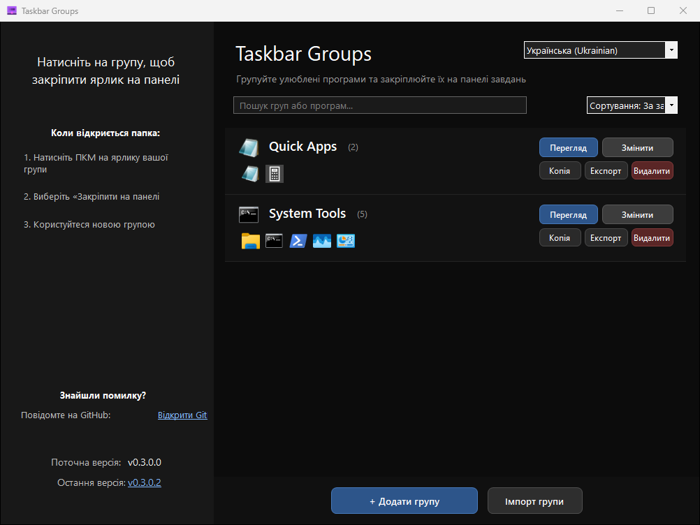
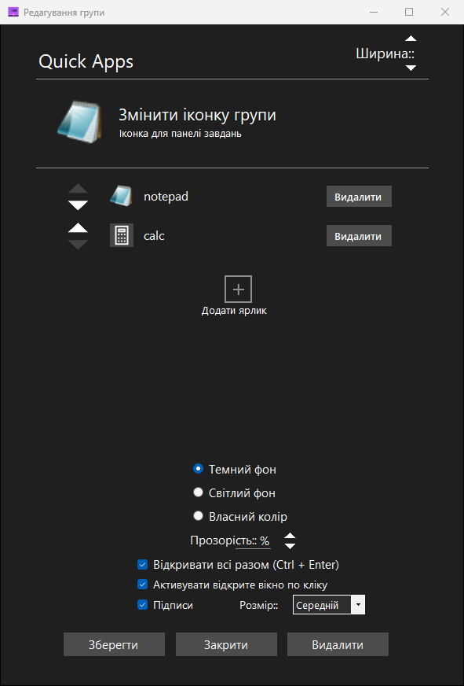

  <a href="../README.md">🇬🇧&nbsp;English</a> · <a href="README.de.md">🇩🇪&nbsp;Deutsch&nbsp;(German)</a> · <a href="README.es.md">🇪🇸&nbsp;Español&nbsp;(Spanish)</a> · <a href="README.fr.md">🇫🇷&nbsp;Français&nbsp;(French)</a> · <a href="README.it.md">🇮🇹&nbsp;Italiano&nbsp;(Italian)</a> · <a href="README.nl.md">🇳🇱&nbsp;Nederlands&nbsp;(Dutch)</a> · <a href="README.pl.md">🇵🇱&nbsp;Polski&nbsp;(Polish)</a> · <a href="README.pt-BR.md">🇧🇷&nbsp;Português&nbsp;(Brasil)&nbsp;(Portuguese)</a> · <a href="README.ru.md">🇷🇺&nbsp;Русский&nbsp;(Russian)</a> · <b>🇺🇦&nbsp;Українська&nbsp;(Ukrainian)</b> · <a href="README.tr.md">🇹🇷&nbsp;Türkçe&nbsp;(Turkish)</a> · <a href="README.az.md">🇦🇿&nbsp;Azərbaycanca&nbsp;(Azerbaijani)</a> · <a href="README.hr.md">🇭🇷&nbsp;Hrvatski&nbsp;(Croatian)</a> · <a href="README.id.md">🇮🇩&nbsp;Bahasa&nbsp;Indonesia&nbsp;(Indonesian)</a> · <a href="README.vi.md">🇻🇳&nbsp;Tiếng&nbsp;Việt&nbsp;(Vietnamese)</a> · <a href="README.th.md">🇹🇭&nbsp;ไทย&nbsp;(Thai)</a> · <a href="README.ja.md">🇯🇵&nbsp;日本語&nbsp;(Japanese)</a> · <a href="README.ko.md">🇰🇷&nbsp;한국어&nbsp;(Korean)</a> · <a href="README.zh-CN.md">🇨🇳&nbsp;简体中文&nbsp;(Chinese&nbsp;Simplified)</a> · <a href="README.zh-TW.md">🇹🇼&nbsp;繁體中文&nbsp;(Chinese&nbsp;Traditional)</a> · <a href="README.ar.md">🇸🇦&nbsp;العربية&nbsp;(Arabic)</a> · <a href="README.he.md">🇮🇱&nbsp;עברית&nbsp;(Hebrew)</a> · <a href="README.fa.md">🇮🇷&nbsp;فارسی&nbsp;(Persian)</a> · <a href="README.hi.md">🇮🇳&nbsp;हिन्दी&nbsp;(Hindi)</a> · <a href="README.ur.md">🇵🇰&nbsp;اردو&nbsp;(Urdu)</a> · <a href="README.bn.md">🇧🇩&nbsp;বাংলা&nbsp;(Bengali)</a>

  

<h1 align="center">Taskbar Groups</h1>

  <b>Taskbar Groups — легка утиліта для Windows, що дозволяє створювати групи ярликів на панелі завдань.</b>

  <a href="https://github.com/bigman2000/taskbar-groups-updated/releases">Завантажити та список змін</a>

> ℹ️ **Примітка:** Цей проєкт є форком [tjackenpacken/taskbar-groups](https://github.com/tjackenpacken/taskbar-groups), що активно розвивається. Оригінальний репозиторій давно не оновлювався і виглядає покинутим, тому було створено цей форк для виправлення помилок та додавання нових функцій.

---

## 📖 Зміст

* ➤ Встановлення
* ➤ Створення першої групи
* ➤ Документація вікон
  * Головне вікно
  * Редактор групи
  * Додатково
* ➤ Кешування іконок
* ➤ Гарячі клавіші
* ➤ Структура папок
* ➤ Останні оновлення
* ➤ Ліцензія

---

## 🔽 Як завантажити Taskbar Groups
1. Завантажте `.zip`-архів останнього релізу (посилання вище)
2. Розпакуйте архів у зручну папку
3. Запустіть `TaskbarGroups.exe` у розпакованій папці

---

## 🛠️ Створення першої групи
1. Натисніть **"Додати групу"**
2. Вкажіть назву групи та оберіть іконку
3. Натисніть **"Додати ярлик"** і виберіть `.exe` або `.lnk` (або перетягніть їх)
4. Збережіть групу
5. Натисніть на картку групи, щоб відкрити папку `Shortcuts`
6. Натисніть правою кнопкою на виділений ярлик і виберіть **"Закріпити на панелі завдань"**

---

## 🖥️ Документація вікон
Нижче наведено опис вікон програми та їхніх можливостей.

#### Головне вікно

Головне вікно керування групами при запуску `TaskbarGroups.exe`. Дозволяє створювати, імпортувати, шукати, сортувати, переглядати, редагувати, клонувати, експортувати та видаляти групи, а також змінювати мову (26 мов).

#### Редактор групи

У вікні створення та редагування налаштовуються параметри групи:

* **Назва групи** — Будь-яка назва (підтримується кирилиця та Unicode, до 49 символів).
* **Ширина** — Кількість ярликів в одному ряду.
* **Змінити іконку групи** — Натисніть (+) або перетягніть `.png`, `.jpg`, `.ico`, `.exe` чи `.lnk`.
* **Додати ярлик** — Підтримуються `.exe`, `.lnk`, `.url`, папки, застосунки Microsoft Store та ігри Steam.
* **Відкривати всі одночасно** — Запускає всі ярлики групи комбінацією `Ctrl + Enter`.
* **Активувати запущене вікно** — Перемикає на відкрите вікно замість повторного запуску.
* **Показувати підписи / Розмір іконок** — Опціональні підписи та розміри *Компактний*, *Середній*, *Великий*.
* **Робоча тека та аргументи** — Налаштування робочої директорії, параметрів запуску та власної іконки (у т.ч. з `.exe`/`.dll`).
* **Колір фону та прозорість** — Темна, Світла або Власна тема і прозорість 0%–100%.

#### Додатково
Для `.exe` іконка береться напряму; для `.lnk` та Microsoft Store іконка визначається автоматично.

---

## 📦 Кешування іконок
Іконки кешуються в `/config/<Назва_групи>/Icons` для миттєвого відкриття. Збереження оновлює кеш.

---

## ⌨️ Гарячі клавіші
* **Цифри `1`–`9`, `0`** — Запускає ярлик на позиції 1–10.
* **Стрілки / `Enter` / `Esc`** — Навігація, запуск або закриття вікна.
* **`Ctrl + Enter`** — Відкриває всі ярлики групи одночасно (якщо увімкнено).
* **Правий клік по ярлику** — Контекстне меню: *Перемкнутися на вікно*, *Закрити вікно*, *Новий екземпляр*, *Від імені адміністратора*, *Відкрити розташування файлу*.

---

## 📁 Структура папок
* **`/config`** — Папки конфігурації всіх груп.
* **`/config/<Group_Name>/Icons`** — Локальний кеш іконок групи.
* **`/config/<Group_Name>/GroupIcon.ico / GroupImage.png`** — Згенеровані іконки групи.
* **`/config/<Group_Name>/ObjectData.xml`** — XML-налаштування групи.
* **`/config/lang.txt`** — Зберігає обрану мову інтерфейсу.
* **`/JITComp`** — Профілі для прискореного запуску.
* **`/Shortcuts`** — Ярлики `.lnk` для закріплення на панелі завдань.

---

## ✨ Останні оновлення
* **Локалізація (26 мов)**: Повний переклад інтерфейсу з вибором мови та синхронізовані README 26 мовами.
* **Панель запуску (`frmMain`)**: Підказки, визначення запущених програм, активація відкритого вікна, контекстне меню, розміри іконок, підписи, заокруглення Windows 11 та навігація клавіатурою.
* **Редактор групи (`frmGroup`)**: Перетягування ярликів з автопрокруткою, вибір іконок з `.exe`/`.dll`/зображень, підтримка Unicode.
* **Головне вікно (`frmClient`)**: Фіксований заголовок і низ, пошук і сортування, Перегляд, Клонування, Експорт/Імпорт (`.tgroup`/`.zip`), швидке Видалення, перенесення іконок на нові рядки при зміні розміру вікна та зміна порядку іконок на картці.

---

## 📜 Ліцензія
Проєкт поширюється за [ліцензією MIT](https://github.com/bigman2000/taskbar-groups-updated/blob/master/LICENSE).

---
