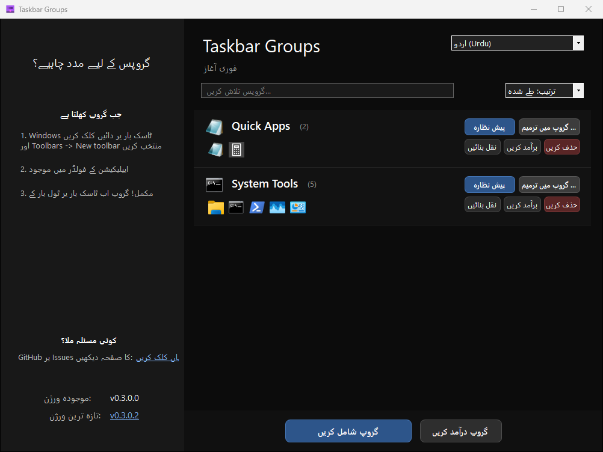
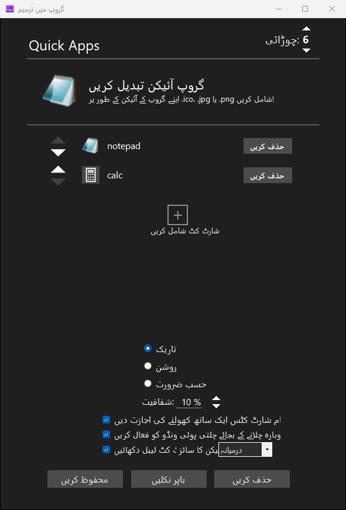

  <a href="../README.md">🇬🇧&nbsp;English</a> · <a href="README.de.md">🇩🇪&nbsp;Deutsch&nbsp;(German)</a> · <a href="README.es.md">🇪🇸&nbsp;Español&nbsp;(Spanish)</a> · <a href="README.fr.md">🇫🇷&nbsp;Français&nbsp;(French)</a> · <a href="README.it.md">🇮🇹&nbsp;Italiano&nbsp;(Italian)</a> · <a href="README.nl.md">🇳🇱&nbsp;Nederlands&nbsp;(Dutch)</a> · <a href="README.pl.md">🇵🇱&nbsp;Polski&nbsp;(Polish)</a> · <a href="README.pt-BR.md">🇧🇷&nbsp;Português&nbsp;(Brasil)&nbsp;(Portuguese)</a> · <a href="README.ru.md">🇷🇺&nbsp;Русский&nbsp;(Russian)</a> · <a href="README.uk.md">🇺🇦&nbsp;Українська&nbsp;(Ukrainian)</a> · <a href="README.tr.md">🇹🇷&nbsp;Türkçe&nbsp;(Turkish)</a> · <a href="README.az.md">🇦🇿&nbsp;Azərbaycanca&nbsp;(Azerbaijani)</a> · <a href="README.hr.md">🇭🇷&nbsp;Hrvatski&nbsp;(Croatian)</a> · <a href="README.id.md">🇮🇩&nbsp;Bahasa&nbsp;Indonesia&nbsp;(Indonesian)</a> · <a href="README.vi.md">🇻🇳&nbsp;Tiếng&nbsp;Việt&nbsp;(Vietnamese)</a> · <a href="README.th.md">🇹🇭&nbsp;ไทย&nbsp;(Thai)</a> · <a href="README.ja.md">🇯🇵&nbsp;日本語&nbsp;(Japanese)</a> · <a href="README.ko.md">🇰🇷&nbsp;한국어&nbsp;(Korean)</a> · <a href="README.zh-CN.md">🇨🇳&nbsp;简体中文&nbsp;(Chinese&nbsp;Simplified)</a> · <a href="README.zh-TW.md">🇹🇼&nbsp;繁體中文&nbsp;(Chinese&nbsp;Traditional)</a> · <a href="README.ar.md">🇸🇦&nbsp;العربية&nbsp;(Arabic)</a> · <a href="README.he.md">🇮🇱&nbsp;עברית&nbsp;(Hebrew)</a> · <a href="README.fa.md">🇮🇷&nbsp;فارسی&nbsp;(Persian)</a> · <a href="README.hi.md">🇮🇳&nbsp;हिन्दी&nbsp;(Hindi)</a> · <b>🇵🇰&nbsp;اردو&nbsp;(Urdu)</b> · <a href="README.bn.md">🇧🇩&nbsp;বাংলা&nbsp;(Bengali)</a>

  

<h1 align="center">Taskbar Groups</h1>

  <b>Taskbar Groups ونڈوز کے لیے ایک ہلکا پھلکا ٹول ہے جو ٹاسک بار پر شارٹ کٹ گروپس بنانے کی سہولت دیتا ہے۔</b>

  <a href="https://github.com/bigman2000/taskbar-groups-updated/releases">ڈاؤن لوڈ اور ریلیز نوٹس</a>

> ℹ️ **نوٹ:** یہ پروجیکٹ [tjackenpacken/taskbar-groups](https://github.com/tjackenpacken/taskbar-groups) کا فعال طور پر برقرار رکھا گیا فورک ہے۔ اصل ریپوزٹری طویل عرصے سے اپ ڈیٹ نہیں ہوئی، اس لیے بگ فکسز اور نئی خصوصیات کے لیے یہ فورک بنایا گیا ہے۔

---

## 📖 فہرست

* ➤ تنصیب
* ➤ پہلا گروپ بنانا
* ➤ ونڈوز کی دستاویزات
  * مرکزی اسکرین
  * گروپ بنانے کی اسکرین
  * اضافی نوٹس
* ➤ آئیکن کیشنگ
* ➤ کی بورڈ شارٹ کٹس
* ➤ فولڈر کا ڈھانچہ
* ➤ حالیہ اپ ڈیٹس
* ➤ لائسنس

---

## 🔽 Taskbar Groups کیسے ڈاؤن لوڈ کریں
1. تازہ ترین ریلیز سے `.zip` فائل ڈاؤن لوڈ کریں (اوپر لنک موجود ہے)
2. `.zip` فائل کو اپنی مطلوبہ جگہ پر ان زپ کریں
3. نکالے گئے فولڈر میں `TaskbarGroups.exe` چلائیں

---

## 🛠️ اپنا پہلا گروپ بنانا
1. **"گروپ شامل کریں"** پر کلک کریں
2. گروپ کو نام دیں اور آئیکن منتخب کریں
3. **"شارٹ کٹ شامل کریں"** پر کلک کریں اور `.exe` یا `.lnk` فائلیں منتخب کریں (یا ڈریگ اینڈ ڈراپ کریں)
4. گروپ محفوظ کریں
5. `Shortcuts` فولڈر کھولنے کے لیے گروپ کارڈ پر بائیں کلک کریں
6. نمایاں شارٹ کٹ پر دائیں کلک کریں اور **"ٹاسک بار پر پن کریں"** منتخب کریں

---

## 🖥️ ونڈوز کی دستاویزات
ذیل میں ہر ونڈو اور اس کے اجزاء کی وضاحت دی گئی ہے۔

#### مرکزی اسکرین

`TaskbarGroups.exe` چلانے پر کھلنے والی مرکزی اسکرین۔ آپ گروپس بنا، درآمد، تلاش، ترتیب، پیش نظارہ، ترمیم، نقل، برآمد، حذف اور زبان تبدیل کر سکتے ہیں (26 زبانیں)۔

#### گروپ بنانے کی اسکرین

گروپ بنانے/ترمیم کرنے کی اسکرین میں آپ یہ سیٹنگز کر سکتے ہیں:

* **گروپ کا نام** — کوئی بھی نام درج کریں (Unicode اور اردو/عربی حروف کی حمایت، زیادہ سے زیادہ 49 حروف)۔
* **چوڑائی** — ہر قطار میں نظر آنے والے شارٹ کٹس کی تعداد۔
* **گروپ آئیکن تبدیل کریں** — (+) پر کلک کریں یا `.png`، `.jpg`، `.ico`، `.exe` یا `.lnk` فائل گھسیٹ کر چھوڑیں۔
* **شارٹ کٹ شامل کریں** — `.exe`، `.lnk`، `.url`، فولڈرز، Microsoft Store ایپس اور Steam گیمز کی حمایت کرتا ہے۔
* **سب ایک ساتھ کھولیں** — `Ctrl + Enter` کے ذریعے گروپ کے تمام شارٹ کٹس ایک ساتھ کھولتا ہے۔
* **چلتی ہوئی ونڈو کو فعال کریں** — نیا انسٹینس کھولنے کے بجائے پہلے سے کھلی ونڈو پر سوئچ کرتا ہے۔
* **لیبل دکھائیں / آئیکن کا سائز** — اختیاری لیبلز اور *مختصر*، *درمیانہ* یا *بڑا* سائز۔
* **کام کی ڈائریکٹری، فائل کا راستہ اور دلائل** — فائل کا راستہ تبدیل کریں (اپ ڈیٹ پر نیا فولڈر بننے کی صورت میں مفید)، ورکنگ ڈائریکٹری، دلائل اور حسب ضرورت آئیکن (`.exe`/`.dll` سمیت) سیٹ کریں۔
* **پس منظر کا رنگ اور شفافیت** — تاریک، روشن یا حسب ضرورت رنگ اور 0%–100% شفافیت۔

#### اضافی نوٹس
`.exe` فائلوں سے آئیکن براہ راست نکالا جاتا ہے؛ `.lnk` اور Microsoft Store ایپس کے لیے خودکار طور پر حل کیا جاتا ہے۔

---

## 📦 آئیکن کیشنگ
آئیکنز `/config/<گروپ_نام>/Icons` میں محفوظ ہوتے ہیں تاکہ مینو فوراً کھلے۔ گروپ محفوظ کرنے سے کیش دوبارہ بنتی ہے۔

---

## ⌨️ کی بورڈ شارٹ کٹس
* **نمبر کیز `1`–`9`، `0`** — 1–10 پوزیشن پر موجود شارٹ کٹ کھولتی ہیں۔
* **تیر کیز / `Enter` / `Esc`** — نیویگیٹ کریں، چلائیں یا مینو بند کریں۔
* **`Ctrl + Enter`** — گروپ کے تمام شارٹ کٹس ایک ساتھ کھولتا ہے (اگر فعال ہو)۔
* **شارٹ کٹ پر دائیں کلک** — سیاق و سباق مینو: *ونڈو پر جائیں*، *ونڈو بند کریں*، *نیا انسٹینس کھولیں*، *بطور ایڈمنسٹریٹر چلائیں*، *فائل کا مقام کھولیں*۔

---

## 📁 فولڈر کا ڈھانچہ
* **`/config`** — ہر بنائے گئے گروپ کے کنفیگریشن فولڈرز۔
* **`/config/<Group_Name>/Icons`** — گروپ کے شارٹ کٹس کی مقامی آئیکن کیش۔
* **`/config/<Group_Name>/GroupIcon.ico / GroupImage.png`** — گروپ کے لیے بنائی گئی آئیکن فائلیں۔
* **`/config/<Group_Name>/ObjectData.xml`** — گروپ کی ترتیبات اور شارٹ کٹس محفوظ کرنے والی XML فائل۔
* **`/config/lang.txt`** — منتخب کردہ زبان کا کوڈ محفوظ کرتا ہے۔
* **`/JITComp`** — تیز آغاز کے لیے مرتب شدہ پروفائلز۔
* **`/Shortcuts`** — Windows ٹاسک بار پر پن کرنے کے لیے `.lnk` شارٹ کٹس۔

---

## ✨ حالیہ اپ ڈیٹس
* **مقامی ترجمہ (26 زبانیں)**: مرکزی ونڈو میں زبان کے انتخاب کے ساتھ مکمل انٹرفیس ترجمہ اور 26 زبانوں میں ہم آہنگ README فائلیں۔
* **لانچ پینل (`frmMain`)**: ٹول ٹپس، چلتی ایپس کی شناخت، کھلی ونڈو کو فعال کرنا، دائیں کلک مینو، آئیکن سائز، لیبلز، Windows 11 گول کونے اور کی بورڈ نیویگیشن۔
* **گروپ ایڈیٹر (`frmGroup`)**: آٹو اسکرول کے ساتھ ڈریگ اینڈ ڈراپ ترتیب، فائل کے راستے میں ترمیم، `.exe`/`.dll`/تصاویر سے آئیکن انتخاب اور Unicode سپورٹ۔
* **مرکزی ونڈو (`frmClient`)**: فکسڈ لے آؤٹ، تلاش و ترتیب، پیش نظارہ، نقل، برآمد/درآمد (`.tgroup`/`.zip`)، فوری حذف، ونڈو سائز کے مطابق کثیر سطری آئیکن ریپنگ اور کارڈ میں ڈریگ اینڈ ڈراپ۔

---

## 📜 لائسنس
یہ پروجیکٹ [MIT لائسنس](https://github.com/bigman2000/taskbar-groups-updated/blob/master/LICENSE) کے تحت جاری کیا گیا ہے۔

---
