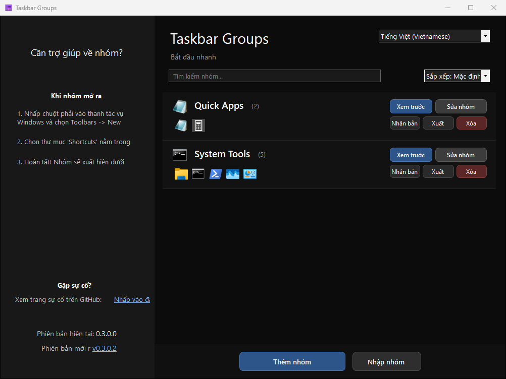
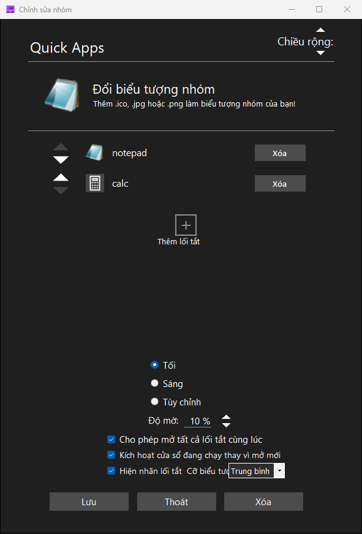

  <a href="../README.md">🇬🇧&nbsp;English</a> · <a href="README.de.md">🇩🇪&nbsp;Deutsch&nbsp;(German)</a> · <a href="README.es.md">🇪🇸&nbsp;Español&nbsp;(Spanish)</a> · <a href="README.fr.md">🇫🇷&nbsp;Français&nbsp;(French)</a> · <a href="README.it.md">🇮🇹&nbsp;Italiano&nbsp;(Italian)</a> · <a href="README.nl.md">🇳🇱&nbsp;Nederlands&nbsp;(Dutch)</a> · <a href="README.pl.md">🇵🇱&nbsp;Polski&nbsp;(Polish)</a> · <a href="README.pt-BR.md">🇧🇷&nbsp;Português&nbsp;(Brasil)&nbsp;(Portuguese)</a> · <a href="README.ru.md">🇷🇺&nbsp;Русский&nbsp;(Russian)</a> · <a href="README.uk.md">🇺🇦&nbsp;Українська&nbsp;(Ukrainian)</a> · <a href="README.tr.md">🇹🇷&nbsp;Türkçe&nbsp;(Turkish)</a> · <a href="README.az.md">🇦🇿&nbsp;Azərbaycanca&nbsp;(Azerbaijani)</a> · <a href="README.hr.md">🇭🇷&nbsp;Hrvatski&nbsp;(Croatian)</a> · <a href="README.id.md">🇮🇩&nbsp;Bahasa&nbsp;Indonesia&nbsp;(Indonesian)</a> · <b>🇻🇳&nbsp;Tiếng&nbsp;Việt&nbsp;(Vietnamese)</b> · <a href="README.th.md">🇹🇭&nbsp;ไทย&nbsp;(Thai)</a> · <a href="README.ja.md">🇯🇵&nbsp;日本語&nbsp;(Japanese)</a> · <a href="README.ko.md">🇰🇷&nbsp;한국어&nbsp;(Korean)</a> · <a href="README.zh-CN.md">🇨🇳&nbsp;简体中文&nbsp;(Chinese&nbsp;Simplified)</a> · <a href="README.zh-TW.md">🇹🇼&nbsp;繁體中文&nbsp;(Chinese&nbsp;Traditional)</a> · <a href="README.ar.md">🇸🇦&nbsp;العربية&nbsp;(Arabic)</a> · <a href="README.he.md">🇮🇱&nbsp;עברית&nbsp;(Hebrew)</a> · <a href="README.fa.md">🇮🇷&nbsp;فارسی&nbsp;(Persian)</a> · <a href="README.hi.md">🇮🇳&nbsp;हिन्दी&nbsp;(Hindi)</a> · <a href="README.ur.md">🇵🇰&nbsp;اردو&nbsp;(Urdu)</a> · <a href="README.bn.md">🇧🇩&nbsp;বাংলা&nbsp;(Bengali)</a>

  

<h1 align="center">Taskbar Groups</h1>

  <b>Taskbar Groups là tiện ích nhẹ cho Windows giúp tạo các nhóm lối tắt trên thanh tác vụ.</b>

  <a href="https://github.com/bigman2000/taskbar-groups-updated/releases">Tải xuống & Ghi chú phát hành</a>

> ℹ️ **Lưu ý:** Dự án này là bản fork được duy trì tích cực từ [tjackenpacken/taskbar-groups](https://github.com/tjackenpacken/taskbar-groups). Kho lưu trữ gốc đã lâu không được cập nhật và có vẻ bị bỏ rơi, vì vậy bản fork này được tạo để sửa lỗi và bổ sung tính năng mới.

---

## 📖 Mục lục

* ➤ Cài đặt
* ➤ Tạo nhóm đầu tiên
* ➤ Tài liệu cửa sổ
  * Màn hình chính
  * Màn hình tạo nhóm
  * Ghi chú thêm
* ➤ Bộ nhớ đệm biểu tượng
* ➤ Phím tắt
* ➤ Cấu trúc thư mục
* ➤ Cập nhật gần đây
* ➤ Giấy phép

---

## 🔽 Cách tải xuống Taskbar Groups
1. Tải tệp `.zip` từ bản phát hành mới nhất (liên kết ở trên)
2. Giải nén tệp `.zip` vào vị trí mong muốn
3. Chạy `TaskbarGroups.exe` trong thư mục vừa giải nén

---

## 🛠️ Tạo nhóm đầu tiên của bạn
1. Nhấp vào **"Thêm nhóm"**
2. Đặt tên và chọn biểu tượng cho nhóm
3. Nhấp vào **"Thêm lối tắt"** và chọn tệp `.exe` hoặc `.lnk` (hoặc kéo thả vào)
4. Lưu nhóm
5. Nhấp chuột trái vào thẻ nhóm để mở thư mục `Shortcuts`
6. Nhấp chuột phải vào lối tắt được chọn và chọn **"Ghim vào thanh tác vụ"**

---

## 🖥️ Tài liệu cửa sổ
Dưới đây là mô tả chi tiết từng cửa sổ và các thành phần.

#### Màn hình chính

Màn hình chính khi khởi chạy `TaskbarGroups.exe`. Bạn có thể tạo, nhập, tìm kiếm, sắp xếp, xem trước, chỉnh sửa, nhân bản, xuất, xóa nhóm và chuyển đổi ngôn ngữ giao diện (26 ngôn ngữ).

#### Màn hình tạo nhóm

Trong màn hình tạo/chỉnh sửa nhóm, bạn có thể tùy chỉnh:

* **Tên nhóm** — Đặt tên bất kỳ (hỗ trợ Unicode/Cyrillic, tối đa 49 ký tự).
* **Chiều rộng** — Số lượng lối tắt hiển thị trên mỗi hàng.
* **Đổi biểu tượng nhóm** — Nhấp (+) hoặc kéo thả tệp `.png`, `.jpg`, `.ico`, `.exe` hoặc `.lnk`.
* **Thêm lối tắt** — Hỗ trợ `.exe`, `.lnk`, `.url`, thư mục, ứng dụng Microsoft Store và trò chơi Steam.
* **Mở tất cả cùng lúc** — Mở toàn bộ lối tắt trong nhóm bằng `Ctrl + Enter`.
* **Kích hoạt cửa sổ đang chạy** — Chuyển sang cửa sổ đang mở thay vì khởi chạy bản mới.
* **Hiện nhãn / Cỡ biểu tượng** — Tùy chọn hiển thị nhãn và các cỡ *Nhỏ gọn*, *Trung bình*, *Lớn*.
* **Thư mục làm việc, đường dẫn tệp & tham số** — Chỉnh sửa đường dẫn tệp thực thi (hữu ích khi ứng dụng cập nhật sang thư mục mới), thư mục làm việc, tham số và biểu tượng tùy chỉnh (kể cả từ `.exe`/`.dll`).
* **Màu nền & độ mờ** — Tối, Sáng hoặc Tùy chỉnh với độ trong suốt 0%–100%.

#### Ghi chú thêm
Biểu tượng từ tệp `.exe` được trích xuất trực tiếp; với `.lnk` và Microsoft Store sẽ được tự động nhận diện.

---

## 📦 Bộ nhớ đệm biểu tượng
Biểu tượng được lưu bộ nhớ đệm tại `/config/<Tên_Nhóm>/Icons` giúp mở menu tức thì. Lưu nhóm sẽ tạo lại bộ nhớ đệm.

---

## ⌨️ Phím tắt
* **Phím số `1`–`9`, `0`** — Mở lối tắt ở vị trí 1–10.
* **Phím mũi tên / `Enter` / `Esc`** — Di chuyển, mở hoặc đóng menu.
* **`Ctrl + Enter`** — Mở tất cả lối tắt trong nhóm cùng lúc (nếu được bật).
* **Nhấp chuột phải vào lối tắt** — Menu ngữ cảnh: *Chuyển đến cửa sổ*, *Đóng cửa sổ*, *Mở phiên bản mới*, *Chạy với quyền quản trị viên*, *Mở vị trí tệp*.

---

## 📁 Cấu trúc thư mục
* **`/config`** — Chứa thư mục cấu hình của từng nhóm.
* **`/config/<Group_Name>/Icons`** — Bộ nhớ đệm biểu tượng cục bộ của nhóm.
* **`/config/<Group_Name>/GroupIcon.ico / GroupImage.png`** — Các biểu tượng được tạo cho nhóm.
* **`/config/<Group_Name>/ObjectData.xml`** — Tệp XML lưu lối tắt và cài đặt nhóm.
* **`/config/lang.txt`** — Lưu mã ngôn ngữ giao diện đã chọn.
* **`/JITComp`** — Hồ sơ biên dịch giúp khởi động nhanh hơn.
* **`/Shortcuts`** — Các lối tắt `.lnk` để ghim lên thanh tác vụ Windows.

---

## ✨ Cập nhật gần đây
* **Bản địa hóa (26 Ngôn ngữ)**: Hỗ trợ đầy đủ giao diện 26 ngôn ngữ với bộ chọn ngôn ngữ ở cửa sổ chính và README đồng bộ.
* **Bảng khởi chạy (`frmMain`)**: Chú thích công cụ, phát hiện ứng dụng đang chạy, kích hoạt cửa sổ đang mở, menu chuột phải, cỡ biểu tượng, nhãn tên, bo góc Windows 11 và điều hướng bàn phím.
* **Trình chỉnh sửa nhóm (`frmGroup`)**: Kéo thả sắp xếp lại với tự động cuộn, chỉnh sửa đường dẫn tệp thực thi, chọn biểu tượng từ `.exe`/`.dll`/ảnh và hỗ trợ Unicode.
* **Cửa sổ chính (`frmClient`)**: Bố cục cố định, tìm kiếm & sắp xếp, Xem trước, Nhân bản, Xuất/Nhập (`.tgroup`/`.zip`), Xóa nhanh, tự động xuống dòng hiển thị toàn bộ biểu tượng và kéo thả sắp xếp ngay trên thẻ.

---

## 📜 Giấy phép
Dự án này được cấp phép theo [Giấy phép MIT](https://github.com/bigman2000/taskbar-groups-updated/blob/master/LICENSE).

---
