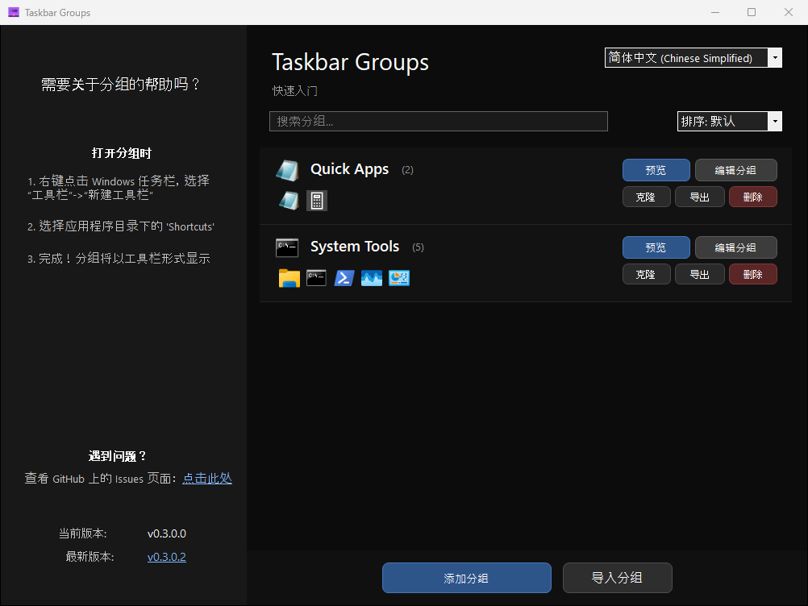
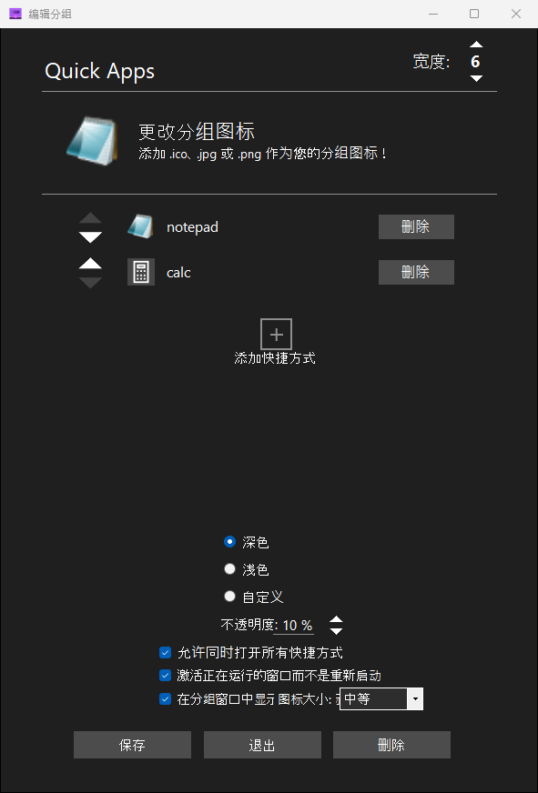

  <a href="../README.md">🇬🇧&nbsp;English</a> · <a href="README.de.md">🇩🇪&nbsp;Deutsch&nbsp;(German)</a> · <a href="README.es.md">🇪🇸&nbsp;Español&nbsp;(Spanish)</a> · <a href="README.fr.md">🇫🇷&nbsp;Français&nbsp;(French)</a> · <a href="README.it.md">🇮🇹&nbsp;Italiano&nbsp;(Italian)</a> · <a href="README.nl.md">🇳🇱&nbsp;Nederlands&nbsp;(Dutch)</a> · <a href="README.pl.md">🇵🇱&nbsp;Polski&nbsp;(Polish)</a> · <a href="README.pt-BR.md">🇧🇷&nbsp;Português&nbsp;(Brasil)&nbsp;(Portuguese)</a> · <a href="README.ru.md">🇷🇺&nbsp;Русский&nbsp;(Russian)</a> · <a href="README.uk.md">🇺🇦&nbsp;Українська&nbsp;(Ukrainian)</a> · <a href="README.tr.md">🇹🇷&nbsp;Türkçe&nbsp;(Turkish)</a> · <a href="README.az.md">🇦🇿&nbsp;Azərbaycanca&nbsp;(Azerbaijani)</a> · <a href="README.hr.md">🇭🇷&nbsp;Hrvatski&nbsp;(Croatian)</a> · <a href="README.id.md">🇮🇩&nbsp;Bahasa&nbsp;Indonesia&nbsp;(Indonesian)</a> · <a href="README.vi.md">🇻🇳&nbsp;Tiếng&nbsp;Việt&nbsp;(Vietnamese)</a> · <a href="README.th.md">🇹🇭&nbsp;ไทย&nbsp;(Thai)</a> · <a href="README.ja.md">🇯🇵&nbsp;日本語&nbsp;(Japanese)</a> · <a href="README.ko.md">🇰🇷&nbsp;한국어&nbsp;(Korean)</a> · <b>🇨🇳&nbsp;简体中文&nbsp;(Chinese&nbsp;Simplified)</b> · <a href="README.zh-TW.md">🇹🇼&nbsp;繁體中文&nbsp;(Chinese&nbsp;Traditional)</a> · <a href="README.ar.md">🇸🇦&nbsp;العربية&nbsp;(Arabic)</a> · <a href="README.he.md">🇮🇱&nbsp;עברית&nbsp;(Hebrew)</a> · <a href="README.fa.md">🇮🇷&nbsp;فارسی&nbsp;(Persian)</a> · <a href="README.hi.md">🇮🇳&nbsp;हिन्दी&nbsp;(Hindi)</a> · <a href="README.ur.md">🇵🇰&nbsp;اردو&nbsp;(Urdu)</a> · <a href="README.bn.md">🇧🇩&nbsp;বাংলা&nbsp;(Bengali)</a>

  

<h1 align="center">Taskbar Groups</h1>

  <b>Taskbar Groups 是一款轻量级 Windows 工具，用于在任务栏上创建快捷方式分组。</b>

  <a href="https://github.com/bigman2000/taskbar-groups-updated/releases">下载与发布说明</a>

> ℹ️ **说明：** 本项目是 [tjackenpacken/taskbar-groups](https://github.com/tjackenpacken/taskbar-groups) 的活跃维护分支（Fork）。由于原项目长期未更新且似乎已停止维护，因此创建此分支以修复问题并添加新功能。

---

## 📖 目录

* ➤ 安装
* ➤ 创建第一个分组
* ➤ 界面说明
  * 主窗口
  * 分组创建窗口
  * 补充说明
* ➤ 图标缓存
* ➤ 快捷键
* ➤ 文件夹结构
* ➤ 近期更新
* ➤ 许可证

---

## 🔽 如何下载 Taskbar Groups
1. 从最新发布版下载 `.zip` 压缩包（见上方链接）
2. 将 `.zip` 文件解压到任意位置
3. 运行解压文件夹中的 `TaskbarGroups.exe`

---

## 🛠️ 创建第一个分组
1. 点击 **"添加分组"**
2. 输入分组名称并选择图标
3. 点击 **"添加快捷方式"** 并选择 `.exe` 或 `.lnk` 文件（也可直接拖放）
4. 保存分组
5. 左键点击分组卡片打开 `Shortcuts` 文件夹
6. 右键点击选中的快捷方式，选择 **"固定到任务栏"**

---

## 🖥️ 界面说明
以下是各窗口及其功能的详细说明。

#### 主窗口

运行 `TaskbarGroups.exe` 后打开的主界面。支持创建、导入、搜索、排序、预览、编辑、克隆、导出、删除分组，以及切换界面语言（支持 26 种语言）。

#### 分组创建窗口

在分组创建/编辑窗口中可以配置以下选项：

* **分组名称** — 可输入任意名称（支持中文、西里尔文等 Unicode 字符，最多 49 个字符）。
* **宽度** — 设置每行显示的快捷方式数量。
* **更改分组图标** — 点击 (+) 或拖放 `.png`、`.jpg`、`.ico`、`.exe`、`.lnk` 文件。
* **添加快捷方式** — 支持 `.exe`、`.lnk`、`.url`、文件夹、Microsoft Store 应用和 Steam 游戏。
* **允许同时打开全部** — 启用后可使用 `Ctrl + Enter` 一次性打开分组内的所有快捷方式。
* **点击时激活运行中的窗口** — 切换到已打开的窗口，而不是重新启动新实例。
* **显示标签 / 图标大小** — 可选择是否显示名称标签，并支持 *紧凑*、*中等*、*大* 三种图标尺寸。
* **工作目录、程序路径与参数** — 支持直接修改可执行文件路径（程序更新更换目录时非常实用）、工作目录、启动参数及自定义图标（支持从 `.exe`/`.dll` 提取）。
* **背景颜色与不透明度** — 可选深色、浅色或自定义颜色，支持 0%–100% 透明度。

#### 补充说明
对于 `.exe` 可直接提取图标；对于 `.lnk` 和 Microsoft Store 应用，程序会自动解析目标图标。

---

## 📦 图标缓存
图标会缓存在 `/config/<分组名>/Icons` 中，使启动面板能够秒开。保存分组时会重新生成图标缓存。

---

## ⌨️ 快捷键
* **数字键 `1`–`9`, `0`** — 启动第 1–10 个快捷方式。
* **方向键 / `Enter` / `Esc`** — 在图标间移动、启动选中项或关闭面板。
* **`Ctrl + Enter`** — 一次性打开分组内的所有快捷方式（需在分组设置中启用）。
* **右键点击快捷方式** — 打开上下文菜单：*切换到窗口*、*关闭窗口*、*打开新实例*、*以管理员身份运行*、*打开文件所在位置*。

---

## 📁 文件夹结构
* **`/config`** — 存放各已创建分组的配置文件夹。
* **`/config/<Group_Name>/Icons`** — 分组内快捷方式的本地图标缓存。
* **`/config/<Group_Name>/GroupIcon.ico / GroupImage.png`** — 生成的分组图标文件。
* **`/config/<Group_Name>/ObjectData.xml`** — 存储分组快捷方式与外观/行为设置的 XML 文件。
* **`/config/lang.txt`** — 保存当前选择的界面语言代码。
* **`/JITComp`** — 用于加快启动速度的预编译配置文件。
* **`/Shortcuts`** — 存放用于固定到 Windows 任务栏的 `.lnk` 快捷方式。

---

## ✨ 近期更新
* **多语言本地化（26 种语言）**：新增完整界面翻译、主窗口语言选择器以及同步的 26 种语言 README。
* **启动面板 (`frmMain`)**：新增悬停提示、运行中应用检测、激活已运行窗口选项、右键菜单、可选图标大小、标签显示、Windows 11 圆角以及键盘导航。
* **分组编辑器 (`frmGroup`)**：新增带自动滚动的拖放排序、可执行文件路径编辑、`.exe`/`.dll`/图片自定义图标选择器以及 Unicode 支持。
* **主窗口 (`frmClient`)**：固定顶部与底部栏、搜索与排序、预览、克隆、导出/导入 (`.tgroup`/`.zip`)、快速删除、随窗口大小自适应的多行图标换行显示以及卡片内拖放排序。

---

## 📜 许可证
本项目基于 [MIT 许可证](https://github.com/bigman2000/taskbar-groups-updated/blob/master/LICENSE) 开源。

---
