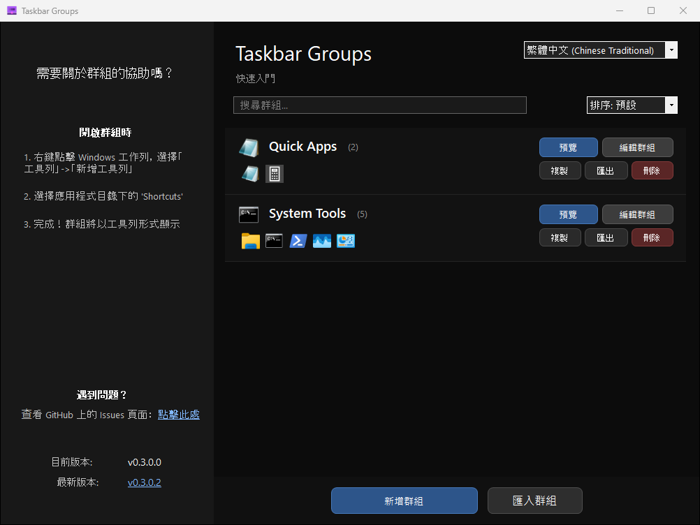
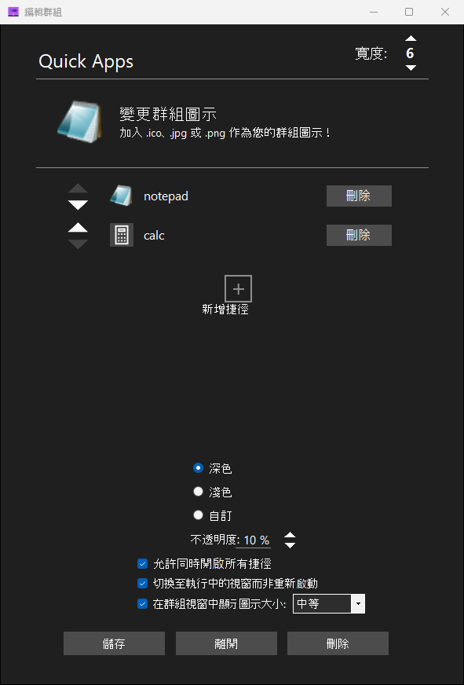

  <a href="../README.md">🇬🇧&nbsp;English</a> · <a href="README.de.md">🇩🇪&nbsp;Deutsch&nbsp;(German)</a> · <a href="README.es.md">🇪🇸&nbsp;Español&nbsp;(Spanish)</a> · <a href="README.fr.md">🇫🇷&nbsp;Français&nbsp;(French)</a> · <a href="README.it.md">🇮🇹&nbsp;Italiano&nbsp;(Italian)</a> · <a href="README.nl.md">🇳🇱&nbsp;Nederlands&nbsp;(Dutch)</a> · <a href="README.pl.md">🇵🇱&nbsp;Polski&nbsp;(Polish)</a> · <a href="README.pt-BR.md">🇧🇷&nbsp;Português&nbsp;(Brasil)&nbsp;(Portuguese)</a> · <a href="README.ru.md">🇷🇺&nbsp;Русский&nbsp;(Russian)</a> · <a href="README.uk.md">🇺🇦&nbsp;Українська&nbsp;(Ukrainian)</a> · <a href="README.tr.md">🇹🇷&nbsp;Türkçe&nbsp;(Turkish)</a> · <a href="README.az.md">🇦🇿&nbsp;Azərbaycanca&nbsp;(Azerbaijani)</a> · <a href="README.hr.md">🇭🇷&nbsp;Hrvatski&nbsp;(Croatian)</a> · <a href="README.id.md">🇮🇩&nbsp;Bahasa&nbsp;Indonesia&nbsp;(Indonesian)</a> · <a href="README.vi.md">🇻🇳&nbsp;Tiếng&nbsp;Việt&nbsp;(Vietnamese)</a> · <a href="README.th.md">🇹🇭&nbsp;ไทย&nbsp;(Thai)</a> · <a href="README.ja.md">🇯🇵&nbsp;日本語&nbsp;(Japanese)</a> · <a href="README.ko.md">🇰🇷&nbsp;한국어&nbsp;(Korean)</a> · <a href="README.zh-CN.md">🇨🇳&nbsp;简体中文&nbsp;(Chinese&nbsp;Simplified)</a> · <b>🇹🇼&nbsp;繁體中文&nbsp;(Chinese&nbsp;Traditional)</b> · <a href="README.ar.md">🇸🇦&nbsp;العربية&nbsp;(Arabic)</a> · <a href="README.he.md">🇮🇱&nbsp;עברית&nbsp;(Hebrew)</a> · <a href="README.fa.md">🇮🇷&nbsp;فارسی&nbsp;(Persian)</a> · <a href="README.hi.md">🇮🇳&nbsp;हिन्दी&nbsp;(Hindi)</a> · <a href="README.ur.md">🇵🇰&nbsp;اردو&nbsp;(Urdu)</a> · <a href="README.bn.md">🇧🇩&nbsp;বাংলা&nbsp;(Bengali)</a>

  

<h1 align="center">Taskbar Groups</h1>

  <b>Taskbar Groups 是一款輕量級 Windows 工具，用於在工作列上建立捷徑群組。</b>

  <a href="https://github.com/bigman2000/taskbar-groups-updated/releases">下載與發佈說明</a>

> ℹ️ **說明：** 本專案是 [tjackenpacken/taskbar-groups](https://github.com/tjackenpacken/taskbar-groups) 的活躍維護分支（Fork）。由於原專案長期未更新且似乎已停止維護，因此建立此分支以修正錯誤並新增功能。

---

## 📖 目錄

* ➤ 安裝
* ➤ 建立第一個群組
* ➤ 視窗說明
  * 主視窗
  * 群組建立視窗
  * 補充說明
* ➤ 圖示快取
* ➤ 快捷鍵
* ➤ 資料夾結構
* ➤ 近期更新
* ➤ 授權條款

---

## 🔽 如何下載 Taskbar Groups
1. 從最新發佈版本下載 `.zip` 壓縮檔（見上方連結）
2. 將 `.zip` 檔案解壓縮到任意位置
3. 執行解壓縮資料夾中的 `TaskbarGroups.exe`

---

## 🛠️ 建立第一個群組
1. 點擊 **"新增群組"**
2. 輸入群組名稱並選擇圖示
3. 點擊 **"新增捷徑"** 並選擇 `.exe` 或 `.lnk` 檔案（也可直接拖放）
4. 儲存群組
5. 左鍵點擊群組卡片開啟 `Shortcuts` 資料夾
6. 右鍵點擊選取的捷徑，選擇 **"釘選到工作列"**

---

## 🖥️ 視窗說明
以下是各視窗與其功能的詳細說明。

#### 主視窗

執行 `TaskbarGroups.exe` 後開啟的主視窗。可建立、匯入、搜尋、排序、預覽、編輯、複製、匯出、刪除群組，並切換介面語言（支援 26 種語言）。

#### 群組建立視窗

在群組建立/編輯視窗中可設定以下項目：

* **群組名稱** — 可輸入任意名稱（支援繁中、Unicode 等字元，最多 49 個字元）。
* **寬度** — 設定每列顯示的捷徑數量。
* **變更群組圖示** — 點擊 (+) 或拖放 `.png`、`.jpg`、`.ico`、`.exe`、`.lnk` 檔案。
* **新增捷徑** — 支援 `.exe`、`.lnk`、`.url`、資料夾、Microsoft Store 應用程式與 Steam 遊戲。
* **允許同時開啟全部** — 啟用後可用 `Ctrl + Enter` 一次開啟群組內的所有捷徑。
* **點擊時切換至執行中視窗** — 切換到已開啟的視窗而非重新啟動新執行個體。
* **顯示標籤 / 圖示大小** — 可選擇顯示名稱標籤，並提供 *精簡*、*中等*、*大* 三種圖示尺寸。
* **工作目錄、程式路徑與參數** — 支援編輯可執行檔路徑（程式更新更換資料夾時特別實用）、工作目錄、啟動參數及自訂圖示（含從 `.exe`/`.dll` 提取）。
* **背景顏色與不透明度** — 可選深色、淺色或自訂顏色，並設定 0%–100% 透明度。

#### 補充說明
`.exe` 檔案會直接提取圖示；`.lnk` 與 Microsoft Store 應用程式會自動解析目標圖示。

---

## 📦 圖示快取
圖示會快取於 `/config/<群組名稱>/Icons`，讓啟動面板能瞬間開啟。儲存群組時會重新產生快取。

---

## ⌨️ 快捷鍵
* **數字鍵 `1`–`9`, `0`** — 開啟第 1–10 個捷徑。
* **方向鍵 / `Enter` / `Esc`** — 移動選取項目、啟動或關閉面板。
* **`Ctrl + Enter`** — 一次開啟群組內所有捷徑（需在設定中啟用）。
* **右鍵點擊捷徑** — 開啟右鍵選單：*切換至視窗*、*關閉視窗*、*開啟新執行個體*、*以系統管理員身分執行*、*開啟檔案位置*。

---

## 📁 資料夾結構
* **`/config`** — 存放各群組的設定資料夾。
* **`/config/<Group_Name>/Icons`** — 群組捷徑的本機圖示快取。
* **`/config/<Group_Name>/GroupIcon.ico / GroupImage.png`** — 產生的群組圖示檔案。
* **`/config/<Group_Name>/ObjectData.xml`** — 儲存群組捷徑與外觀設定的 XML 檔案。
* **`/config/lang.txt`** — 儲存目前選擇的介面語言代碼。
* **`/JITComp`** — 用於加快啟動速度的編譯設定檔。
* **`/Shortcuts`** — 存放用於釘選到 Windows 工作列的 `.lnk` 捷徑。

---

## ✨ 近期更新
* **多語言在地化（26 種語言）**：新增完整介面翻譯、主視窗語言選擇器及同步的 26 種語言 README。
* **啟動面板 (`frmMain`)**：新增提示文字、執行中程式偵測、啟用執行中視窗選項、右鍵選單、圖示大小選項、名稱標籤、Windows 11 圓角與鍵盤導覽。
* **群組編輯器 (`frmGroup`)**：新增支援自動捲動的拖放排序、可執行檔路徑編輯、`.exe`/`.dll`/圖片圖示選擇器與 Unicode 支援。
* **主視窗 (`frmClient`)**：固定頂部與底部列、搜尋與排序、預覽、複製、匯出/匯入 (`.tgroup`/`.zip`)、快速刪除、隨視窗縮放自適應的多行圖示換行及卡片內拖放排序。

---

## 📜 授權條款
本專案採用 [MIT 授權條款](https://github.com/bigman2000/taskbar-groups-updated/blob/master/LICENSE)。

---
